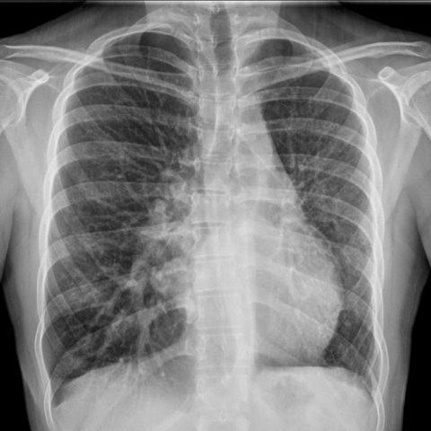
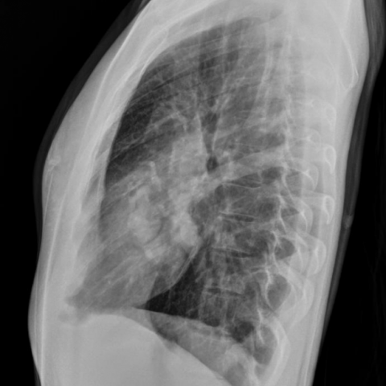
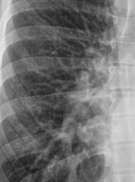
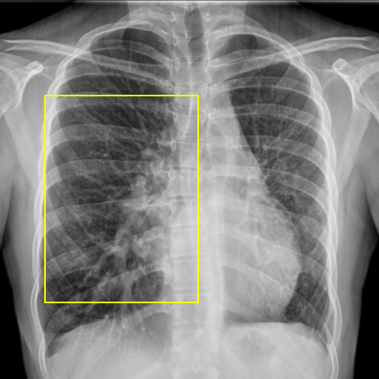
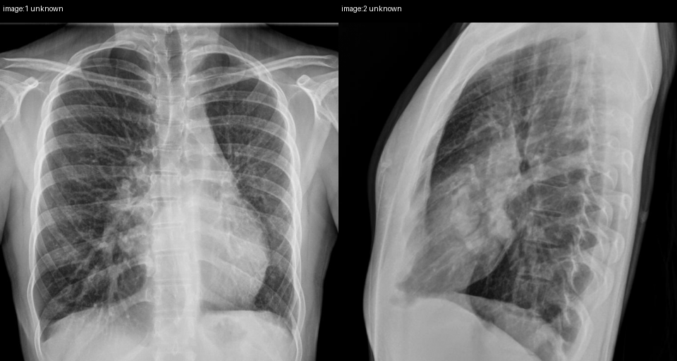

# Official gain: 12255_8353800651353

Post-run explicit answers: D **D**, M **D**, P **D**, reference **D**. Frozen runtime answers: D D, M D, P D; original records unchanged.

[Complete observable requests, tools and stages](../traces/12255_8353800651353.json) · [Original benchmark case](../../v12/results/cases/12255_8353800651353.md) · [D cached original observable request](../../direct_qwen60/requests/12255_8353800651353.json)

```text
Based on the chest X-ray findings, what is the most likely explanation for the serpentine tubular structure observed in the right medial lobe, taking into account the volume loss in the left hemithorax?
A) The presence of a right-sided aortic arch causing deviation.
B) An anomalous right bronchial artery.
C) A right-sided pulmonary artery aneurysm.
D) An abnormal course of a single right meandering pulmonary vein.
E) A right-sided pneumothorax causing mediastinal shift.
F) A dilated right main bronchus due to chronic infection.
```





## D

```text
Answer: D) An abnormal course of a single right meandering pulmonary vein.  
Reason: The serpentine tubular structure in the right medial lung with left hemithorax volume loss suggests compensatory overinflation on the right and mediastinal shift leftward; this appearance is classic for a “meandering” or “scimitar” pulmonary vein—often associated with partial anomalous pulmonary venous return (e.g., scimitar syndrome), where a single anomalous vein drains the right lung to the inferior vena cava, appearing as a curved tubular shadow in the right lower/middle zone. The left volume loss supports ipsilateral hypoplasia or atelectasis, commonly seen in this syndrome.
```

## M

```text
D) An abnormal course of a single right meandering pulmonary vein.

Evidence: The frontal view shows volume loss in the left hemithorax with mediastinal shift toward the left, and a serpentine tubular structure in the right medial (middle) lobe. The lateral view confirms this structure is within the lung parenchyma rather than mediastinal. Given the compensatory changes from left-sided volume loss, a meandering pulmonary vein taking an abnormal course due to altered thoracic anatomy is the most plausible explanation for a serpentine vascular structure in the right middle lobe. Pulmonary veins can appear as serpentine opacities when they take unusual courses, especially in the setting of asymmetric lung volumes. The other options are less consistent: right aortic arch would affect mediastinal contour differently; bronchial artery anomalies are rarely visible on plain X-ray; pulmonary artery aneurysm would be more focal; pneumothorax would show hyperlucency; and dilated main bronchus would be more central and not serpentine in the medial lobe.
```

## P

```text
Answer: D) An abnormal course of a single right meandering pulmonary vein.

The serpentine tubular opacity in the right medial lung courses inferiorly toward the diaphragm, not medially toward the hilum, and expert analysis confirms it follows the expected course of a pulmonary vein (e.g., right inferior pulmonary vein) based on caliber, tapering, and relation to adjacent structures. Left hemithorax volume loss with mediastinal shift explains the altered anatomy, making a meandering pulmonary vein—possibly due to compensatory or anomalous drainage—the most likely explanation. No evidence supports aortic arch anomaly, bronchial artery, aneurysm, pneumothorax, or dilated bronchus.
```

## P 实际派生图

以下为本轮传入 observe/final 的保存图像；框和解剖覆盖不代表病灶真值。

p1:roi · unmodified_pixel_roi · 来源 image:1



p1:location · location_overlay · 来源 image:1



p2:paired · paired_original_pixels · 来源 image:1, image:2



