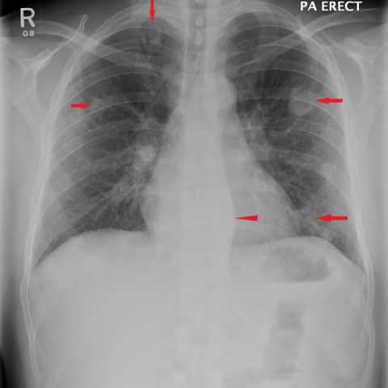
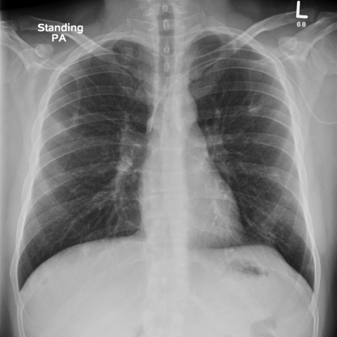
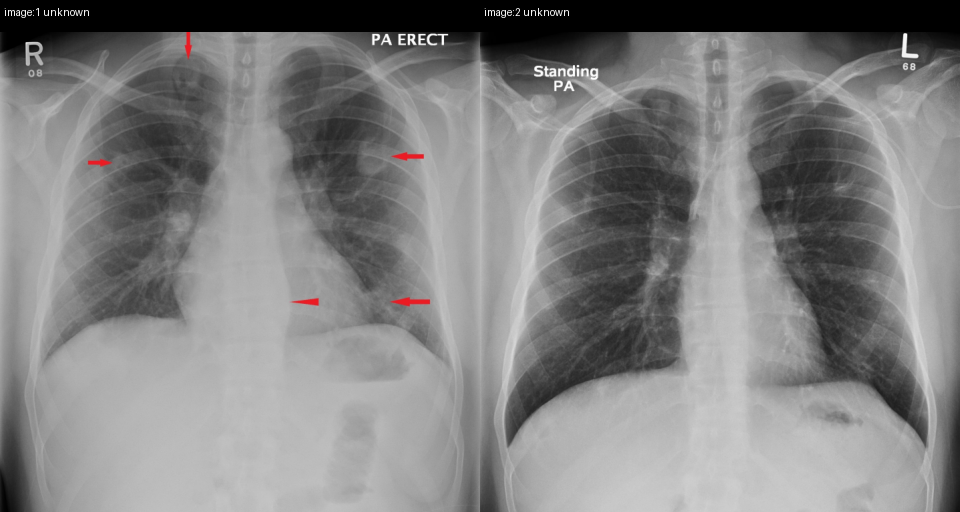
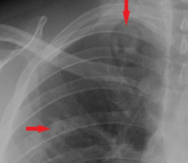
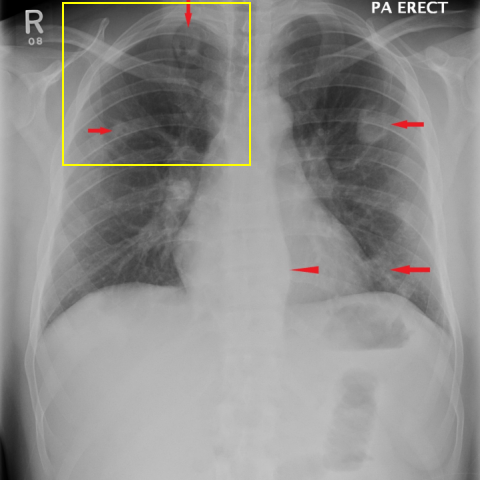

# Official gain: 12721_8353800681884

Post-run explicit answers: D **B**, M **E**, P **B**, reference **B**. Frozen runtime answers: D B, M E, P B; original records unchanged.

[Complete observable requests, tools and stages](../traces/12721_8353800681884.json) · [Original benchmark case](../../v12/results/cases/12721_8353800681884.md) · [D cached original observable request](../../direct_qwen60/requests/12721_8353800681884.json)

```text
Considering the chest X-ray findings and the patient's clinical presentation, which of the following best describes the progression and most likely diagnosis of the pulmonary condition seen in the X-rays?

A) The pulmonary nodules have increased in number and size, with new cavitations, suggesting a worsening case of tuberculosis.
B) The pulmonary nodules have decreased in size and number post-antibiotic therapy, with resolution of cavitations, consistent with septic emboli.
C) The thickened para-vertebral stripe has enlarged, indicating the progression of a metastatic disease.
D) The pulmonary nodules remain unchanged in number and size, indicating chronic inflammatory disease such as Wegner's granulomatosis.
E) There is complete resolution of all pulmonary nodules, suggesting an initial misdiagnosis.
F) The para-vertebral stripe thickening has resolved, indicating the treatment was effective against a primary spinal infection.
```





## D

```text
Answer: B) The pulmonary nodules have decreased in size and number post-antibiotic therapy, with resolution of cavitations, consistent with septic emboli.  
Reason: Comparing Figure 1 (initial) and Figure 7 (follow-up), the multiple peripheral pulmonary nodules and opacities seen in Figure 1 are no longer present in Figure 7, indicating significant improvement. This pattern—multiple bilateral nodules that resolve with antibiotic treatment—is classic for septic pulmonary emboli (e.g., from right-sided endocarditis or IV drug use), rather than tuberculosis (which typically shows upper lobe predominance and slower resolution) or malignancy.
```

## M

```text
Looking at the images and the available information:

- Figure 1 shows multiple pulmonary nodules (indicated by red arrows in both upper and lower lung zones)
- Figure 7 shows a much clearer chest X-ray with no visible nodules or red arrows
- The progression is from multiple nodules to resolution

Among the options:
A) describes worsening with increased nodules and cavitations - doesn't match (we see improvement)
B) describes decreased nodules post-antibiotic therapy, resolution of cavitations, consistent with septic emboli - possible, but we don't see cavitations in Figure 1
C) talks about para-vertebral stripe enlargement for metastatic disease - not evident
D) says nodules remain unchanged - contradicts visual evidence
E) says complete resolution of all pulmonary nodules - matches what we see visually
F) talks about para-vertebral stripe resolution - not the main finding

The most consistent with the visual evidence is option E: complete resolution of all pulmonary nodules. The first image shows multiple nodules (marked by red arrows) and the second image shows clear lungs with no visible nodules.

While the tool reports were inconsistent, my visual assessment clearly shows progression from multiple pulmonary nodules to resolution.

Answer: E) There is complete resolution of all pulmonary nodules, suggesting an initial misdiagnosis.
```

## P

```text
Answer: B) The pulmonary nodules have decreased in size and number post-antibiotic therapy, with resolution of cavitations, consistent with septic emboli.

Evidence: In Figure 1, multiple pulmonary nodules are marked (red arrows), but no cavity is visible in the right upper lung. In Figure 7, the same region appears clearer with fewer or no visible nodules, and no cavity is present—consistent with resolution after therapy. Although image resolution limits quantitative assessment, the visual improvement aligns best with a responsive infectious process like septic emboli rather than progressive disease.
```

## P 实际派生图

以下为本轮传入 observe/final 的保存图像；框和解剖覆盖不代表病灶真值。

p1:paired · paired_original_pixels · 来源 image:1, image:2



p2:roi · unmodified_pixel_roi · 来源 image:1



p2:location · location_overlay · 来源 image:1



