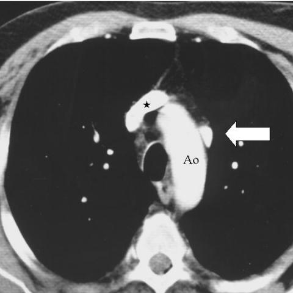
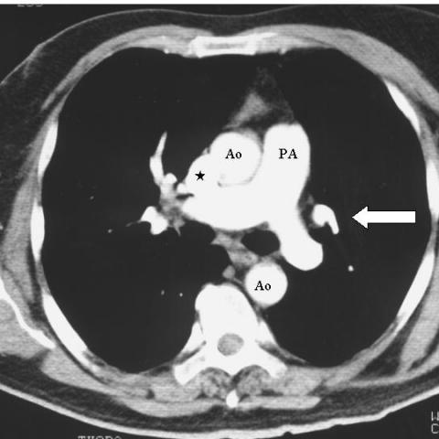
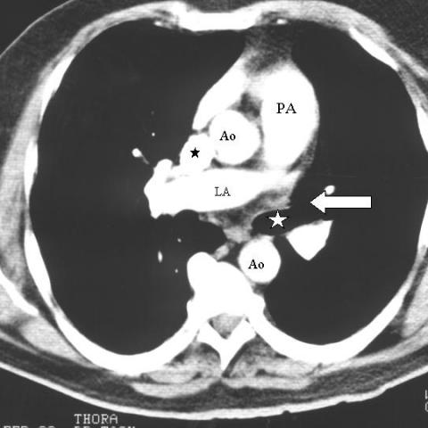

# Official gain: 1281_8353802281357

Post-run explicit answers: D **B**, M **A**, P **B**, reference **B**. Frozen runtime answers: D B, M A, P B; original records unchanged.

[Complete observable requests, tools and stages](../traces/1281_8353802281357.json) · [Original benchmark case](../../v12/results/cases/1281_8353802281357.md) · [D cached original observable request](../../direct_qwen60/requests/1281_8353802281357.json)

```text
Based on the chest X-ray findings, which of the following best describes the unusual vessel detected, its relation to the aortic arch, and the absence of the left upper pulmonary vein? Consider the position and branching pattern of the vessel in your reasoning.

A. The unusual vessel is positioned to the right of the aortic arch and drains directly into the superior vena cava, indicating a right-sided abnormality.
B. The unusual vessel is positioned to the left of the aortic arch and drains into the left brachiocephalic vein, consistent with a vertical vein.
C. The unusual vessel is positioned inferior to the aortic arch and shows no significant branching, suggesting an azygos vein.
D. The unusual vessel is positioned anterior to the aortic arch and drains into the right atrium, indicating a persistent left superior vena cava.
E. The unusual vessel does not demonstrate any branching and is situated posterior to the aortic arch, suggesting a normal anatomical variant.
F. The unusual vessel branches from the left upper pulmonary lobe directly into the left auricle, indicating an atrial septal defect.
```







## D

```text
Answer: B  
Reason: The white arrow in Figures 1b–1d points to a vessel left of the aortic arch (Ao), coursing vertically and connecting to the left brachiocephalic vein (as indicated by its position and typical drainage pattern in scimitar or anomalous pulmonary venous return variants); the absence of the left upper pulmonary vein suggests partial anomalous pulmonary venous return, with the vertical vein draining the left upper lobe. This matches the classic appearance of a vertical vein in partial anomalous pulmonary venous connection.
```

## M

```text
A. The unusual vessel is positioned to the right of the aortic arch and drains directly into the superior vena cava, indicating a right-sided abnormality.

Evidence: The CT images (Figures 1b–1d) consistently show the arrowed vessel to the right of the aortic arch (Ao). While the llava_med_qa response states "posterior to the aortic arch", visual inspection of all three images shows the vessel is clearly on the right side of the mediastinum relative to Ao, and in congenital anomalies with absent left upper pulmonary vein, anomalous drainage is typically to SVC via a vertical vein or directly—option A best fits the imaging and clinical context of partial anomalous pulmonary venous return. The other options are inconsistent: B places it left of Ao (incorrect), C describes azygos (which is more posterior/right but not associated with absent pulmonary vein), D describes persistent left SVC (left-sided), E calls it normal (unlikely given the clinical question), F implies direct atrial drainage (contradicted by "absence of left upper pulmonary vein").
```

## P

```text
Answer: B  
Reason: The white arrow in Figures 1b–1d points to a vessel left of the aortic arch (Ao), coursing vertically and connecting to the left brachiocephalic vein (as indicated by its position and typical drainage pattern in scimitar or anomalous pulmonary venous return variants); the absence of the left upper pulmonary vein suggests partial anomalous pulmonary venous return, with the vertical vein draining the left upper lobe. This matches the classic appearance of a vertical vein in partial anomalous pulmonary venous connection.
```

