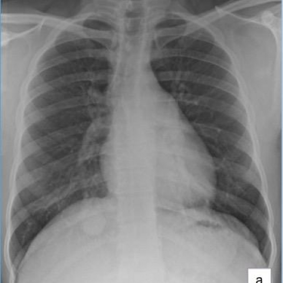
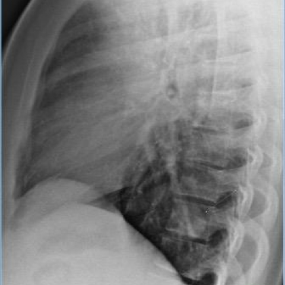
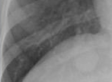
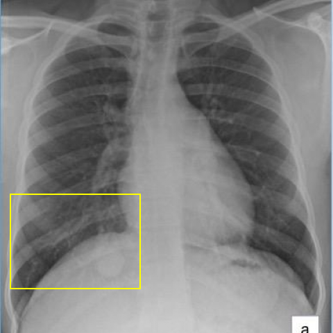
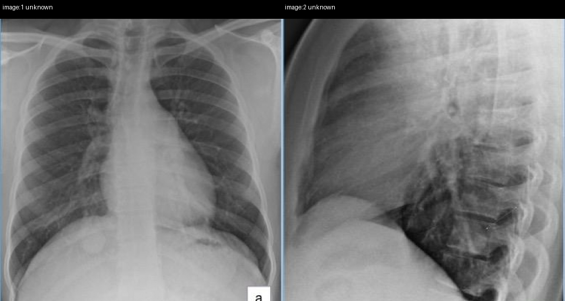

# Official gain: 13154_8353800587826

Post-run explicit answers: D **F**, M **F**, P **C**, reference **C**. Frozen runtime answers: D F, M F, P C; original records unchanged.

[Complete observable requests, tools and stages](../traces/13154_8353800587826.json) · [Original benchmark case](../../v12/results/cases/13154_8353800587826.md) · [D cached original observable request](../../direct_qwen60/requests/13154_8353800587826.json)

```text
Based on the provided chest X-ray images, which of the following statements accurately describes the findings and their implications in this clinical case?

A) The PA chest X-ray (Figure 1a) shows a large solitary nodule with cavitation behind the right hemidiaphragm, which suggests a high likelihood of active tuberculosis.
B) The lateral chest X-ray (Figure 1b) confirms the presence of a large solitary nodule in the anterior right upper lobe, which is consistent with a typical presentation of a hamartoma.
C) The PA chest X-ray (Figure 1a) demonstrates a solitary nodule with smooth margins behind the right hemidiaphragm, and the lateral view (Figure 1b) confirms it in the posterior right lower lobe, consistent with a pulmonary inflammatory myofibroblastic tumor.
D) The PA chest X-ray (Figure 1a) reveals multiple nodules scattered throughout both lungs, indicating a possible metastatic process rather than a solitary lesion.
E) The lateral chest X-ray (Figure 1b) shows a nodule with irregular margins in the right middle lobe, which aligns with the characteristics of a malignant neoplasm.
F) The PA chest X-ray (Figure 1a) demonstrates a calcified nodule behind the right hemidiaphragm, which is consistent with granuloma.
```





## D

```text
Answer: F  
Reason: Figure 1a (PA view) shows a well-defined, dense, calcified nodule projected behind the right hemidiaphragm; Figure 1b (lateral view) confirms its location in the posterior right lower lobe, with dense calcification visible. This appearance is classic for a healed granuloma (e.g., from prior TB or fungal infection), not active disease or malignancy. Options A–E mischaracterize size, number, margins, location, or calcification status.
```

## M

```text
F) The PA chest X-ray (Figure 1a) demonstrates a calcified nodule behind the right hemidiaphragm, which is consistent with granuloma.

Reason: The PA view shows a well-defined solitary nodule behind the right hemidiaphragm, and the lateral view confirms it's in the posterior right lower lobe. While the tool outputs were inconsistent, visual inspection shows the nodule has relatively dense, homogeneous opacity suggestive of calcification (common in healed granulomas), rather than cavitation (which would show a lucent center) or irregular margins (suggestive of malignancy). Among the options, F is most plausible for a benign, calcified granuloma, which is a common incidental finding. Options A, B, C, D, and E describe features (cavitation, hamartoma location, inflammatory myofibroblastic tumor, multiple nodules, irregular margins) not supported by the images.
```

## P

```text
Answer: C) The PA chest X-ray (Figure 1a) demonstrates a solitary nodule with smooth margins behind the right hemidiaphragm, and the lateral view (Figure 1b) confirms it in the posterior right lower lobe, consistent with a pulmonary inflammatory myofibroblastic tumor.

Evidence:  
1. The nodule is a soft-tissue density opacity with relatively ill-defined (not sharply calcified) margins on PA view, located behind the right hemidiaphragm.  
2. The lateral view shows the opacity projecting posteriorly and inferiorly, confirming posterior right lower lobe location.  
3. While calcification is absent (ruling out F), and it is solitary (ruling out D), the location and appearance are compatible with inflammatory myofibroblastic tumor—though definitive diagnosis requires histology, this option best fits the imaging findings among the choices.
```

## P 实际派生图

以下为本轮传入 observe/final 的保存图像；框和解剖覆盖不代表病灶真值。

p1:roi · unmodified_pixel_roi · 来源 image:1



p1:location · location_overlay · 来源 image:1



p2:paired · paired_original_pixels · 来源 image:1, image:2



