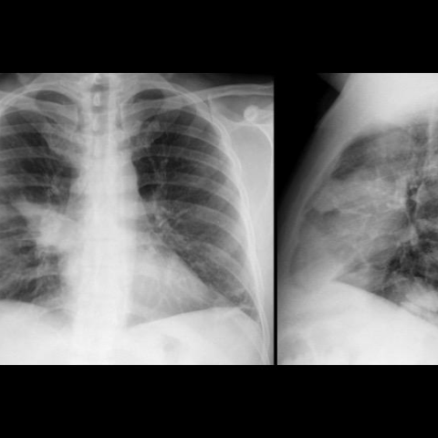
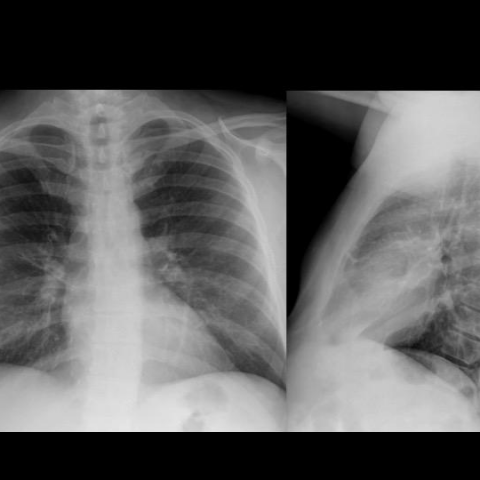
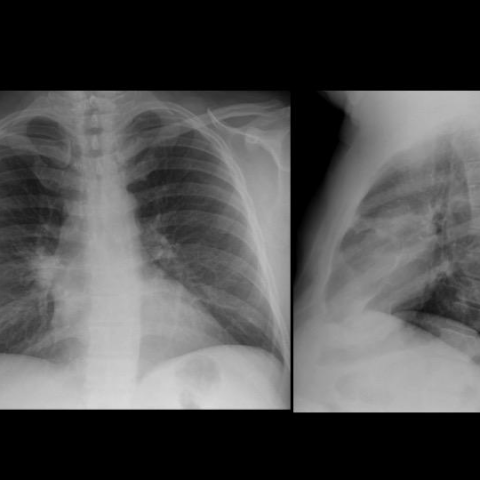
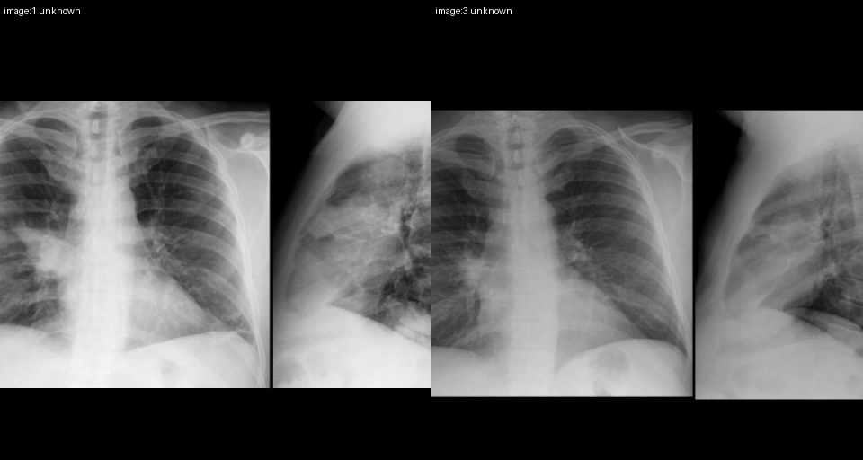

# Official gain: 13698_8353800603937

Post-run explicit answers: D **F**, M **F**, P **F**, reference **C**. Frozen runtime answers: D F, M F, P F; original records unchanged.

[Complete observable requests, tools and stages](../traces/13698_8353800603937.json) · [Original benchmark case](../../v12/results/cases/13698_8353800603937.md) · [D cached original observable request](../../direct_qwen60/requests/13698_8353800603937.json)

```text
A 51-year-old man with a history of heavy smoking and metabolic syndrome presented with high fever and right-sided chest pain. The initial chest X-ray (Figure 1) revealed a right hilar opacity with indistinct borders, diagnosed as pneumonia of the right upper lobe. After antibiotic therapy, a follow-up X-ray (Figure 2) showed resolution of the pneumonia. Four months later, a new chest X-ray (Figure 3) showed a recurrence of the consolidation in the same location. Given this clinical scenario and the provided X-ray figures, what is the most likely explanation for the recurrent pneumonia observed in the patient?

A) The initial pneumonia was inadequately treated, leading to recurrence.
B) The recurrent pneumonia is due to a persistent mucus plug causing obstruction.
C) The recurrent pneumonia is due to an endobronchial fibrolipoma causing obstruction.
D) The recurrent pneumonia is due to a new infection with a different pathogen.
E) The recurrent pneumonia is caused by a blood clot in the bronchus.
F) The recurrent pneumonia is caused by bronchogenic carcinoma.
```







## D

```text
Answer: F) The recurrent pneumonia is caused by bronchogenic carcinoma.  
Reason: The patient is a heavy smoker with metabolic syndrome, and the recurrence of consolidation in the exact same location after initial resolution strongly suggests an obstructive lesion—most commonly bronchogenic carcinoma in this demographic. Recurrent lobar pneumonia in the same site despite adequate treatment is a classic red flag for underlying malignancy causing post-obstructive pneumonia.
```

## M

```text
I've exhausted the tool budget. Let me use my clinical reasoning.

The key diagnostic clue is **recurrent pneumonia in the exact same location** in a heavy smoker. This pattern is highly characteristic of bronchogenic carcinoma causing endobronchial obstruction, leading to post-obstructive pneumonia.

- Option A (inadequate treatment) is unlikely because the pneumonia resolved completely on follow-up X-ray
- Option B (mucus plug) is possible but mucus plugs typically don't cause recurrent episodes 4 months later without other factors
- Option C (fibrolipoma) is very rare and not associated with smoking history
- Option D (new infection) doesn't explain why it's in the exact same location
- Option E (blood clot in bronchus) is extremely rare and would likely resolve or cause different findings
- Option F (bronchogenic carcinoma) fits perfectly: heavy smoking history, recurrent obstructive pneumonia in same location, elevated mass probability on imaging

The imaging shows high "Mass" probability in both initial and recurrent episodes, supporting a persistent mass lesion.

Return Answer: F) The recurrent pneumonia is caused by bronchogenic carcinoma.
```

## P

```text
Answer: F) The recurrent pneumonia is caused by bronchogenic carcinoma.

Evidence: The patient is a 51-year-old heavy smoker with metabolic syndrome, a high-risk profile for lung cancer. Recurrent, localized consolidation in the same lobe after apparent resolution suggests an underlying obstructive lesion. Although no discrete mass or volume loss is definitively visible on X-ray, the opacity in Figure 3 is denser and less ill-defined than in Figure 1, consistent with tumor growth causing post-obstructive pneumonia. Bronchogenic carcinoma is the most likely cause of recurrent lobar pneumonia in this setting, especially given the clinical risk factors and radiographic pattern.
```

## P 实际派生图

以下为本轮传入 observe/final 的保存图像；框和解剖覆盖不代表病灶真值。

p1:paired · paired_original_pixels · 来源 image:1, image:3



