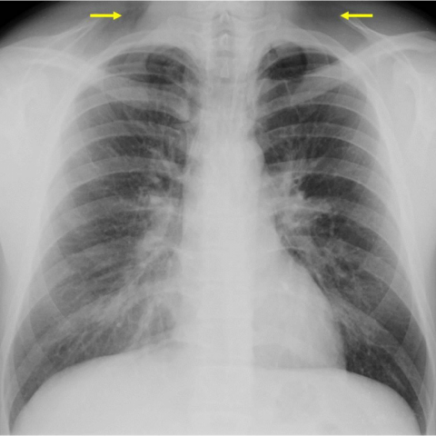
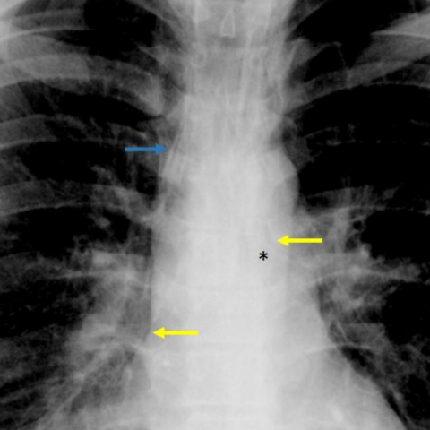
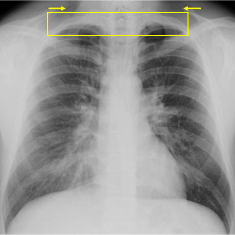
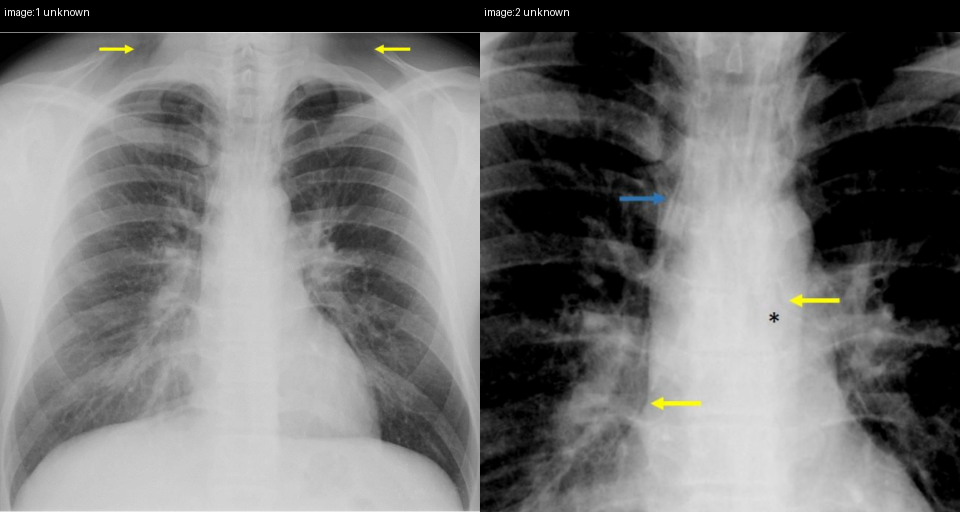

# Official gain: 13935_8353800618951

Post-run explicit answers: D **B**, M **B**, P **C**, reference **C**. Frozen runtime answers: D B, M B, P C; original records unchanged.

[Complete observable requests, tools and stages](../traces/13935_8353800618951.json) · [Original benchmark case](../../v12/results/cases/13935_8353800618951.md) · [D cached original observable request](../../direct_qwen60/requests/13935_8353800618951.json)

```text
A 26-year-old male patient presents with sudden thoracic and supraclavicular pain and dyspnoea. The chest X-ray was initially misinterpreted as normal. Upon reevaluation, multiple subtle signs were observed. Which of the following findings is most indicative of a spontaneous pneumomediastinum on the chest X-ray, and what does this imply about the underlying pathophysiological mechanism?

A) Presence of a continuous diaphragmatic sign; suggests pneumopericardium due to air posterior to the pericardium.
B) Observation of subcutaneous emphysema in the supraclavicular region; indicates air leakage from the mediastinum into subcutaneous tissue.
C) Detection of a double bronchial wall sign; implies air dissecting along the bronchial walls due to alveolar rupture.
D) Identification of Naclerio's V sign; indicates an esophageal rupture with mediastinal air lateral to the aorta.
E) Visualization of the thymic sail sign; suggests pneumomediastinum in a pediatric patient due to elevated thymus.
F) Recognition of the ring around the artery sign; signifies air enclosing the pulmonary artery due to tracheobronchial injury.
```





## D

```text
Answer: B) Observation of subcutaneous emphysema in the supraclavicular region; indicates air leakage from the mediastinum into subcutaneous tissue.

Reason: The arrows in Figure 3a point to lucency in the supraclavicular regions, consistent with subcutaneous emphysema—a classic sign of spontaneous pneumomediastinum. This occurs when air from ruptured alveoli dissects along bronchovascular sheaths into the mediastinum and then tracks upward into the neck, supporting a pathophysiological mechanism of alveolar rupture (e.g., due to Valsalva maneuver), not esophageal or tracheal injury.
```

## M

```text
The tool outputs are not very helpful - the classifier shows various pathologies but doesn't specifically identify pneumomediastinum, and the expert tool explicitly states "No pneumomediastinum is detected," which contradicts the clinical scenario described in the question.

Let me reconsider based on my medical knowledge and the visual evidence:

The question states this is a case of spontaneous pneumomediastinum with subtle signs. Looking at the images:
- Figure 3a has yellow arrows pointing to supraclavicular regions
- Figure 3b shows air in the mediastinum (arrows and star)

In spontaneous pneumomediastinum, the most characteristic and often earliest radiographic finding is **subcutaneous emphysema in the supraclavicular region** (option B), which occurs when air from the mediastinum tracks upward through the fascial planes into the subcutaneous tissues of the neck and supraclavicular areas.

The pathophysiological mechanism is: alveolar rupture → air dissects along bronchovascular bundles into the mediastinum → air then tracks upward into subcutaneous tissues via fascial planes.

While other signs like Naclerio's V sign (D) and ring around the artery sign (F) can be seen in pneumomediastinum, subcutaneous emphysema in the supraclavicular region is often the most visible and clinically apparent finding, especially in spontaneous cases in young adults.

Option B is correct because subcutaneous emphysema in the supraclavicular region is a classic sign of pneumomediastinum and directly indicates air leakage from the mediastinum into subcutaneous tissue, which is the typical pathway for spontaneous pneumomediastinum.

B) Observation of subcutaneous emphysema in the supraclavicular region; indicates air leakage from the mediastinum into subcutaneous tissue.
```

## P

```text
Answer: C) Detection of a double bronchial wall sign; implies air dissecting along the bronchial walls due to alveolar rupture.

The chest X-ray expert confirms presence of either double bronchial wall sign or ring-around-artery sign in image:2, and the image shows linear lucent markings (e.g., blue arrow near left main bronchus) consistent with the double bronchial wall sign. This sign reflects air tracking along bronchial walls after alveolar rupture—classic in spontaneous pneumomediastinum. Subcutaneous emphysema (B) is not confirmed in image:1, and continuity between mediastinal and subcutaneous air is not demonstrable.
```

## P 实际派生图

以下为本轮传入 observe/final 的保存图像；框和解剖覆盖不代表病灶真值。

p1:roi · unmodified_pixel_roi · 来源 image:1


p1:location · location_overlay · 来源 image:1



p3:paired · paired_original_pixels · 来源 image:1, image:2



