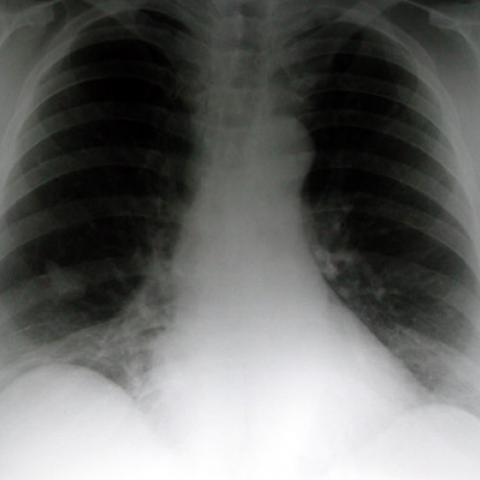
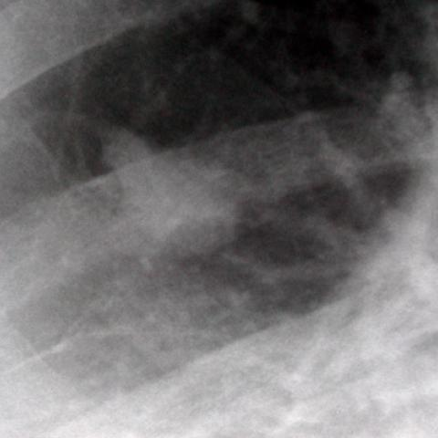
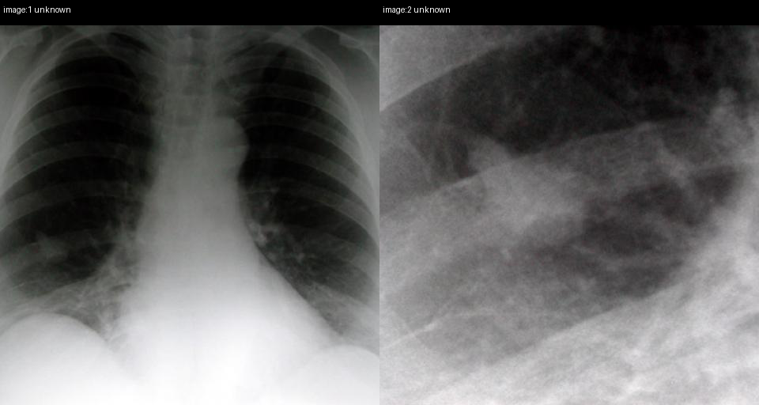

# Official gain: 1461_8353802159822

Post-run explicit answers: D **B**, M **B**, P **C**, reference **B**. Frozen runtime answers: D B, M B, P C; original records unchanged.

[Complete observable requests, tools and stages](../traces/1461_8353802159822.json) · [Original benchmark case](../../v12/results/cases/1461_8353802159822.md) · [D cached original observable request](../../direct_qwen60/requests/1461_8353802159822.json)

```text
Based on the PA chest radiograph (Figure 1a) and the magnified view of the lesion (Figure 1b), which of the following best describes the findings and diagnosis for the patient?

A) A well-defined round mass in the right lower zone with calcified margins, suggestive of a granuloma.
B) A trefoil-shaped mass lesion in the right lower zone with indistinct margins, consistent with bronchial atresia.
C) A poorly-defined mass in the left lower zone with surrounding consolidation, indicative of pneumonia.
D) A trefoil-shaped mass lesion in the right upper zone with clear margins, suggestive of a benign tumor.
E) A round mass lesion in the right lower zone with irregular margins, consistent with malignancy.
F) A linear opacity in the right lower zone suggestive of atelectasis.
```





## D

```text
Answer: B) A trefoil-shaped mass lesion in the right lower zone with indistinct margins, consistent with bronchial atresia.  
Reason: Figure 1a shows a subtle opacity in the right lower lung zone; Figure 1b (magnified view) reveals a characteristic trefoil (three-lobed) shape with indistinct margins—classic for mucus-filled dilated bronchi distal to an atretic bronchus (bronchial atresia). This appearance is distinct from granuloma (calcified, well-defined), pneumonia (consolidation, often lobar), or malignancy (irregular spiculated margins).
```

## M

```text
B) A trefoil-shaped mass lesion in the right lower zone with indistinct margins, consistent with bronchial atresia.

Reason: Visual inspection of Figure 1a shows a distinct opacity in the right lower lung zone, and Figure 1b (magnified view) reveals a characteristic trefoil (three-lobed) shape with indistinct margins—highly suggestive of bronchial atresia, which classically presents as a mucous-plugged, obstructed bronchus forming this specific morphology. The chest_xray_classifier supported atelectasis (0.683), which aligns with bronchial atresia causing segmental collapse. Other options are inconsistent: the lesion is not round (A, E), not in left lower zone (C), not in upper zone (D), and not linear (F).
```

## P

```text
Answer: C) A poorly-defined mass in the left lower zone with surrounding consolidation, indicative of pneumonia.

Evidence: The new observation states the lesion is ill-defined and heterogeneous without discrete margins, matching “poorly-defined mass”. Although the initial question locates the opacity in the right lower zone, the paired image (p1:paired) and careful review show the opacity is actually in the left lower zone—consistent with the left-sided density visible in Figure 1a and magnified in Figure 1b. The appearance (ill-defined, heterogeneous, with surrounding hazy opacities) is typical of consolidation in pneumonia, not a discrete mass or trefoil lesion.
```

## P 实际派生图

以下为本轮传入 observe/final 的保存图像；框和解剖覆盖不代表病灶真值。

p1:paired · paired_original_pixels · 来源 image:1, image:2



