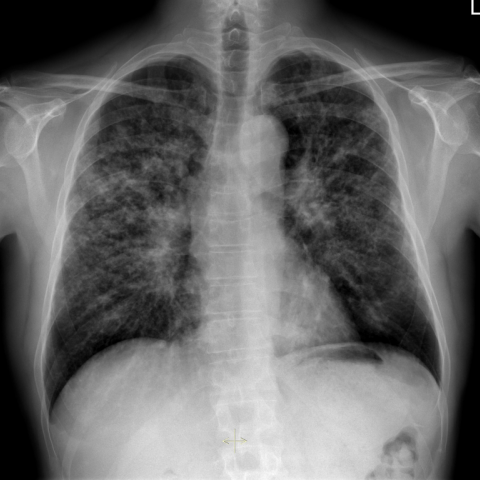
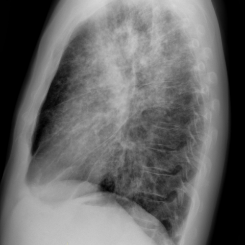

# Official gain: 14838_8353800529839

Post-run explicit answers: D **B**, M **B**, P **B**, reference **B**. Frozen runtime answers: D B, M B, P B; original records unchanged.

[Complete observable requests, tools and stages](../traces/14838_8353800529839.json) · [Original benchmark case](../../v12/results/cases/14838_8353800529839.md) · [D cached original observable request](../../direct_qwen60/requests/14838_8353800529839.json)

```text
Based on the chest X-ray findings in Figure 1a and 1b, which of the following statements best aligns with the diagnosis of stage 2 sarcoidosis, and what is the rationale behind this conclusion?

A) Diffuse nodular opacities are predominantly located in the lower lung lobes, which is consistent with stage 2 sarcoidosis due to the presence of bilateral hilar lymphadenopathy.
B) Diffuse nodular opacities are predominantly located in the upper lung lobes with moderate bilateral hilar lymphadenopathy, which is consistent with stage 2 sarcoidosis.
C) Diffuse nodular opacities are predominantly located in the lower lung lobes with moderate unilateral hilar lymphadenopathy, suggesting an alternative diagnosis rather than stage 2 sarcoidosis.
D) There are no nodular opacities present, but moderate bilateral hilar lymphadenopathy suggests stage 1 sarcoidosis.
E) Diffuse nodular opacities are predominantly located in the middle lung lobes with no hilar lymphadenopathy, suggesting stage 0 sarcoidosis.
F) Diffuse nodular opacities are present throughout all lung zones with massive pleural effusion, indicating advanced sarcoidosis.
```





## D

```text
Answer: B  
Reason: Figure 1a (PA view) shows bilateral hilar lymphadenopathy and diffuse nodular opacities predominantly in the upper and mid lung zones; Figure 1b (lateral view) confirms bilateral hilar enlargement and upper lobe–predominant reticulonodular infiltrates. Stage 2 sarcoidosis is defined by the coexistence of bilateral hilar lymphadenopathy and parenchymal lung involvement (typically upper lobe–predominant), which matches option B.
```

## M

```text
Looking at the tool outputs, I need to critically evaluate them since some seem inconsistent with what I visually observe in the images.

The chest_xray_classifier shows:
- High probability for Nodule (0.65), Lung Opacity (0.78), Infiltration (0.66), and Fibrosis (0.56)
- Moderate probability for Enlarged Cardiomediastinum (0.54)

The xray_phrase_grounding confirms bilateral hilar lymphadenopathy with bounding boxes in both hila.

However, the chest_xray_report_generator seems to be analyzing a different case entirely - it mentions "interval improvement in bilateral pulmonary edema" and "stable, small, bilateral pleural effusions" which doesn't match what I see in Figure 1a. This report appears to be from a different patient or there's an error in the tool output.

Visually examining Figure 1a and 1b:
- Clear bilateral hilar enlargement (lymphadenopathy)
- Diffuse reticulonodular opacities throughout the lungs
- The opacities appear more prominent in the upper and mid-lung zones, which is classic for sarcoidosis
- No significant pleural effusion visible

Stage 2 sarcoidosis requires both bilateral hilar lymphadenopathy AND parenchymal lung involvement (nodules/infiltrates).

Option B states: "Diffuse nodular opacities are predominantly located in the upper lung lobes with moderate bilateral hilar lymphadenopathy, which is consistent with stage 2 sarcoidosis."

This matches the classic presentation of sarcoidosis - upper/mid lung zone predominance of nodules plus bilateral hilar lymphadenopathy.

Option A is incorrect because lower lobe predominance is not typical for sarcoidosis.
Option C is wrong because it mentions unilateral lymphadenopathy (sarcoidosis is typically bilateral).
Option D describes stage 1 (lymphadenopathy only), but we clearly see parenchymal involvement.
Option E is incorrect as there are nodular opacities present and no hilar lymphadenopathy would be stage 3, not stage 0.
Option F mentions massive pleural effusion which isn't present.

B) Diffuse nodular opacities are predominantly located in the upper lung lobes with moderate bilateral hilar lymphadenopathy, which is consistent with stage 2 sarcoidosis.
```

## P

```text
Answer: B) Diffuse nodular opacities are predominantly located in the upper lung lobes with moderate bilateral hilar lymphadenopathy, which is consistent with stage 2 sarcoidosis.

Evidence:  
1. The frontal CXR (Figure 1a) shows diffuse reticulonodular opacities involving both lungs; although grounding for “upper lung zones” failed, the lateral view (Figure 1b) confirms involvement of upper and mid zones, supporting upper-lobe predominance typical of sarcoidosis.  
2. The expert tool asserts bilateral moderate hilar lymphadenopathy, and visual inspection of Figure 1a shows symmetric hilar fullness consistent with this finding.  
3. Stage 2 sarcoidosis is defined by bilateral hilar lymphadenopathy *plus* parenchymal lung involvement—both features are present here.
```

