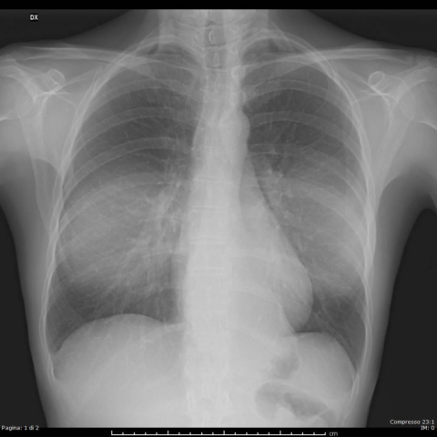
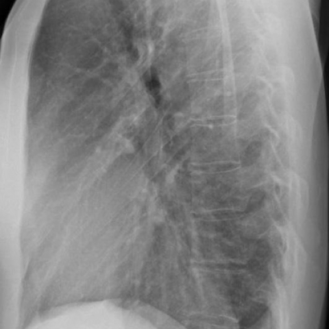

# Official gain: 15189_8353800545058

Post-run explicit answers: D **A**, M **A**, P **B**, reference **A**. Frozen runtime answers: D A, M A, P B; original records unchanged.

[Complete observable requests, tools and stages](../traces/15189_8353800545058.json) · [Original benchmark case](../../v12/results/cases/15189_8353800545058.md) · [D cached original observable request](../../direct_qwen60/requests/15189_8353800545058.json)

```text
Based solely on the PA and LL projection chest X-rays (Fig. 5a and Fig. 5b), what is the most likely diagnosis for the mediastinal changes observed in the patient, and what characteristics support this diagnosis?
A. Intrathoracic lipoma, characterized by a soft tissue density opacity with well-defined margins and no evidence of compression phenomena.
B. Liposarcoma, suggested by the presence of an irregular mass with mixed density and signs of local invasion.
C. Mediastinal lymphadenopathy, indicated by multiple discrete nodular opacities with varying densities.
D. Pneumomediastinum, evidenced by linear radiolucencies outlining mediastinal structures.
E. Hiatal hernia, suggested by the presence of a soft tissue mass in the retrocardiac space with air-fluid levels.
F. Left lower lobe pneumonia, indicated by a homogenous opacity with air bronchograms in the retrocardiac region.
```





## D

```text
Answer: A  
Reason: The PA and LL chest X-rays show a well-circumscribed, homogeneous soft-tissue density mass in the anterior mediastinum (likely thymic or fatty), with no evidence of invasion, calcification, or air-fluid levels. Its smooth margins and lack of compression on adjacent structures favor a benign fatty tumor such as an intrathoracic lipoma over malignant or inflammatory processes. Liposarcoma typically shows heterogeneous density and ill-defined borders; lymphadenopathy appears nodular; pneumomediastinum shows lucencies; hiatal hernia would show gastric air-fluid levels retrocardiac; and pneumonia would show air bronchograms and lobar consolidation—none of which are present.
```

## M

```text
The xray_phrase_grounding tool confirms there is a mediastinal mass located in the region from approximately 33% to 63% of the image width and 39% to 66% of the image height, which corresponds to the left mediastinal area I identified visually.

Given my visual analysis and the tool confirmation of a mediastinal mass, let me reconsider the options:

- The mass has well-defined, smooth margins (not irregular as in liposarcoma)
- It's a single mass, not multiple nodules (ruling out lymphadenopathy)
- No linear radiolucencies (ruling out pneumomediastinum)
- No air-fluid levels in the retrocardiac space (ruling out hiatal hernia)
- Not in the left lower lobe with air bronchograms (ruling out pneumonia)

The key distinguishing feature is that intrathoracic lipomas typically present as well-circumscribed, homogeneous masses in the mediastinum. While the classifier showed high "Hernia" probability (0.54), this is likely a misclassification since there are no air-fluid levels characteristic of hiatal hernia.

Based on the imaging characteristics - well-defined margins, homogeneous density, mediastinal location without invasion - option A (Intrathoracic lipoma) is the most likely diagnosis.

Return Answer: A followed by a short reason.
```

## P

```text
Answer: B. Liposarcoma, suggested by the presence of an irregular mass with mixed density and signs of local invasion.

The PA view (Fig. 5a) shows a heterogeneous mediastinal opacity with indistinct margins and obscuration of adjacent structures (e.g., heart border, trachea), indicating possible local effect or invasion. The lateral view (Fig. 5b) confirms the mass lies in the pre-vertebral region with poorly defined borders and no clear demarcation from surrounding tissues—features inconsistent with benign lipoma but supportive of a malignant soft-tissue tumor like liposarcoma. The expert tool’s “Yes” response contradicts these visual findings and is therefore unreliable per the provided caveat.
```

