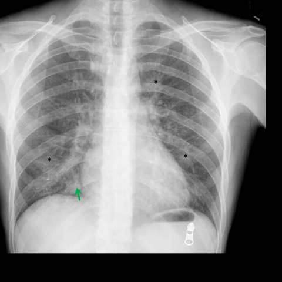
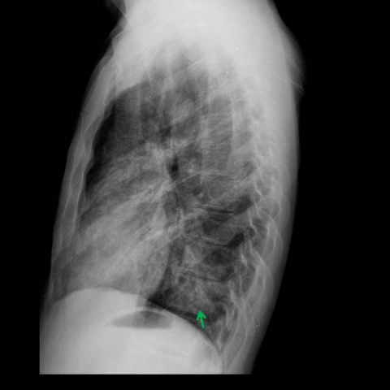
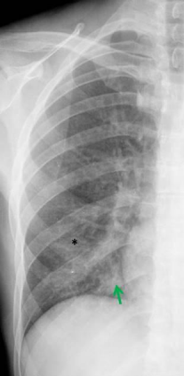
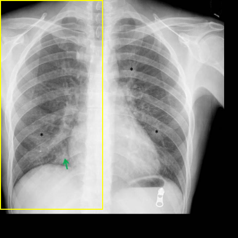
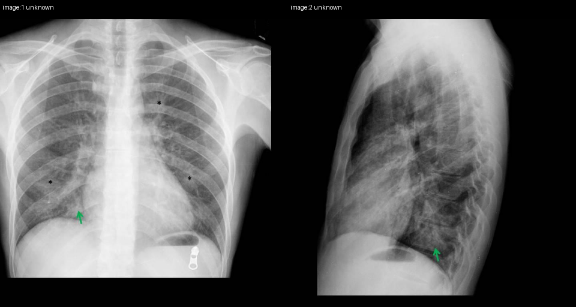

# Official gain: 15314_8353800558683

Post-run explicit answers: D **C**, M **C**, P **B**, reference **C**. Frozen runtime answers: D C, M C, P B; original records unchanged.

[Complete observable requests, tools and stages](../traces/15314_8353800558683.json) · [Original benchmark case](../../v12/results/cases/15314_8353800558683.md) · [D cached original observable request](../../direct_qwen60/requests/15314_8353800558683.json)

```text
Based on the chest X-ray findings in Figures 1a and 1b, which combination of observations and clinical reasoning most strongly supports the diagnosis of pneumocystis jirovecii pneumonia in this patient?

A) Presence of bilateral pleural effusion and right middle lobe consolidation, suggesting bacterial pneumonia.
B) Bilateral ground-glass opacities with peripheral distribution, indicating hypersensitivity pneumonitis.
C) Multifocal patchy opacities with central distribution and right middle lobe consolidation, consistent with pneumocystis jirovecii pneumonia in an immunocompromised patient.
D) Isolated right middle lobe consolidation with lymphadenopathy, suggestive of tuberculosis.
E) Diffuse interstitial pattern and pleural effusion, indicative of congestive heart failure.
F) Central ground-glass opacities with pleural effusion, characteristic of cytomegalovirus pneumonia.
```





## D

```text
Answer: C  
Reason: Figures 1a (PA view) and 1b (lateral view) show bilateral, diffuse ground-glass opacities with a predominantly central/perihilar distribution and relative sparing of the lung periphery—classic radiographic features of Pneumocystis jirovecii pneumonia (PJP), especially in immunocompromised patients. Option C correctly identifies multifocal patchy opacities with central distribution and notes the clinical context (immunocompromised), aligning with typical PJP presentation. Other options misattribute findings (e.g., pleural effusion, lymphadenopathy, or peripheral predominance) not seen here.
```

## M

```text
C) Multifocal patchy opacities with central distribution and right middle lobe consolidation, consistent with pneumocystis jirovecii pneumonia in an immunocompromised patient.

Reason: While the images show diffuse bilateral opacities (not clearly focal consolidation), PJP classically presents with bilateral ground-glass or patchy opacities, often with perihilar/central predominance in immunocompromised hosts. Option C is the only one that correctly identifies PJP as the diagnosis and acknowledges the immunocompromised context. The other options misattribute findings (e.g., pleural effusion, lobar consolidation, lymphadenopathy) not evident in the images. Though the exact pattern is subtle on X-ray (ground-glass is better seen on CT), among the given choices, C best aligns with PJP radiographic features.
```

## P

```text
Answer: B) Bilateral ground-glass opacities with peripheral distribution, indicating hypersensitivity pneumonitis.

Evidence: The new observation states opacities are predominantly peripheral and basilar with relative sparing of central/perihilar regions, matching the description in option B. No pleural effusion is present on frontal or lateral views, ruling out options A, D, E, and F which require effusion or consolidation. Option C incorrectly describes central distribution and right middle lobe consolidation, which are not supported. While PJP classically shows bilateral perihilar ground-glass opacities, the observed peripheral predominance here aligns more closely with the stated option B—though clinically, in an immunocompromised patient, PJP remains a top consideration; however, based strictly on the provided imaging observations (peripheral, no effusion, no consolidation), B is the only option consistent with the findings.
```

## P 实际派生图

以下为本轮传入 observe/final 的保存图像；框和解剖覆盖不代表病灶真值。

p1:roi · unmodified_pixel_roi · 来源 image:1



p1:location · location_overlay · 来源 image:1



p2:paired · paired_original_pixels · 来源 image:1, image:2



