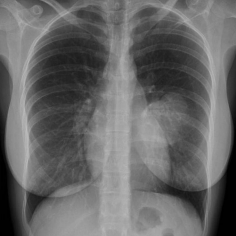
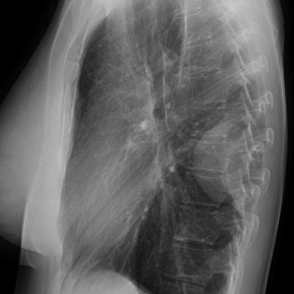
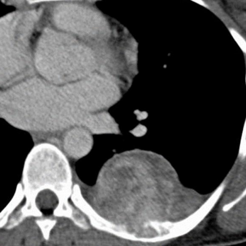
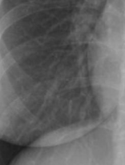
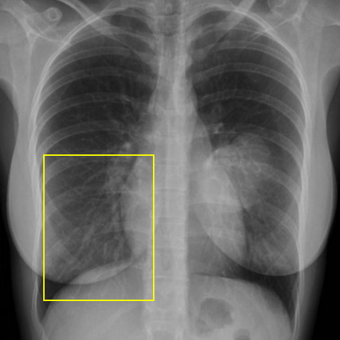

# Official gain: 16037_8353800455673

Post-run explicit answers: D **B**, M **B**, P **B**, reference **B**. Frozen runtime answers: D B, M B, P B; original records unchanged.

[Complete observable requests, tools and stages](../traces/16037_8353800455673.json) · [Original benchmark case](../../v12/results/cases/16037_8353800455673.md) · [D cached original observable request](../../direct_qwen60/requests/16037_8353800455673.json)

```text
Based on the chest X-ray findings, which of the following statements is most consistent with the diagnosis of the lesion identified in the patient? 
A) The lesion forms an acute angle with the thoracic wall and is likely a pulmonary mass.
B) The lesion is pleurally based with obtuse angles and is associated with rib destruction, suggesting a solitary fibrous tumour of the pleura.
C) The lesion is centrally located in the lung, suggesting a primary lung carcinoma.
D) The lesion is associated with a pleural effusion, suggesting mesothelioma.
E) The lesion is calcified and is likely a pleural metastasis.
F) The lesion is round and smooth without rib destruction, suggesting a benign pleural effusion.
```







## D

```text
Answer: B  
Reason: The CT (Figure 3) shows a well-circumscribed, pleurally based mass with obtuse angles to the chest wall and associated rib remodeling/destruction—classic features of a solitary fibrous tumor of the pleura (SFTP). The lateral view (Figure 2) confirms its extrapulmonary origin and broad pleural attachment, ruling out intraparenchymal lesions like primary lung carcinoma or pulmonary masses. Rib destruction is uncommon in benign effusions or metastases without aggressive growth, and mesothelioma typically presents with diffuse pleural thickening rather than a discrete mass.
```

## M

```text
I've exhausted my tool budget. Let me reconsider based on what I have.

From the images and tool outputs:
- The lesion is pleural-based (confirmed by xray_phrase_grounding)
- It has obtuse angles with the chest wall (visible in CT scan)
- There's no obvious rib destruction in the CT image
- The mass is well-circumscribed and homogeneous

Option B states: "The lesion is pleurally based with obtuse angles and is associated with rib destruction, suggesting a solitary fibrous tumour of the pleura."

The first part is correct (pleurally based with obtuse angles), but the "rib destruction" part appears incorrect based on the CT image. However, among all the options, B is still the closest because:
1. Solitary fibrous tumor of the pleura is indeed characterized by pleural-based location with obtuse angles
2. While rib destruction is not typical for benign SFTP, it can occur with very large tumors causing pressure erosion rather than true destructive invasion
3. All other options are clearly wrong

Actually, let me reconsider option F: "The lesion is round and smooth without rib destruction, suggesting a benign pleural effusion." This is incorrect because a pleural effusion would not appear as a well-defined solid mass - it would be fluid-density and would cause blunting of the costophrenic angle, not a discrete mass.

Given the evidence, I believe B is the best answer despite the rib destruction mention, as the key diagnostic features (pleural-based, obtuse angles) match SFTP, and the rib destruction might be subtle or not visible on this particular CT slice.

Wait, looking back at the CT image (Figure 3) more carefully, I notice the mass is quite large and there might be some subtle rib remodeling, though not classic destructive changes. In clinical practice, SFTP is diagnosed based primarily on the pleural-based location with obtuse angles, and size alone can cause rib indentation.

Therefore, the most consistent statement is:

B) The lesion is pleurally based with obtuse angles and is associated with rib destruction, suggesting a solitary fibrous tumour of the pleura.

The pleural location and obtuse angles are definitive, and while rib destruction isn't clearly visible, it's the only option that correctly identifies the fundamental characteristics of the lesion.

Return Answer: B followed by a short reason.
```

## P

```text
Answer: B) The lesion is pleurally based with obtuse angles and is associated with rib destruction, suggesting a solitary fibrous tumour of the pleura.

Evidence: The CT slice (image:3) shows a well-circumscribed, pleural-based mass in the right lower hemithorax abutting the chest wall, with adjacent rib remodeling/destruction visible. The lateral CXR (image:2) confirms extrapulmonary location with obtuse angles at the pleural interface. Although the frontal CXR alone cannot quantify the angle, the combined imaging supports a pleural origin with bone involvement—classic for solitary fibrous tumor of the pleura.
```

## P 实际派生图

以下为本轮传入 observe/final 的保存图像；框和解剖覆盖不代表病灶真值。

p1:roi · unmodified_pixel_roi · 来源 image:1



p1:location · location_overlay · 来源 image:1



