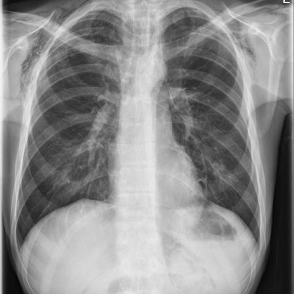
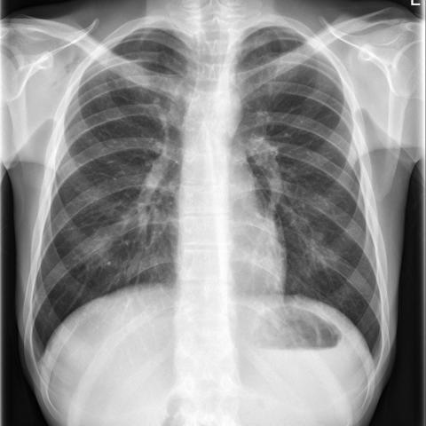
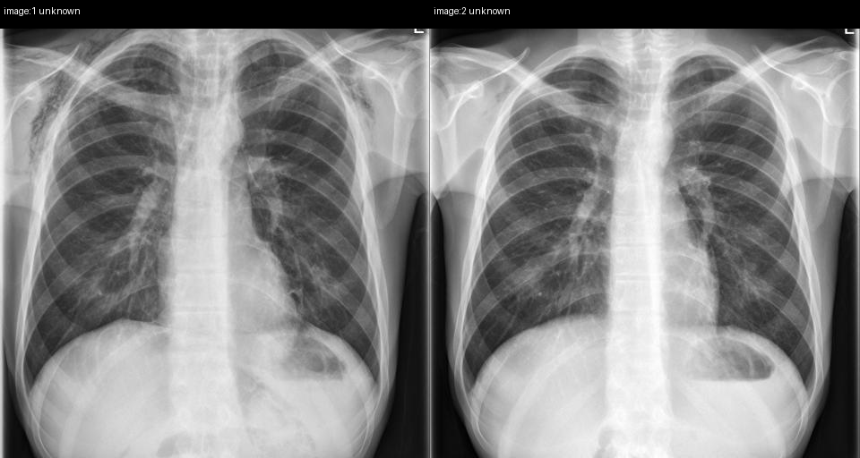

# Official gain: 16486_8353800471802

Post-run explicit answers: D **C**, M **F**, P **C**, reference **C**. Frozen runtime answers: D C, M F, P C; original records unchanged.

[Complete observable requests, tools and stages](../traces/16486_8353800471802.json) · [Original benchmark case](../../v12/results/cases/16486_8353800471802.md) · [D cached original observable request](../../direct_qwen60/requests/16486_8353800471802.json)

```text
Based on the chest X-ray findings in Figure 1 and Figure 8, what is the most likely diagnosis, and what does the progression of findings suggest about the clinical course of the condition in this patient?
A) Secondary pneumomediastinum due to oesophageal rupture, with worsening condition
B) Spontaneous pneumothorax with stable condition
C) Primary spontaneous pneumomediastinum with improvement
D) Pneumopericardium with no change in condition
E) Pneumoperitoneum with deterioration
F) Primary spontaneous pneumomediastinum with worsening condition
```





## D

```text
Answer: C) Primary spontaneous pneumomediastinum with improvement  
Reason: Both Figure 1 and Figure 8 show subtle linear lucencies along the left heart border and mediastinum, consistent with pneumomediastinum; however, the second image (Figure 8) shows less prominent air, suggesting resolution. There is no evidence of pneumothorax, pneumopericardium, or pneumoperitoneum, and no signs of oesophageal rupture (e.g., pleural effusion, subcutaneous emphysema, or mediastinal shift). The absence of trauma or underlying lung disease favors primary spontaneous pneumomediastinum, and the reduced air on follow-up indicates improvement.
```

## M

```text
F) Primary spontaneous pneumomediastinum with worsening condition

Reason: Visual inspection of both X-rays shows air in the mediastinum (pneumomediastinum), particularly along the left heart border and aortic arch, with subtle progression from Figure 1 to Figure 8 (increased lucency/air tracking). The xray_phrase_grounding tool for Figure 1 returned "Pneumopericardium" but this is likely a misclassification—the appearance is classic for pneumomediastinum (linear lucencies outlining mediastinal structures, not the circumferential gas around the heart typical of pneumopericardium). Given the absence of trauma, surgery, or obvious esophageal perforation signs (no pleural effusion, subcutaneous emphysema, or clinical context provided), primary spontaneous pneumomediastinum is most likely. The slight increase in mediastinal air between images suggests worsening, ruling out improvement (C) or stability (B). Options A, D, and E are inconsistent with the imaging findings.
```

## P

```text
Answer: C) Primary spontaneous pneumomediastinum with improvement  

The linear lucency along the left heart border is more apparent in Figure 1 than in Figure 8, suggesting resolution over time. No secondary signs of oesophageal rupture (e.g., pleural effusion, subcutaneous emphysema) or pneumothorax are present, making secondary causes unlikely. The faint, non-continuous lucency without associated pathology supports a benign, self-limited process like primary spontaneous pneumomediastinum.
```

## P 实际派生图

以下为本轮传入 observe/final 的保存图像；框和解剖覆盖不代表病灶真值。

p1:paired · paired_original_pixels · 来源 image:1, image:2



