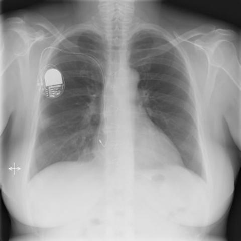
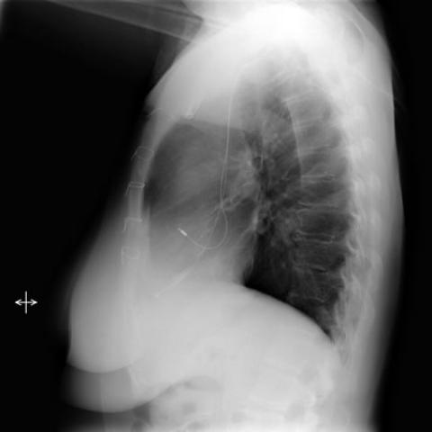
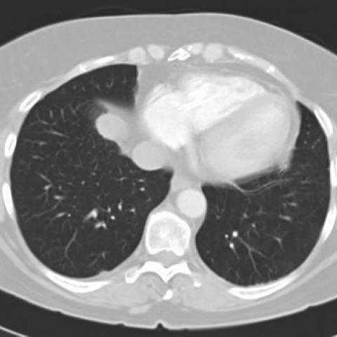
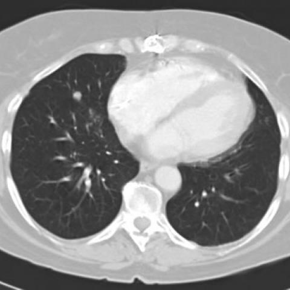
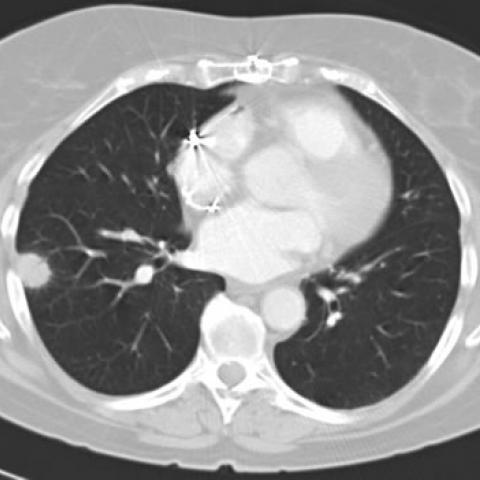

# Official gain: 1653_8353802281156

Post-run explicit answers: D **A**, M **A**, P **A**, reference **C**. Frozen runtime answers: D A, M A, P A; original records unchanged.

[Complete observable requests, tools and stages](../traces/1653_8353802281156.json) · [Original benchmark case](../../v12/results/cases/1653_8353802281156.md) · [D cached original observable request](../../direct_qwen60/requests/1653_8353802281156.json)

```text
In a patient with a history of heart transplantation and a pacemaker, presenting with two nodular shadows in the right lung observed on routine chest X-ray, which of the following is the most likely diagnosis for the nodular lesions, considering the absence of symptoms and geographic exposure?

A) Post-transplant lymphoproliferative disorder
B) Lung tumor (primary or secondary)
C) Pulmonary blastomycosis
D) Histoplasmosis
E) Tuberculosis
F) Fungal infection other than blastomycosis
```











## D

```text
Answer: A) Post-transplant lymphoproliferative disorder  
Reason: In immunosuppressed patients (e.g., post-heart transplant), asymptomatic pulmonary nodules are highly concerning for PTLD, especially EBV-driven B-cell proliferations; the CT images show well-defined, peripheral nodules without cavitation or calcification—typical of PTLD—and absence of geographic exposure makes endemic fungi less likely.
```

## M

```text
The tool outputs are inconsistent and unreliable for this case. The chest_xray_classifier is designed for X-rays, not CT scans, so the high probabilities for conditions like "Mass" (0.52) and "Lung Lesion" (0.53) on CT images are artifacts of using the wrong modality. The report generator incorrectly states "lung parenchyma is clear" when the CT clearly shows two nodules. The expert tool incorrectly suggests "Pneumonia" which doesn't fit the imaging.

Let me use my own clinical reasoning:

In heart transplant recipients, the most common cause of pulmonary nodules is **Post-transplant lymphoproliferative disorder (PTLD)**. Key points:
- PTLD occurs in 1-10% of solid organ transplant recipients
- Epstein-Barr virus-driven B-cell proliferation
- Lungs are a common extranodal site (up to 30% of cases)
- Can present as multiple pulmonary nodules, often asymptomatic initially
- More common than fungal infections in the absence of geographic exposure
- More common than primary lung cancer in this demographic

While fungal infections (histoplasmosis, blastomycosis) are important considerations, the question specifically states "absence of geographic exposure," making endemic fungal infections less likely.

The CT images (2a-c) show two well-defined nodules in the right lung, which is classic for PTLD.

A) Post-transplant lymphoproliferative disorder

Return Answer: A) Post-transplant lymphoproliferative disorder - In immunosuppressed heart transplant recipients, PTLD is the most common cause of pulmonary nodules, especially when asymptomatic and found incidentally, with lungs being a frequent extranodal site.
```

## P

```text
Answer: A) Post-transplant lymphoproliferative disorder  
Evidence: The patient is immunocompromised due to heart transplantation and likely on immunosuppressive therapy, a major risk factor for PTLD. Two nodular lesions—one peripheral and one hilar/mediastinal—are consistent with extranodal PTLD manifestations in the lung. The absence of symptoms and geographic exposure makes endemic fungal infections (C–F) less likely, and primary/secondary tumors are less common than PTLD in this setting without additional risk factors.
```

