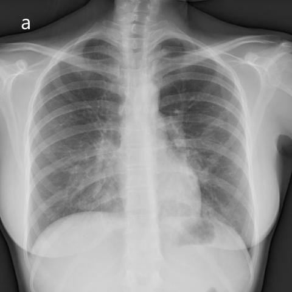
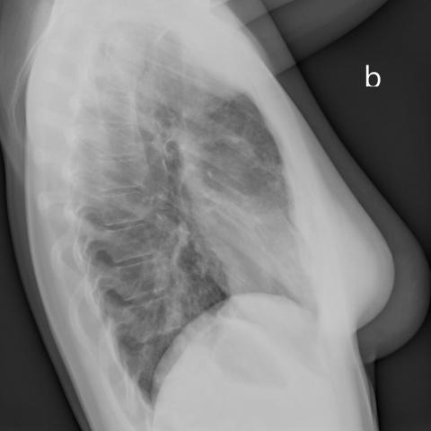
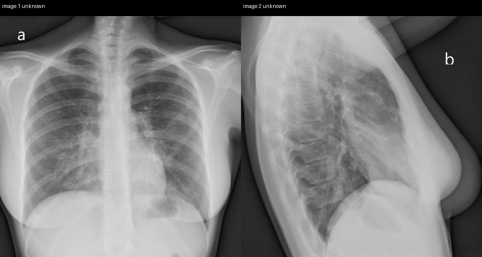
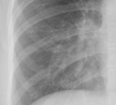
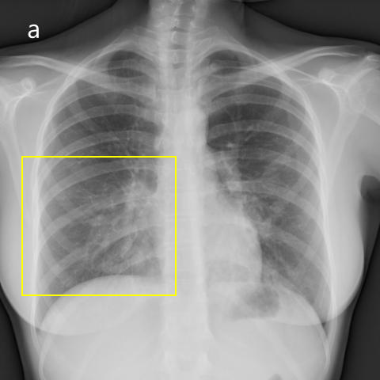

# Official gain: 16568_8353800483171

Post-run explicit answers: D **B**, M **B**, P **A**, reference **B**. Frozen runtime answers: D B, M B, P A; original records unchanged.

[Complete observable requests, tools and stages](../traces/16568_8353800483171.json) · [Original benchmark case](../../v12/results/cases/16568_8353800483171.md) · [D cached original observable request](../../direct_qwen60/requests/16568_8353800483171.json)

```text
Based on the chest radiographs in Figures 1a and 1b, which statement best describes the findings and their clinical significance in relation to the patient's condition?

A) The radiographs indicate unilateral alveolar infiltrates confined to the right lung's middle lobe, suggesting a localized infection.
B) The bilateral alveolar infiltrates are predominantly in the lower lobes and the middle lobe of the right lung, consistent with pulmonary alveolar proteinosis, despite the absence of restrictive impairment in pulmonary function tests.
C) The infiltrates are primarily observed in the upper lobes bilaterally, aligning with a pattern suggestive of pulmonary edema.
D) The X-rays show no significant infiltrates, indicating a possible error in clinical correlation.
E) The infiltrates are diffuse and homogeneously distributed across all lung lobes, indicating acute respiratory distress syndrome.
F) The radiographs reveal alveolar infiltrates only in the left lower lobe, suggesting lipoid pneumonia.
```





## D

```text
Answer: B  
Reason: Figures 1a (PA) and 1b (lateral) show bilateral, patchy alveolar infiltrates with relative sparing of the upper lobes and predominance in the lower lobes and right middle lobe—classic for pulmonary alveolar proteinosis (PAP). Although PAP often presents with restrictive physiology, its absence does not rule it out; the radiographic pattern is highly characteristic. Other options are inconsistent: A and F describe unilateral disease; C misattributes upper-lobe predominance; D denies visible infiltrates (which are present); E describes diffuse homogeneous opacities (ARDS), not the patchy, gravity-dependent infiltrates seen here.
```

## M

```text
The tool outputs are conflicting and somewhat unreliable. Let me critically analyze:

1. The classifier shows high "Lung Opacity" (0.79, 0.76) and "Infiltration" (0.54, 0.54) but low "Pneumonia" (0.002, 0.017) and "Edema" (0.004, 0.011), which is inconsistent with the visual appearance.

2. The report generator states "no focal lung consolidation" and "mild pulmonary edema" - but visually there are clear bilateral alveolar infiltrates.

3. The expert tool incorrectly states "Unilateral, lower lung zone" when the PA view clearly shows bilateral involvement.

Let me examine the images more carefully myself:
- Figure 1a (PA): Bilateral hazy opacities, more prominent in lower lung zones, with some right middle lobe involvement (loss of right heart border)
- Figure 1b (lateral): Confirms posterior lower lobe involvement bilaterally

The pattern is bilateral alveolar infiltrates predominantly in lower lobes with right middle lobe involvement. This is classic for aspiration pneumonia or certain types of infection that gravitate to dependent lung regions.

Looking at the answer choices:
A) Unilateral - incorrect, it's bilateral
B) Bilateral alveolar infiltrates in lower lobes and right middle lobe - matches my visual assessment. Pulmonary alveolar proteinosis can present this way, though it's less common.
C) Upper lobes - incorrect, it's lower lobes
D) No infiltrates - incorrect, clear infiltrates present
E) Diffuse homogeneous across all lobes - not quite, it's predominantly lower lobes
F) Left lower lobe only - incorrect, bilateral

Option B is the most accurate description of the findings, even if the specific diagnosis of pulmonary alveolar proteinosis might be questionable without more clinical context. The question asks for the statement that "best describes the findings and their clinical significance," and B correctly identifies the bilateral, lower lobe predominant pattern with right middle lobe involvement.

However, let me reconsider: pulmonary alveolar proteinosis typically shows "crazy-paving" pattern on CT and bilateral symmetric ground-glass opacities, but the X-ray description here could fit several conditions. The key is that B is the only option that correctly describes the anatomical distribution.

Actually, looking more carefully at the lateral view (Figure 1b), the infiltrates appear to be in the posterior aspects of both lower lobes, and the PA view shows bilateral involvement. The right middle lobe involvement is suggested by the obscuring of the right heart border.

Given the options provided, B is the most accurate description of the radiographic findings.

Return Answer: B) The bilateral alveolar infiltrates are predominantly in the lower lobes and the middle lobe of the right lung, consistent with pulmonary alveolar proteinosis, despite the absence of restrictive impairment in pulmonary function tests.
```

## P

```text
Answer: A) The radiographs indicate unilateral alveolar infiltrates confined to the right lung's middle lobe, suggesting a localized infection.

Evidence:  
1. Frontal view (Figure 1a) shows a well-localized region of increased opacity in the right middle lobe, confirmed by grounding tool (pixel coordinates [50, 218, 199, 352]).  
2. Lateral view (Figure 1b) supports middle and lower zone involvement but does not clearly show left-sided infiltrates; upper lobes are relatively spared.  
3. No evidence of bilateral or diffuse infiltrates is present, and upper-lobe–predominant disease (e.g., edema, ARDS) is not supported.
```

## P 实际派生图

以下为本轮传入 observe/final 的保存图像；框和解剖覆盖不代表病灶真值。

p1:paired · paired_original_pixels · 来源 image:1, image:2



p2:roi · unmodified_pixel_roi · 来源 image:1



p2:location · location_overlay · 来源 image:1



