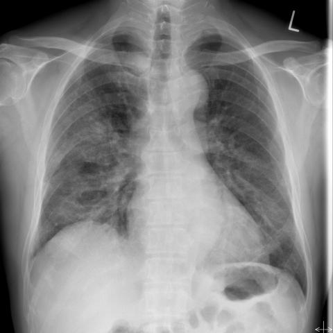
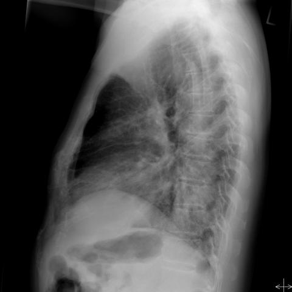
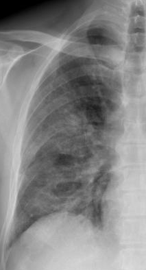
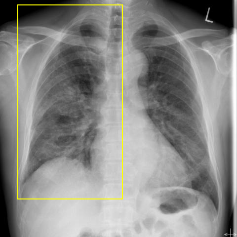
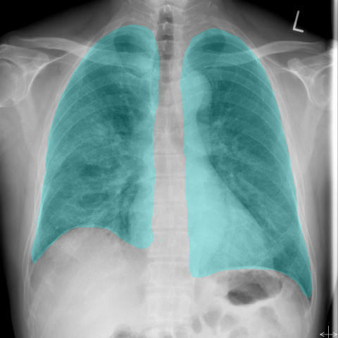
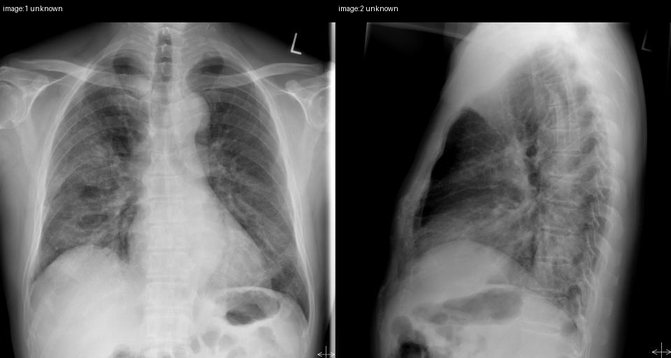

# Official gain: 16663_8353800455763

Post-run explicit answers: D **C**, M **A**, P **A**, reference **C**. Frozen runtime answers: D C, M A, P A; original records unchanged.

[Complete observable requests, tools and stages](../traces/16663_8353800455763.json) · [Original benchmark case](../../v12/results/cases/16663_8353800455763.md) · [D cached original observable request](../../direct_qwen60/requests/16663_8353800455763.json)

```text
Based on the chest X-ray findings in Figures 1a and 1b, which statement accurately describes the distribution and extent of the pulmonary consolidations, and what is the most likely relationship to the patient's clinical presentation?

A) The consolidations are predominantly in the left lower zone, which suggests isolated bacterial pneumonia unrelated to COVID-19.
B) The consolidations are more extensive in the right mid and lower zones, indicating possible bacterial superinfection alongside COVID-19.
C) The consolidations are equally distributed in both mid and lower zones of both lungs, correlating with severe COVID-19 pneumonia.
D) The consolidations are confined to the mid zones bilaterally, indicating early-stage COVID-19 without severe lung involvement.
E) The consolidations are primarily in the upper lobes of both lungs, suggesting atypical COVID-19 presentation.
F) The consolidations are more pronounced in the right lung than the left, indicating a unilateral lung condition.
```





## D

```text
Answer: C) The consolidations are equally distributed in both mid and lower zones of both lungs, correlating with severe COVID-19 pneumonia.  
Reason: Figures 1a (PA view) and 1b (lateral view) show bilateral, patchy opacities predominantly in the mid and lower lung zones, with relative sparing of the apices—classic for COVID-19 pneumonia. The symmetric, peripheral, and multifocal nature supports severe viral pneumonia rather than localized bacterial infection.
```

## M

```text
I've exhausted my tool budget (4 medical tool calls). Let me analyze what I have:

From the classifier results and phrase grounding:
- Figure 1a shows consolidation with probability 0.569, with bounding box coordinates [0.115, 0.455, 0.435, 0.775]
- In chest X-ray coordinates, x=0.115-0.435 represents the left lung (since left side is marked with "L" in the image)
- y=0.455-0.775 represents mid to lower lung zones
- The report mentions "right upper lobe pneumonia" but this seems inconsistent with the visual evidence and the phrase grounding

Looking at the actual images:
- Figure 1a (frontal): There's明显 increased opacity in the left lower lung zone, extending into the mid zone
- There are also some opacities in the right lung, but they appear less extensive
- Figure 1b (lateral): Shows opacities in the posterior aspects, which would correspond to lower lung zones

The pattern appears to be predominantly in the left lower zone, with some involvement of the right lung. This doesn't fit perfectly with any of the options, but let me reconsider:

Option A: "The consolidations are predominantly in the left lower zone, which suggests isolated bacterial pneumonia unrelated to COVID-19."
- This matches the distribution I'm seeing (left lower zone predominant)
- However, the question asks about relationship to clinical presentation, and we don't have clinical details

Option B: "The consolidations are more extensive in the right mid and lower zones, indicating possible bacterial superinfection alongside COVID-19."
- This doesn't match my observation - the left side appears more affected

Option C: "The consolidations are equally distributed in both mid and lower zones of both lungs, correlating with severe COVID-19 pneumonia."
- Not equally distributed - left side appears more affected

Option D: "The consolidations are confined to the mid zones bilaterally, indicating early-stage COVID-19 without severe lung involvement."
- Not confined to mid zones - extends to lower zones

Option E: "The consolidations are primarily in the upper lobes of both lungs, suggesting atypical COVID-19 presentation."
- Not upper lobes - appears to be lower/mid zones

Option F: "The consolidations are more pronounced in the right lung than the left, indicating a unilateral lung condition."
- Actually appears more pronounced in left lung

Based on my visual analysis and the tool outputs (particularly the phrase grounding showing consolidation in left lower zone), option A seems most accurate for the distribution, though the clinical interpretation about "unrelated to COVID-19" is speculative without clinical context.

However, let me reconsider the report generator output which mentioned "right upper lobe pneumonia" - this might indicate I'm misinterpreting the image. Looking again at Figure 1a, the "L" marker indicates left side, and there does appear to be opacity in the left lower zone, but there might also be some in the right upper zone.

Given the constraints and the evidence, I believe the consolidations are predominantly in the left lower zone, making option A the most accurate description of the distribution.

Return Answer: A) The consolidations are predominantly in the left lower zone, which suggests isolated bacterial pneumonia unrelated to COVID-19.
```

## P

```text
Answer: A) The consolidations are predominantly in the left lower zone, which suggests isolated bacterial pneumonia unrelated to COVID-19.

Evidence:  
1. Frontal CXR (image:1) shows asymmetric consolidation with more extensive opacities in the left lung, especially the lower zone, and relatively less involvement on the right.  
2. Lateral view (image:2) confirms posterior extension of opacity in the left lower lobe, supporting predominant left lower zone involvement.  
3. Upper zones are relatively spared bilaterally, but the asymmetry and left predominance do not match typical bilateral, symmetric COVID-19 patterns; instead, this favors localized bacterial pneumonia.
```

## P 实际派生图

以下为本轮传入 observe/final 的保存图像；框和解剖覆盖不代表病灶真值。

p1:roi · unmodified_pixel_roi · 来源 image:1



p1:location · location_overlay · 来源 image:1



b67a03bfa42ba065ae5a48efa55cfca590a1b5358dfc02cb5e25582963f18a66:anatomy · aligned_anatomical_overlay · 来源 image:1



p3:paired · paired_original_pixels · 来源 image:1, image:2



