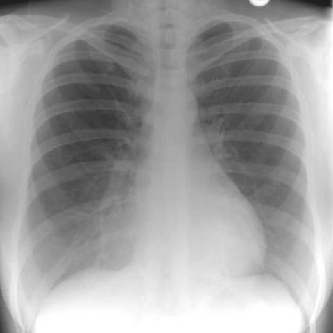
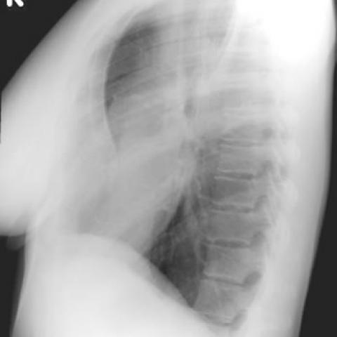
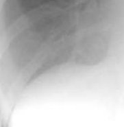
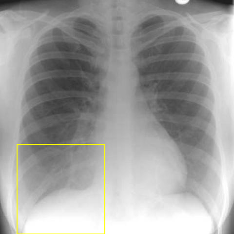

# Official gain: 1678_8353802279918

Post-run explicit answers: D **C**, M **B**, P **C**, reference **C**. Frozen runtime answers: D C, M B, P C; original records unchanged.

[Complete observable requests, tools and stages](../traces/1678_8353802279918.json) · [Original benchmark case](../../v12/results/cases/1678_8353802279918.md) · [D cached original observable request](../../direct_qwen60/requests/1678_8353802279918.json)

```text
Based on the chest X-ray findings, what is the most likely explanation for the observed right cardio-phrenic angle opacity in Figure 1a, and how does Figure 1b support your conclusion?

A) The opacity is due to right middle lobe pneumonia, as confirmed by the presence of an air bronchogram in Figure 1b.
B) The opacity is due to right middle lobe collapse, as indicated by volume loss in the right lung in Figure 1a.
C) The opacity is due to the projection of anterior chest wall tissues over the lung, as Figure 1b shows a depressed sternum with no air bronchogram.
D) The opacity represents a pleural effusion, as confirmed by fluid levels visible in Figure 1b.
E) The opacity is due to a mass in the right middle lobe, as Figure 1b shows an outline of a mass.
F) The opacity is due to cardiomegaly, as the heart is enlarged and shifted to the right in Figure 1b.
```





## D

```text
Answer: C) The opacity is due to the projection of anterior chest wall tissues over the lung, as Figure 1b shows a depressed sternum with no air bronchogram.

Reason: Figure 1a shows a right cardio-phrenic angle opacity that could mimic pathology, but Figure 1b (lateral view) reveals a depressed sternum (suggesting pectus excavatum or similar chest wall deformity), and the opacity is not associated with air bronchograms, volume loss, fluid levels, or a discrete mass—ruling out pneumonia, collapse, effusion, or tumor. The lateral view confirms the opacity lies anteriorly, consistent with chest wall tissue superimposition.
```

## M

```text
I've exhausted my tool budget (4 medical tool calls). Let me reconsider based on my visual analysis and the available information.

Looking again at the images:
- Figure 1a shows an opacity in the right cardio-phrenic angle that has a triangular shape, hugging the right heart border (silhouette sign)
- Figure 1b (lateral view) shows this opacity is located anteriorly, which is exactly where the right middle lobe sits
- The report generators say "no focal consolidation" and "no evidence of pneumonia," which argues against active pneumonia
- The classifier showed moderate probability for atelectasis (0.168) and consolidation (0.307), but the expert report generator is more reliable for detailed interpretation

The key distinguishing feature is that middle lobe collapse typically presents as a triangular opacity in the right lower zone with silhouette sign against the heart, without air bronchograms. Middle lobe pneumonia would show air bronchograms if it were consolidated.

From Figure 1a, I don't see clear air bronchograms (branching lucent lines within the opacity), which supports collapse rather than active pneumonia.

Also, option C mentions "projection of anterior chest wall tissues" - but the lateral view (Figure 1b) would show if this were just chest wall tissue, and the opacity appears to be within the lung field.

Option D (pleural effusion) is unlikely because pleural effusions typically cause blunting of the costophrenic angle and have a meniscus shape, not a triangular opacity hugging the heart border.

Option E (mass) is possible given the high mass probability (0.492), but masses are usually more rounded and don't typically follow the anatomical boundaries of lung lobes.

Option F (cardiomegaly) is incorrect because the heart doesn't appear enlarged or shifted to the right.

Given the triangular shape, silhouette sign with the heart, anterior location on lateral view, and absence of air bronchograms, the most likely diagnosis is right middle lobe collapse.

Return Answer: B) The opacity is due to right middle lobe collapse, as indicated by volume loss in the right lung in Figure 1a.
```

## P

```text
Answer: C) The opacity is due to the projection of anterior chest wall tissues over the lung, as Figure 1b shows a depressed sternum with no air bronchogram.

Evidence:  
1. The lateral view (Figure 1b) shows the opacity as a wedge-shaped density abutting the anterior chest wall and diaphragm, indicating an anterior (chest wall) location rather than intraparenchymal.  
2. Neither image shows air bronchograms—opacity is homogeneously dense—ruling out pneumonia (A), collapse (B), or mass (E).  
3. The frontal CXR (Figure 1a) shows the opacity localized at the right cardio-phrenic angle but extending laterally to the chest wall, consistent with overlying soft tissue; the depressed sternum in the lateral view supports chest wall contribution.
```

## P 实际派生图

以下为本轮传入 observe/final 的保存图像；框和解剖覆盖不代表病灶真值。

p2:roi · unmodified_pixel_roi · 来源 image:1



p2:location · location_overlay · 来源 image:1



