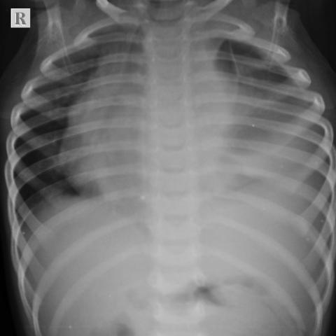
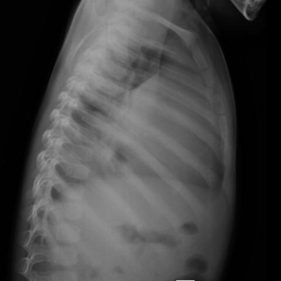
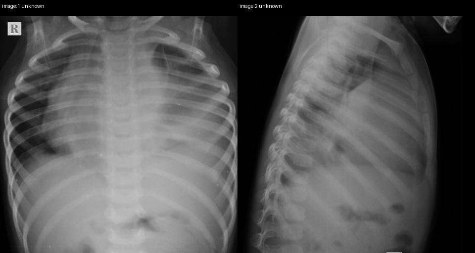

# Official gain: 17132_8143559675802

Post-run explicit answers: D **B**, M **B**, P **B**, reference **B**. Frozen runtime answers: D B, M B, P B; original records unchanged.

[Complete observable requests, tools and stages](../traces/17132_8143559675802.json) · [Original benchmark case](../../v12/results/cases/17132_8143559675802.md) · [D cached original observable request](../../direct_qwen60/requests/17132_8143559675802.json)

```text
Based on the chest radiograph findings and the clinical presentation, which of the following is the most likely diagnosis, considering the obscuration of the left heart border, significant cardio-mediastinal shift to the right, and mediastinal widening observed in the chest X-ray (Figures 1 and 2)?

A) Left lower lobe pneumonia
B) T-cell acute lymphoblastic leukemia/lymphoma
C) Pulmonary tuberculosis
D) Primary lung carcinoma
E) Left-sided pleural effusion
F) Hodgkin’s lymphoma
```





## D

```text
Answer: B) T-cell acute lymphoblastic leukemia/lymphoma  
Reason: The chest X-ray shows a large mediastinal mass causing obscuration of the left heart border (loss of left cardiac silhouette), significant rightward mediastinal shift, and mediastinal widening—classic radiographic features of a bulky anterior mediastinal mass. In pediatric patients, T-cell acute lymphoblastic leukemia/lymphoma (especially lymphoblastic lymphoma) commonly presents with a rapidly enlarging thymic mass in the anterior mediastinum, leading to these findings. The age-appropriate presentation (implied by the pediatric chest X-ray appearance) and aggressive mass effect favor this over other options like Hodgkin’s lymphoma (less common in very young children and often more nodal), pneumonia, or pleural effusion (which would not cause such marked mediastinal shift and widening without fluid layering).
```

## M

```text
The tool outputs are inconsistent with my visual assessment. The classifier shows high probability for "Mass" (0.80) and "Lung Opacity" (0.82), and moderate for "Enlarged Cardiomediastinum" (0.66) and "Effusion" (0.60), but the report generator incorrectly states "no pleural effusion" and "no focal consolidation" while calling it "mild pulmonary edema" - which doesn't match the obvious large left-sided opacity.

Looking at the images again:
- Figure 1 shows a massive left hemithoracic opacity that obscures the left heart border (silhouette sign)
- The mediastinum is clearly shifted to the right
- The opacity appears to be in the anterior/superior mediastinum rather than a simple pleural effusion (which would typically cause meniscus sign and more uniform opacity)

The key differentiator is that a simple pleural effusion (option E) would not typically cause such significant mediastinal widening - it would cause mediastinal shift but the mediastinal contour would remain relatively normal. Here we have true mediastinal widening, suggesting a mediastinal mass.

In pediatric/young adult patients, the most common cause of a large anterior mediastinal mass with rightward shift is lymphoma, particularly T-cell acute lymphoblastic leukemia/lymphoma (option B) or Hodgkin's lymphoma (option F). T-cell ALL/lymphoma typically presents as a bulky anterior mediastinal mass in adolescents/young adults, often with superior vena cava syndrome symptoms.

Given the massive mediastinal widening and rightward shift, this is characteristic of a large mediastinal tumor. Between the options, T-cell acute lymphoblastic leukemia/lymphoma is more likely to present with such a dramatic mediastinal mass in younger patients, while Hodgkin's lymphoma can also cause this but typically in older adolescents/young adults.

However, looking more carefully at the lateral view (Figure 2), the mass appears to be centered in the anterior mediastinum, which is classic for T-cell lymphoblastic lymphoma/leukemia.

B) T-cell acute lymphoblastic leukemia/lymphoma
```

## P

```text
Answer: B) T-cell acute lymphoblastic leukemia/lymphoma  
The obscuration of the left heart border with anterior mediastinal extension and significant rightward cardio-mediastinal shift, plus loss of retrosternal clear space on lateral view, strongly suggests a large anterior mediastinal mass—classic for T-cell ALL/lymphoma in pediatric patients. Pleural effusion (E) would cause posterior displacement or meniscus sign, not anterior widening; pneumonia (A), TB (C), or carcinoma (D) do not typically cause such marked mediastinal shift and anterior mass effect; Hodgkin’s (F) can cause mediastinal mass but is less common in young children and usually presents with less acute shift.
```

## P 实际派生图

以下为本轮传入 observe/final 的保存图像；框和解剖覆盖不代表病灶真值。

p2:paired · paired_original_pixels · 来源 image:1, image:2



