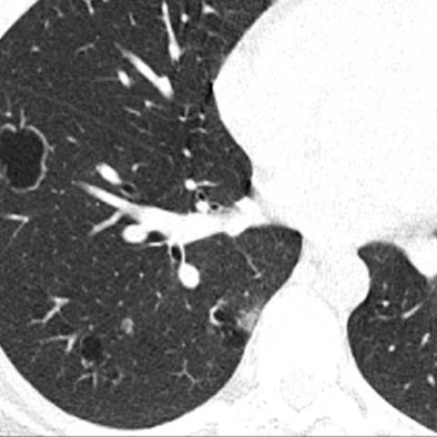
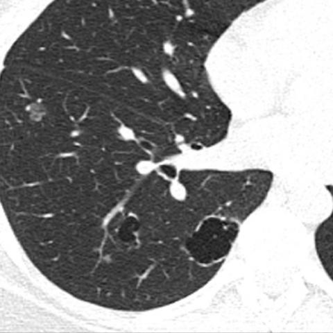
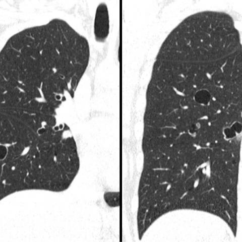
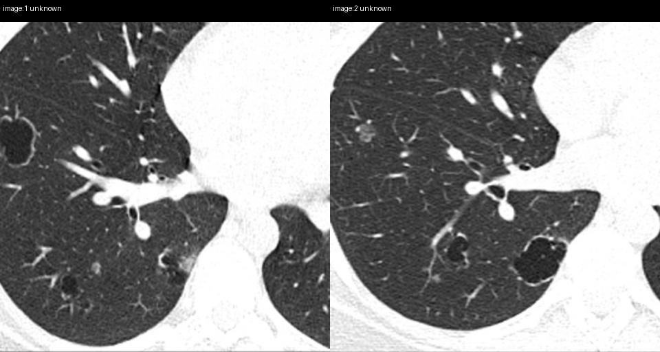

# Official gain: 17182_8143559676067

Post-run explicit answers: D **C**, M **C**, P **C**, reference **C**. Frozen runtime answers: D C, M C, P C; original records unchanged.

[Complete observable requests, tools and stages](../traces/17182_8143559676067.json) · [Original benchmark case](../../v12/results/cases/17182_8143559676067.md) · [D cached original observable request](../../direct_qwen60/requests/17182_8143559676067.json)

```text
Based on the chest X-ray observations from Figures 1a-c, which of the following best describes the likely diagnosis and the reasoning behind it, considering the clinical history of recurrent pneumonia and a supraglottic polypoid lesion?

A) Granulomatosis with polyangiitis, due to bilateral lung nodules with cavitation.
B) Lymphangioleiomyomatosis, indicated by the presence of cystic lesions in the lung parenchyma.
C) Recurrent respiratory papillomatosis, supported by cavitated nodules and the presence of a supraglottic lesion.
D) Pulmonary Langerhans cell histiocytosis, characterized by cystic and nodular lung lesions.
E) Cystic pulmonary metastases, due to the presence of multiple nodular lesions with variable sizes.
```







## D

```text
Answer: C) Recurrent respiratory papillomatosis, supported by cavitated nodules and the presence of a supraglottic lesion.

Reason: The images show multiple cavitary nodules in the lungs, and the clinical history includes recurrent pneumonia and a supraglottic polypoid lesion—classic features of recurrent respiratory papillomatosis (RRP), especially when caused by HPV. RRP can disseminate to the lungs, forming wart-like endobronchial lesions that may cavitate and cause recurrent infections. While other conditions (e.g., PLCH, GPA) can cause cavitary nodules, the combination with a supraglottic polypoid lesion strongly favors RRP.
```

## M

```text
The chest_xray_report_generator is giving me a report that doesn't match what I'm seeing in the images. It's describing a normal chest X-ray with only a right upper lobe opacity, but the images clearly show multiple cystic lesions in CT format. This suggests the tool is misinterpreting the CT images as chest X-rays.

Given that the tools are not providing reliable analysis of these CT images, I need to rely on my clinical reasoning and the key diagnostic clues:

1. **Supraglottic polypoid lesion** - This is classic for recurrent respiratory papillomatosis (RRP), which is caused by HPV 6/11
2. **Recurrent pneumonia** - Consistent with airway obstruction and impaired clearance in RRP
3. **Pulmonary cystic/nodular lesions** - Pulmonary involvement in RRP can manifest as nodules, sometimes cavitated, due to spread of papillomatous tissue through the airways

Among the options:
- A) GPA: supraglottic polyps are not typical; usually ulcerative lesions
- B) LAM: no association with supraglottic lesions
- C) RRP: perfect match - supraglottic polyps + pulmonary involvement + recurrent infections
- D) PLCH: typically in smokers, no supraglottic connection
- E) Metastases: unlikely to present with supraglottic polyp as primary finding

The clinical history is the most discriminating factor here. Recurrent respiratory papillomatosis is specifically characterized by recurrent papillomatous growths in the respiratory tract, starting in the larynx/supraglottis and potentially spreading to the lungs.

Return Answer: C) Recurrent respiratory papillomatosis, supported by cavitated nodules and the presence of a supraglottic lesion.
```

## P

```text
Answer: C) Recurrent respiratory papillomatosis, supported by cavitated nodules and the presence of a supraglottic lesion.

Evidence: The clinical history includes recurrent pneumonia and a supraglottic polypoid lesion, which strongly suggests recurrent respiratory papillomatosis (RRP), a condition caused by HPV that can lead to tracheobronchial and pulmonary involvement. Cavitated nodules are visible in both lungs across Figures 1a–1c, with asymmetric distribution as confirmed by the new observation—consistent with RRP’s tendency for irregular, multifocal pulmonary spread. While other options like GPA or PLCH may show cavitation or cysts, they lack the key association with a supraglottic polypoid lesion, making C the best fit.
```

## P 实际派生图

以下为本轮传入 observe/final 的保存图像；框和解剖覆盖不代表病灶真值。

p3:paired · paired_original_pixels · 来源 image:1, image:2



