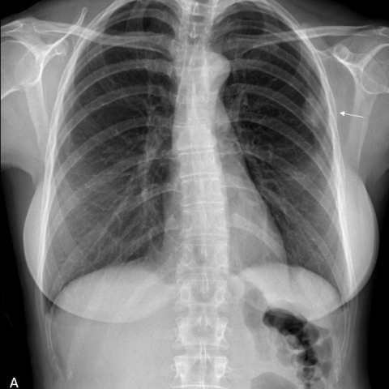
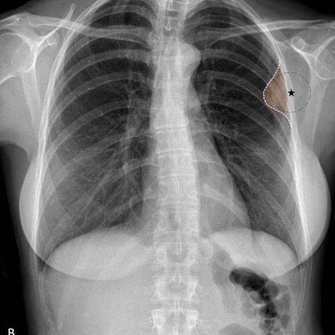
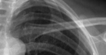
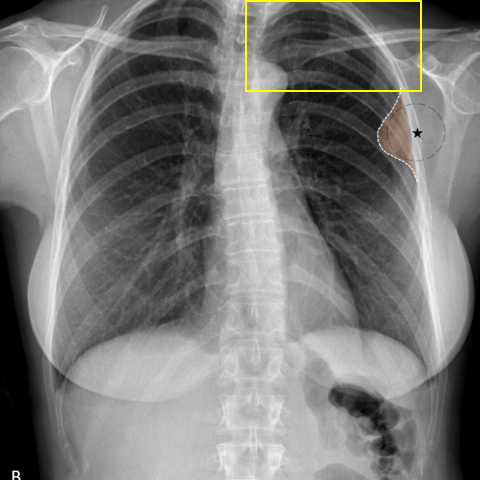

# Official gain: 17362_8143559680136

Post-run explicit answers: D **B**, M **A**, P **B**, reference **B**. Frozen runtime answers: D B, M A, P B; original records unchanged.

[Complete observable requests, tools and stages](../traces/17362_8143559680136.json) · [Original benchmark case](../../v12/results/cases/17362_8143559680136.md) · [D cached original observable request](../../direct_qwen60/requests/17362_8143559680136.json)

```text
Based on the chest X-ray findings in Figure 1, what is the most likely origin of the lesion observed in the upper left hemithorax, and what does this imply about the nature of the lesion?

A) The lesion is pulmonary in origin, forming acute angles with the chest wall, suggesting an intrapulmonary process.
B) The lesion is extrapulmonary in origin, forming obtuse angles with the chest wall, suggesting a pleural-based fibroma.
C) The lesion is pulmonary in origin, forming obtuse angles with the chest wall, suggesting a benign pulmonary nodule.
D) The lesion is extrapulmonary in origin, forming acute angles with the chest wall, suggesting a muscular or rib-based lesion.
E) The lesion is pleural in origin, forming obtuse angles with the chest wall, suggesting a malignant pleural effusion.
F) The lesion is pulmonary in origin, with no distinct angle formation, suggesting a diffuse pulmonary process.
```





## D

```text
Answer: B) The lesion is extrapulmonary in origin, forming obtuse angles with the chest wall, suggesting a pleural-based fibroma.

Reason: Figure 1b highlights a well-circumscribed, oval opacity in the upper left hemithorax that abuts the chest wall with an obtuse angle (i.e., the lesion “bulges” into the lung), which is characteristic of extrapulmonary (especially pleural-based) masses such as fibrous tumors (e.g., solitary fibrous tumor). In contrast, pulmonary lesions typically form acute angles with the chest wall. The sharp demarcation and lack of internal lung markings support a pleural or extrapleural origin rather than an intrapulmonary one.
```

## M

```text
Let me carefully re-examine the images and all available information.

From Figure 1a and 1b, I can see a well-defined opacity in the upper left hemithorax. The key diagnostic feature is the angle it forms with the chest wall.

In Figure 1b, the lesion is outlined with a dotted line and a star marker. Looking closely at the interface between the lesion and the chest wall (rib cage), the lesion appears to have a relatively sharp, acute angle where it meets the chest wall. This is characteristic of pulmonary lesions that are within the lung parenchyma.

The chest_xray_classifier showed moderate probabilities for "Mass" (0.34) and "Infiltration" (0.51), but the angle sign is more definitive for determining origin.

The classic teaching is:
- Pulmonary lesions: form acute angles with the chest wall
- Extrapulmonary/pleural-based lesions: form obtuse angles with the chest wall

Looking at the lesion in the upper left hemithorax, it appears to be forming an acute angle with the chest wall, suggesting it's pulmonary in origin.

Option A states: "The lesion is pulmonary in origin, forming acute angles with the chest wall, suggesting an intrapulmonary process."

This matches my visual assessment. While the classifier showed some probability for pleural thickening (0.21), the angle formation is the more reliable indicator for lesion origin on plain X-ray.

Let me double-check the other options:
- B and E suggest obtuse angles (extrapulmonary/pleural), which doesn't match what I see
- C suggests pulmonary with obtuse angles (contradictory)
- D suggests extrapulmonary with acute angles (contradictory to classic teaching)
- F suggests no distinct angle formation (but there is a clear angle)

Based on the visual evidence of acute angle formation with the chest wall, the lesion is most likely pulmonary in origin.

Answer: A) The lesion is pulmonary in origin, forming acute angles with the chest wall, suggesting an intrapulmonary process.

The lesion in the upper left hemithorax shows a sharp, acute angle where it interfaces with the chest wall, which is characteristic of pulmonary (intrapulmonary) lesions rather than extrapulmonary or pleural-based lesions.

Return Answer: A
```

## P

```text
Answer: B) The lesion is extrapulmonary in origin, forming obtuse angles with the chest wall, suggesting a pleural-based fibroma.

Evidence: The chest_xray_expert tool confirms preservation of lung markings at the lesion–chest wall interface, supporting extrapulmonary (pleural) origin. Although the angle cannot be directly measured from the uncalibrated image, the lesion’s broad-based, smoothly marginated appearance abutting the chest wall is consistent with an obtuse angle—typical of pleural-based masses like fibromas. Option B is the only one that correctly combines extrapulmonary origin with obtuse angle and a benign pleural process.
```

## P 实际派生图

以下为本轮传入 observe/final 的保存图像；框和解剖覆盖不代表病灶真值。

p1:roi · unmodified_pixel_roi · 来源 image:2



p1:location · location_overlay · 来源 image:2



