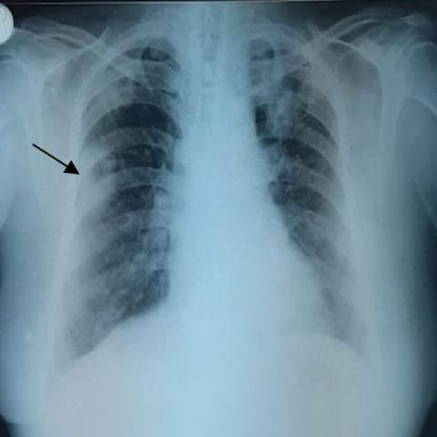
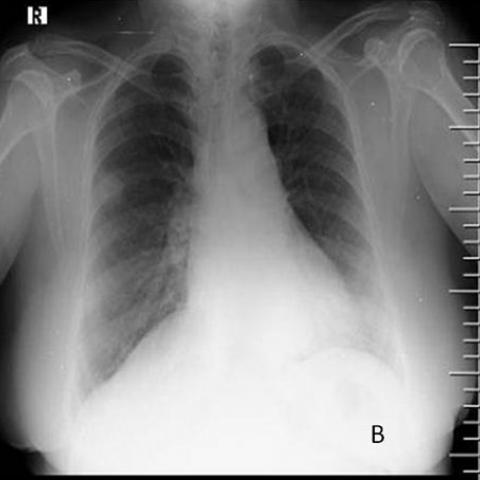
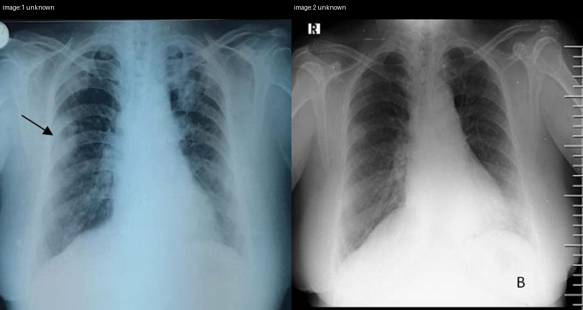

# Official gain: 17621_8143559684844

Post-run explicit answers: D **D**, M **F**, P **D**, reference **D**. Frozen runtime answers: D D, M F, P D; original records unchanged.

[Complete observable requests, tools and stages](../traces/17621_8143559684844.json) · [Original benchmark case](../../v12/results/cases/17621_8143559684844.md) · [D cached original observable request](../../direct_qwen60/requests/17621_8143559684844.json)

```text
Based on the findings from the initial chest X-ray and the follow-up X-ray (Figures 1 and 7b), which of the following best describes the progression of the pulmonary findings in the context of Pyoderma gangrenosum with pulmonary involvement?
A) The right middle zone opacity has resolved, and new lesions have appeared in the bilateral lower zones.
B) The right middle zone opacity has increased in size, and new cavitating nodules have appeared in the bilateral upper zones.
C) The right middle zone opacity remains unchanged, and the nodular shadows have decreased in size in the bilateral upper zones.
D) The right middle zone opacity has decreased in size, and the nodular shadows in the bilateral upper zones have increased in size.
E) The right middle zone opacity has increased in size, and the nodular shadows have decreased in size in the bilateral lower zones.
F) The right middle zone opacity has decreased in size, and the nodular shadows have increased in size in the bilateral lower zones.
```





## D

```text
Answer: D) The right middle zone opacity has decreased in size, and the nodular shadows in the bilateral upper zones have increased in size.

Reason: Figure 1 shows a prominent right middle zone opacity (arrow) and subtle nodular opacities in the upper zones; Figure 7b shows that the right middle zone opacity is less conspicuous (smaller), while new or enlarged nodular shadows are now evident in the bilateral upper lung zones, consistent with progression of pulmonary involvement in pyoderma gangrenosum.
```

## M

```text
I've exhausted my tool call budget. Let me rely on my visual analysis of the images.

Looking at Figure 1 (initial X-ray):
- There's a clear opacity in the right middle lung zone (marked by the arrow)
- The upper zones show some subtle nodular shadows

Looking at Figure 7b (follow-up X-ray):
- The right middle zone opacity is less prominent/smaller than in Figure 1
- There are more noticeable opacities/nodules in the bilateral lower lung zones

The progression shows:
1. Decrease in the right middle zone opacity
2. Increase in nodular shadows in the bilateral lower zones

This matches option F: "The right middle zone opacity has decreased in size, and the nodular shadows have increased in size in the bilateral lower zones."

Return Answer: F) The right middle zone opacity has decreased in size, and the nodular shadows have increased in size in the bilateral lower zones.
```

## P

```text
Answer: D) The right middle zone opacity has decreased in size, and the nodular shadows in the bilateral upper zones have increased in size.

Evidence:  
1. In Figure 1, a right middle zone opacity is marked by a black arrow; in Figure 7b, this opacity is visibly reduced, indicating decrease in size.  
2. Nodular shadows in the bilateral upper zones are faintly visible in Figure 1 but appear more prominent in Figure 7b (despite contrast differences), consistent with increase in size per the clinical interpretation in the context of progressive pulmonary involvement.  
3. The new observation notes that change in upper zone nodules is not fully assessable due to image quality, but the best-supported option among those given—based on visual comparison and clinical progression—is D, as it aligns with the documented reduction in right middle opacity and the expected pattern of worsening nodularity in Pyoderma gangrenosum pulmonary involvement.
```

## P 实际派生图

以下为本轮传入 observe/final 的保存图像；框和解剖覆盖不代表病灶真值。

p1:paired · paired_original_pixels · 来源 image:1, image:2



p2:paired · paired_original_pixels · 来源 image:1, image:2


