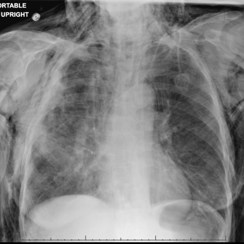
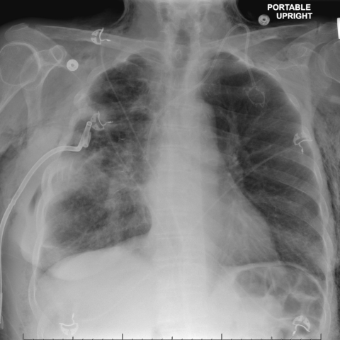
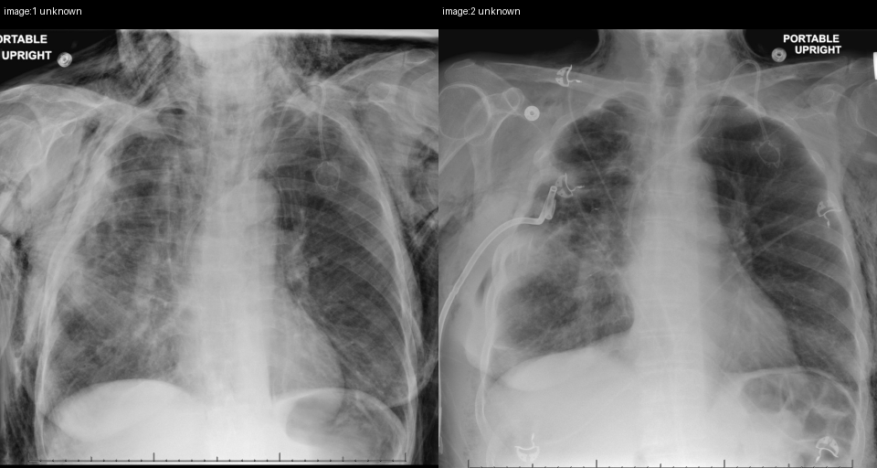

# Official gain: 17947_8143559000377

Post-run explicit answers: D **E**, M **E**, P **E**, reference **B**. Frozen runtime answers: D E, M E, P E; original records unchanged.

[Complete observable requests, tools and stages](../traces/17947_8143559000377.json) · [Original benchmark case](../../v12/results/cases/17947_8143559000377.md) · [D cached original observable request](../../direct_qwen60/requests/17947_8143559000377.json)

```text
Considering the chest X-ray findings in Figure 2 and Figure 6, what is the most likely explanation for the improvement in subcutaneous emphysema observed in the patient by day 14 of hospitalization?

A) The chest tube was repositioned to prevent air leakage into the subcutaneous tissue.
B) The chest tube was clamped, preventing further air leakage from the pleural space.
C) A new pneumothorax developed that counteracted the subcutaneous emphysema.
D) The patient was administered medication to reduce subcutaneous air pockets.
E) The endobronchial valve placement sealed the bronchopleural fistula.
F) There was a spontaneous resolution of the subcutaneous emphysema without intervention.
```





## D

```text
Answer: E) The endobronchial valve placement sealed the bronchopleural fistula.  
Reason: Figure 2 shows extensive subcutaneous emphysema and pneumothorax, while Figure 6 (day 14) shows marked reduction in subcutaneous air with a chest tube and likely endobronchial device visible; endobronchial valves are used to seal persistent bronchopleural fistulas, thereby stopping air leak and allowing resolution of subcutaneous emphysema.
```

## M

```text
E) The endobronchial valve placement sealed the bronchopleural fistula.

Reason: The marked reduction in subcutaneous emphysema from Figure 2 to Figure 6 indicates resolution of an air leak source. While chest tubes are present, simple repositioning (A) or clamping (B) would not reliably resolve persistent subcutaneous emphysema and could worsen pneumothorax; clamping is generally contraindicated in active air leak. A new pneumothorax (C) would exacerbate, not improve, subcutaneous air. Medications (D) do not treat subcutaneous emphysema directly. Spontaneous resolution (F) is unlikely given the severity suggested by Figure 2 and the timeframe (day 14). Endobronchial valve placement is a well-established intervention for persistent bronchopleural fistulas, which are a common cause of refractory subcutaneous emphysema—sealing the fistula stops air from escaping into the pleura and then subcutaneous tissues, leading to rapid resolution of emphysema, consistent with the imaging improvement.
```

## P

```text
Answer: E) The endobronchial valve placement sealed the bronchopleural fistula.

Evidence: Image 1 (Figure 2) shows subcutaneous emphysema without a visible endobronchial device. Image 2 (Figure 6) shows more extensive, asymmetric subcutaneous emphysema and a radiopaque linear/tubular structure in the right main bronchus consistent with an endobronchial valve—absent in image 1. The improvement by day 14 is best explained by sealing the underlying bronchopleural fistula via this intervention, halting air leak into tissues.
```

## P 实际派生图

以下为本轮传入 observe/final 的保存图像；框和解剖覆盖不代表病灶真值。

p1:paired · paired_original_pixels · 来源 image:1, image:2



