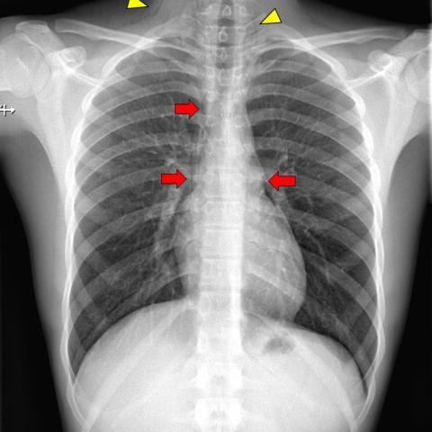
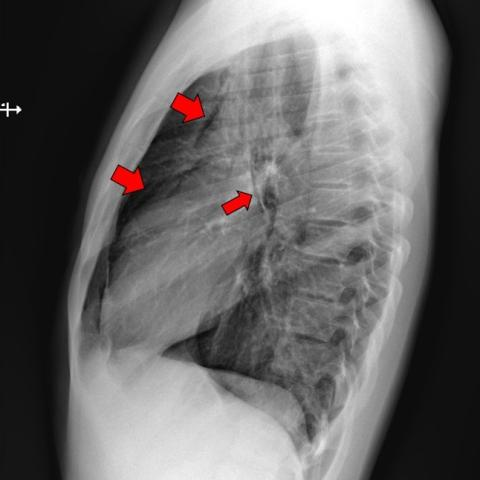
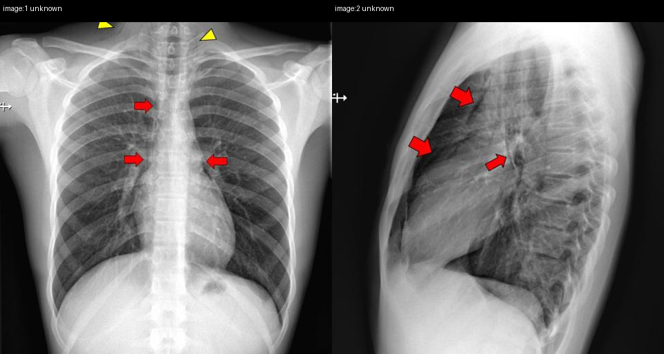

# Official gain: 18001_8143559000935

Post-run explicit answers: D **C**, M **C**, P **C**, reference **C**. Frozen runtime answers: D C, M C, P C; original records unchanged.

[Complete observable requests, tools and stages](../traces/18001_8143559000935.json) · [Original benchmark case](../../v12/results/cases/18001_8143559000935.md) · [D cached original observable request](../../direct_qwen60/requests/18001_8143559000935.json)

```text
Based on the chest X-ray findings in Figure 1a and Figure 1b, which of the following is the most likely diagnosis for the patient's condition, given the clinical history of strong coughing attacks and the physical exam findings?
A) Pneumonia with subcutaneous emphysema
B) Pneumothorax with subcutaneous emphysema
C) Spontaneous pneumomediastinum with subcutaneous emphysema
D) Pneumopericardium with subcutaneous emphysema
E) Mediastinitis with subcutaneous emphysema
F) Oesophageal rupture with subcutaneous emphysema
```





## D

```text
Answer: C) Spontaneous pneumomediastinum with subcutaneous emphysema  
Reason: Figures 1a and 1b show air in the mediastinum (red arrows outlining lucent streaks along the heart border and aorta) and subcutaneous air in the neck (yellow arrowheads in Fig. 1a), without evidence of lung collapse or pleural air, which favors spontaneous pneumomediastinum—commonly triggered by forceful coughing—and associated subcutaneous emphysema.
```

## M

```text
I've exhausted my tool budget. Let me rely on my clinical reasoning based on the visual evidence and the limited tool outputs.

From my visual analysis:
- The yellow arrows in Figure 1a point to subcutaneous emphysema (air in neck/upper chest soft tissues)
- The red arrows in both figures point to air in the mediastinum (pneumomediastinum)
- The lateral view (Figure 1b) clearly shows the classic "continuous diaphragm sign" or "ring around the heart" appearance of pneumomediastinum
- The clinical history of "strong coughing attacks" is the classic precipitant for spontaneous pneumomediastinum

While the automated tools gave conflicting results (the report generator said "no pneumothorax" and "mediastinum within normal limits"), the xray_phrase_grounding did identify pneumomediastinum, and my visual assessment confirms this finding.

Among the options:
A) Pneumonia with subcutaneous emphysema - No infiltrates suggesting pneumonia
B) Pneumothorax with subcutaneous emphysema - No visible pleural line or lung collapse
C) Spontaneous pneumomediastinum with subcutaneous emphysema - Matches the findings perfectly
D) Pneumopericardium with subcutaneous emphysema - Air would be specifically around the heart, not throughout mediastinum
E) Mediastinitis with subcutaneous emphysema - Would show signs of infection/inflammation, not just air
F) Oesophageal rupture with subcutaneous emphysema - Would typically have more severe clinical presentation and possibly pleural effusion

The most likely diagnosis is C) Spontaneous pneumomediastinum with subcutaneous emphysema, given the classic radiographic findings and the history of forceful coughing.

Return Answer: C followed by a short reason.
```

## P

```text
Answer: C) Spontaneous pneumomediastinum with subcutaneous emphysema  
Evidence: Lucent streaks outline the heart border and aorta on the PA view (Figure 1a), consistent with mediastinal air, without pleural line or lung collapse; on the lateral view (Figure 1b), air extends from the mediastinum into the neck subcutaneously with no evident pleural air; clinical history of strong coughing attacks supports spontaneous etiology.
```

## P 实际派生图

以下为本轮传入 observe/final 的保存图像；框和解剖覆盖不代表病灶真值。

p2:paired · paired_original_pixels · 来源 image:1, image:2



