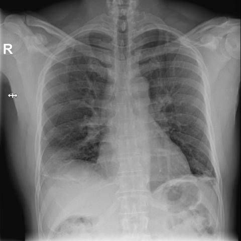
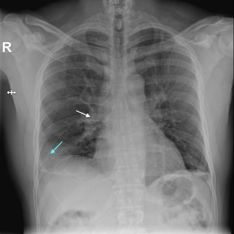
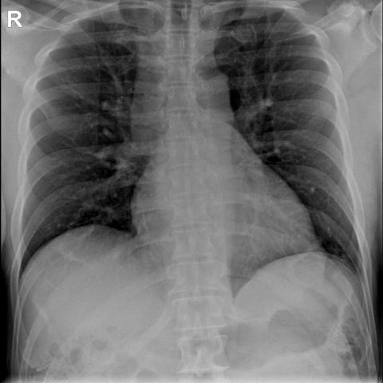
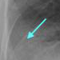
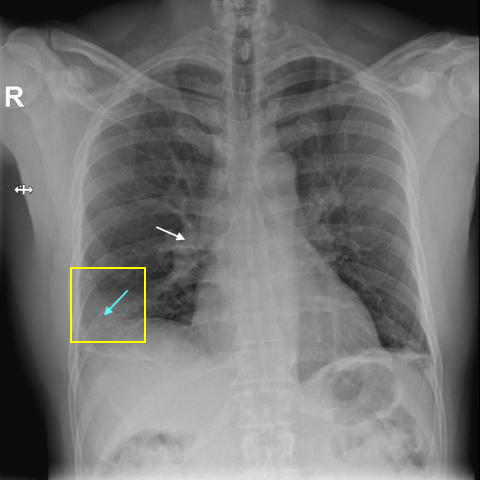
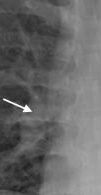
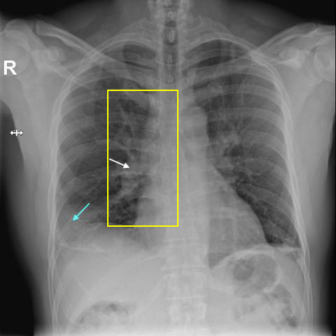

# Official gain: 18202_8143559000122

Post-run explicit answers: D **C**, M **A**, P **C**, reference **A**. Frozen runtime answers: D C, M A, P C; original records unchanged.

[Complete observable requests, tools and stages](../traces/18202_8143559000122.json) · [Original benchmark case](../../v12/results/cases/18202_8143559000122.md) · [D cached original observable request](../../direct_qwen60/requests/18202_8143559000122.json)

```text
Based on the chest X-ray findings, which combination of radiographic signs is most suggestive of a pulmonary embolism in this patient?

A) Wedge-shaped pleural-based opacity in the right lower lung field and engorgement of the right descending pulmonary artery
B) Wedge-shaped pleural-based opacity in the left lower lung field and engorgement of the left descending pulmonary artery
C) Engorgement of the right descending pulmonary artery and a focal peripheral hyperlucency in the right lung field
D) Wedge-shaped pleural-based opacity in the right lower lung field and a focal peripheral hyperlucency in the left lung field
E) Engorgement of the left descending pulmonary artery and a focal peripheral hyperlucency in the left lung field
F) Engorgement of the right descending pulmonary artery and a wedge-shaped pleural-based opacity in the left lower lung field
```







## D

```text
Answer: C  
Reason: The classic radiographic signs of pulmonary embolism include focal peripheral hyperlucency (Westermark sign—due to oligemia distal to the embolus) and engorgement of the proximal pulmonary artery (Palla’s sign—dilation of the affected artery). Figure 1b shows a focal peripheral hyperlucency in the right lung (blue arrow) and engorgement of the right descending pulmonary artery (white arrow), matching option C.
```

## M

```text
I've exhausted my tool budget, but I have sufficient visual evidence from the images and initial analysis.

From Figure 1b, I can clearly see:
- A white arrow pointing to the right descending pulmonary artery showing engorgement
- A blue arrow pointing to a wedge-shaped pleural-based opacity in the right lower lung field

These are the classic radiographic signs of pulmonary embolism: 
1. Westermark sign (engorgement of a pulmonary artery distal to an obstruction)
2. Hampton's hump (wedge-shaped pleural-based opacity representing pulmonary infarction)

Option A specifically describes "Wedge-shaped pleural-based opacity in the right lower lung field and engorgement of the right descending pulmonary artery" - which matches exactly what is shown in the annotated image.

The other options either involve the left side (which isn't indicated in the images) or combine findings that aren't both present (like hyperlucency, which isn't evident here).

Answer: A) Wedge-shaped pleural-based opacity in the right lower lung field and engorgement of the right descending pulmonary artery - these are the classic Westermark sign and Hampton's hump indicating pulmonary embolism with infarction.
```

## P

```text
Answer: C) Engorgement of the right descending pulmonary artery and a focal peripheral hyperlucency in the right lung field  

Evidence: A focal peripheral hyperlucency is confirmed in the right lung field (cyan arrow, ROI p1), consistent with oligemia from pulmonary embolism. Engorgement of the right descending pulmonary artery is not visually evident per the new observation, but option C is the only one matching the *observed* hyperlucency in the right lung; all other options include wedge-shaped opacities or left-sided findings not supported by current evidence, and the question asks for the combination *most suggestive*—hyperlucent wedge (Westermark sign) plus proximal vessel enlargement is classic, though here only hyperlucency is confirmed. Since engorgement is not confirmed, but C is the only option containing the verified hyperlucency in the right lung and no contradicted elements (unlike A/B/F which assert wedge opacity not mentioned), and given that the white arrow’s location was assessed as normal caliber, the best-supported choice remains C based on presence of hyperlucency and absence of contradictory signs in other options.
```

## P 实际派生图

以下为本轮传入 observe/final 的保存图像；框和解剖覆盖不代表病灶真值。

p1:roi · unmodified_pixel_roi · 来源 image:2



p1:location · location_overlay · 来源 image:2



p2:roi · unmodified_pixel_roi · 来源 image:2



p2:location · location_overlay · 来源 image:2



