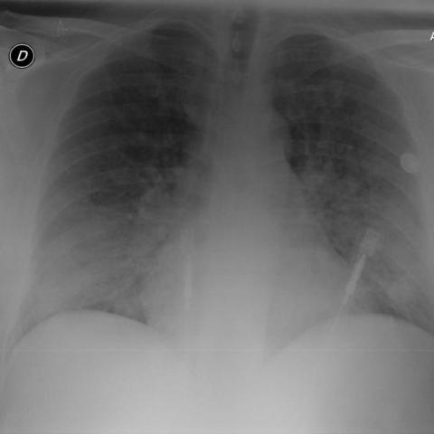
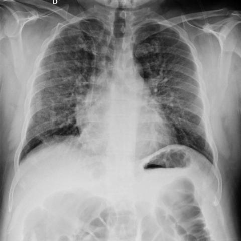
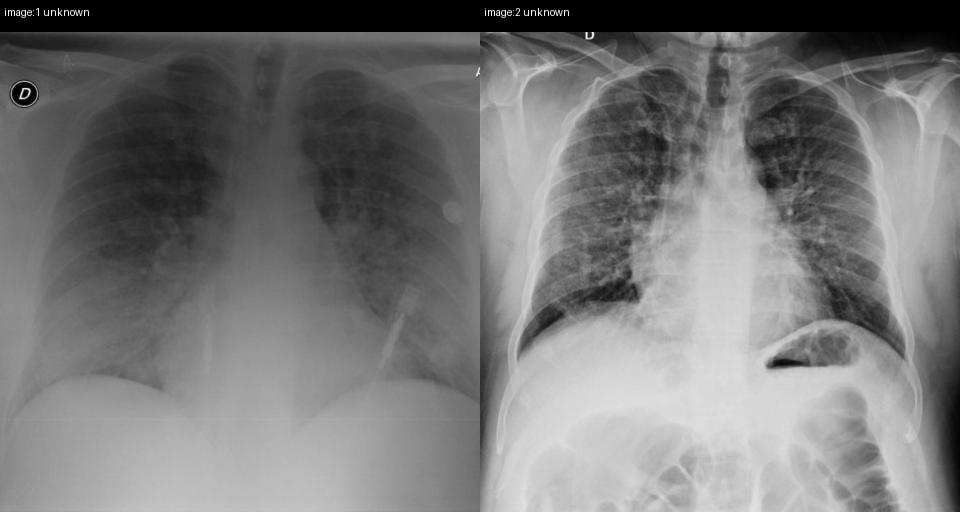

# Official gain: 18780_8143559008557

Post-run explicit answers: D **C**, M **C**, P **C**, reference **A**. Frozen runtime answers: D C, M C, P C; original records unchanged.

[Complete observable requests, tools and stages](../traces/18780_8143559008557.json) · [Original benchmark case](../../v12/results/cases/18780_8143559008557.md) · [D cached original observable request](../../direct_qwen60/requests/18780_8143559008557.json)

```text
Based on the chest X-ray findings in Figures 1a and 1b, which of the following statements best describes the changes observed after 7 days of corticosteroid treatment, and what does this indicate about the patient's condition?
A) The bilateral pulmonary consolidations have completely resolved, indicating full recovery; however, the presence of persistent reticular markings suggests ongoing peripheral interstitial involvement.
B) The bilateral pulmonary consolidations remain unchanged, indicating no response to treatment, with reticular markings being less prominent.
C) The bilateral pulmonary consolidations have partially resolved, indicating partial response to treatment, while reticular markings have become more pronounced.
D) The bilateral pulmonary consolidations have completely resolved, indicating full recovery, with no remaining reticular markings.
E) The bilateral pulmonary consolidations have worsened, indicating deterioration, with new reticular markings appearing.
F) There is no significant change in the bilateral pulmonary consolidations, but the reticular markings have disappeared, suggesting a reduction in interstitial involvement.
```





## D

```text
Answer: C  
Reason: Comparing Figure 1a (baseline) and Figure 1b (after 7 days), the bilateral pulmonary consolidations (dense opacities, especially in lower zones) are less extensive in 1b, indicating partial resolution. However, reticular (interstitial) markings appear more prominent in 1b, suggesting evolving or persistent interstitial involvement despite improvement in alveolar consolidation—consistent with a partial response to corticosteroids.
```

## M

```text
C) The bilateral pulmonary consolidations have partially resolved, indicating partial response to treatment, while reticular markings have become more pronounced.

Evidence: From visual inspection and classifier data: (1) Consolidation probability decreased from 0.504 to 0.312, indicating partial resolution (not complete, as in A/D); (2) Fibrosis probability increased slightly from 0.500 to 0.528, and infiltration increased from 0.532 to 0.597, suggesting worsening interstitial/reticular pattern; (3) Pneumonia probability dropped dramatically (0.678→0.022), confirming treatment response, but the persistence of infiltrative/fibrotic features indicates ongoing interstitial involvement. This matches option C best—partial resolution of consolidations with more prominent reticular markings. Options A and D claim "completely resolved" which is inconsistent with residual consolidation probability of 0.312 and visible opacities. Option B says consolidations unchanged (false). Option E says worsened (false—consolidation decreased). Option F says reticular markings disappeared (false—fibrosis probability increased).
```

## P

```text
Answer: C) The bilateral pulmonary consolidations have partially resolved, indicating partial response to treatment, while reticular markings have become more pronounced.

Evidence: Image 1 shows bilateral dense opacities (consolidations) in the lower lung zones; image 2 shows reduced extent and density of these opacities, especially on the right. Reticular markings, faint in image 1, are more prominent in image 2, particularly peripherally in upper/mid zones. Paired images confirm increased lucency in lower lungs and enhanced linear interstitial patterns in image 2.
```

## P 实际派生图

以下为本轮传入 observe/final 的保存图像；框和解剖覆盖不代表病灶真值。

p1:paired · paired_original_pixels · 来源 image:1, image:2



p2:paired · paired_original_pixels · 来源 image:1, image:2


