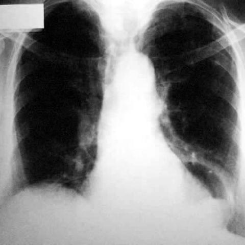
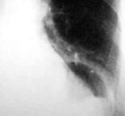
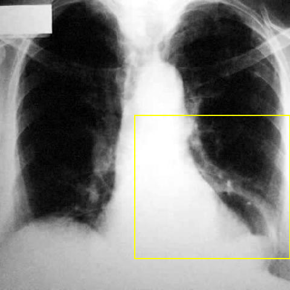

# Official gain: 1975_8353802257622

Post-run explicit answers: D **B**, M **B**, P **B**, reference **B**. Frozen runtime answers: D B, M B, P B; original records unchanged.

[Complete observable requests, tools and stages](../traces/1975_8353802257622.json) · [Original benchmark case](../../v12/results/cases/1975_8353802257622.md) · [D cached original observable request](../../direct_qwen60/requests/1975_8353802257622.json)

```text
Based on the chest X-ray in Figure 1, which of the following statements best describes the characteristics and relationships of the cystic lesion and irregular mass in the left paracardiac area that are consistent with a mixed-type hiatal hernia?
A) The cystic lesion is centrally located and directly compresses the heart, while the irregular mass is entirely below the diaphragm, suggesting a paraoesophageal hernia.
B) The cystic lesion has a smooth margin and is located superior to the irregular mass, which extends from the mediastinal area to the left paracardiac area, consistent with a mixed-type hiatal hernia.
C) The irregular mass is located above the cystic lesion and does not extend to the mediastinal area, indicating a sliding hernia.
D) Both the cystic lesion and the irregular mass are entirely within the right hemithorax, unrelated to a hiatal hernia.
E) The cystic lesion is irregular and located inferiorly, with the mass positioned superiorly in the left lung apex, suggesting a pulmonary cystic lesion.
F) The irregular mass is centrally located, and the cystic lesion is found bilaterally, consistent with a diaphragmatic hernia.
```



## D

```text
Answer: B  
Reason: In a mixed-type hiatal hernia, a portion of the stomach (often gas-filled, appearing cystic with smooth margins) herniates above the diaphragm, while a solid component (e.g., gastric wall or associated mass) may extend from the mediastinum into the left paracardiac region. Figure 1 shows a radiolucent (cystic-appearing) structure superiorly near the left heart border and an irregular soft-tissue density extending from the mediastinum into the left paracardiac area—consistent with this configuration. Option B correctly describes this spatial relationship and morphology.
```

## M

```text
I've exhausted my tool budget, but I have sufficient information to make a determination.

Based on my visual analysis of the chest X-ray and the tool outputs:
- The phrase grounding confirms a hiatal hernia in the lower mediastinum/left paracardiac region
- The paracardiac mass is identified in a larger area that includes the left paracardiac region
- Visually, there's a cystic (radiolucent) component superiorly and an irregular (more opaque) mass inferiorly in the left paracardiac area
- In mixed-type hiatal hernias, we typically see both sliding components (creating a cystic appearance from gas-filled stomach) and paraesophageal components (creating an irregular mass from gastric wall/tissue)

Option B correctly describes this relationship: "The cystic lesion has a smooth margin and is located superior to the irregular mass, which extends from the mediastinal area to the left paracardiac area, consistent with a mixed-type hiatal hernia."

The other options are incorrect:
- A suggests the irregular mass is entirely below the diaphragm, which isn't consistent with the findings
- C suggests the irregular mass is above the cystic lesion, which contradicts the visual evidence
- D places both structures in the right hemithorax, but they're clearly in the left
- E reverses the positions and suggests a pulmonary origin, which doesn't fit
- F describes bilateral findings, but the abnormalities are localized to the left side

Return Answer: B) The cystic lesion has a smooth margin and is located superior to the irregular mass, which extends from the mediastinal area to the left paracardiac area, consistent with a mixed-type hiatal hernia.
```

## P

```text
Answer: B) The cystic lesion has a smooth margin and is located superior to the irregular mass, which extends from the mediastinal area to the left paracardiac area, consistent with a mixed-type hiatal hernia.

Evidence: The new observation states the cystic-appearing radiolucency is superior and slightly medial to the irregular soft-tissue density, with a sharply demarcated, smooth margin, while the soft-tissue density shows indistinct, spiculated margins. Both are in the left paracardiac region, and the soft-tissue density extends from the mediastinal area into the left paracardiac region—features compatible with a mixed-type hiatal hernia (containing both gastric fundus/air-filled sac and solid components like stomach wall or omentum). Option B correctly captures these spatial and morphological relationships.
```

## P 实际派生图

以下为本轮传入 observe/final 的保存图像；框和解剖覆盖不代表病灶真值。

p1:roi · unmodified_pixel_roi · 来源 image:1



p1:location · location_overlay · 来源 image:1



p2:roi · unmodified_pixel_roi · 来源 image:1


p2:location · location_overlay · 来源 image:1


