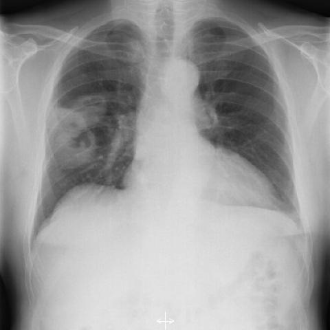
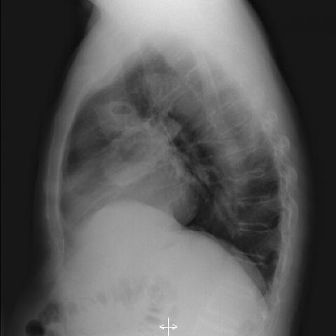
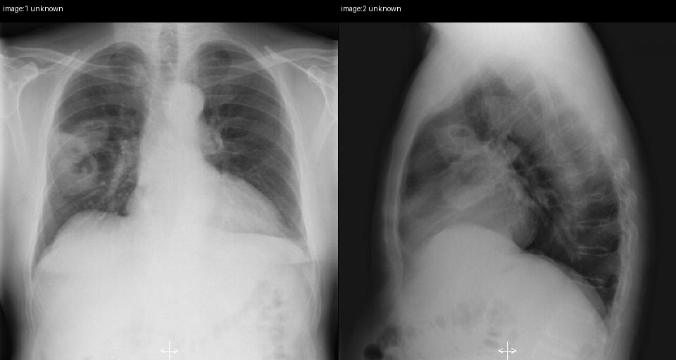

# Official gain: 2243_8353801511231

Post-run explicit answers: D **C**, M **C**, P **C**, reference **C**. Frozen runtime answers: D C, M C, P C; original records unchanged.

[Complete observable requests, tools and stages](../traces/2243_8353801511231.json) · [Original benchmark case](../../v12/results/cases/2243_8353801511231.md) · [D cached original observable request](../../direct_qwen60/requests/2243_8353801511231.json)

```text
Based on the chest X-ray findings in Figure 1a and Figure 1b, which of the following best explains the radiographic features that support the diagnosis of Wegener's granulomatosis in this patient?
A) The presence of bilateral pleural effusions, which are common in Wegener's granulomatosis.
B) Solitary nodular mass with smooth margins, typical of Wegener's granulomatosis.
C) Multiple nodular masses with irregular margins and cavitation in the right lung, consistent with necrotising granulomatous vasculitis.
D) Diffuse bilateral interstitial infiltrates, which are a hallmark of Wegener's granulomatosis.
E) Left lung involvement with dense consolidation and air bronchograms, indicating Wegener's granulomatosis.
F) Mediastinal lymphadenopathy, which is a common finding in Wegener's granulomatosis.
```





## D

```text
Answer: C  
Reason: Figures 1a and 1b show multiple nodular opacities in the right lung with irregular margins and central lucency (cavitation), which are classic radiographic features of necrotising granulomatous vasculitis in granulomatosis with polyangiitis (formerly Wegener’s granulomatosis). Pleural effusions, smooth-margined solitary masses, diffuse interstitial infiltrates, dense consolidation with air bronchograms, and mediastinal lymphadenopathy are not typical primary manifestations of this condition.
```

## M

```text
I've exhausted my tool budget. Let me analyze what I have so far and use my medical knowledge.

From the available information:
- Figure 1a shows a large mass in the right upper lobe (3.2 x 3.9 cm)
- The classifier shows high probability for "Mass" (0.67) and "Nodule" (0.56)
- The report describes it as a "large rounded mass" and "stable right upper lobe nodule"

Now, let me recall the characteristic radiographic features of Wegener's granulomatosis (Granulomatosis with Polyangiitis):
- Multiple pulmonary nodules (not solitary)
- Nodules often have irregular margins
- Cavitation is common (due to necrotizing granulomatous vasculitis)
- Can be bilateral but often asymmetric
- Pleural effusions are uncommon in GPA (they're more typical of other conditions like lupus or heart failure)

Looking at the options:
A) Bilateral pleural effusions - but the report specifically says "no pleural effusion"
B) Solitary nodular mass with smooth margins - GPA typically presents with multiple nodules, not solitary, and they often have irregular margins
C) Multiple nodular masses with irregular margins and cavitation in the right lung - this matches the classic description of GPA
D) Diffuse bilateral interstitial infiltrates - not typical for GPA; more characteristic of sarcoidosis or hypersensitivity pneumonitis
E) Left lung involvement with dense consolidation - the findings are in the right lung, not left
F) Mediastinal lymphadenopathy - not mentioned in the report and not typical for GPA

The key issue is whether the finding is solitary or multiple, and whether there's cavitation. The report calls it a "large rounded mass" and "stable right upper lobe nodule," which suggests a single lesion. However, in GPA, even if one lesion is prominent, there are often multiple lesions.

Given that option C specifically mentions "multiple nodular masses with irregular margins and cavitation" which is the classic radiographic presentation of GPA, and considering that chest X-rays may not show all lesions (especially small ones), and that the high mass probability (0.67) could represent a cavitary lesion appearing as a mass on X-ray, I believe C is the best answer.

Wegener's granulomatosis classically presents with multiple pulmonary nodules that can cavitate due to necrotizing granulomatous vasculitis, which is exactly what option C describes.

Return Answer: C) Multiple nodular masses with irregular margins and cavitation in the right lung, consistent with necrotising granulomatous vasculitis.
```

## P

```text
Answer: C) Multiple nodular masses with irregular margins and cavitation in the right lung, consistent with necrotising granulomatous vasculitis.

Evidence: Frontal (Figure 1a) and lateral (Figure 1b) views both show multiple nodular opacities in the right lung with irregular margins and central lucency (cavitation), confirmed by expert tool localization of two cavitary nodules; no pleural effusions or mediastinal lymphadenopathy are present. These features align with necrotising granulomatous vasculitis seen in Wegener’s granulomatosis (now GPA).
```

## P 实际派生图

以下为本轮传入 observe/final 的保存图像；框和解剖覆盖不代表病灶真值。

p1:paired · paired_original_pixels · 来源 image:1, image:2



