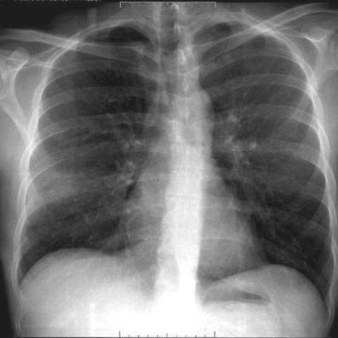
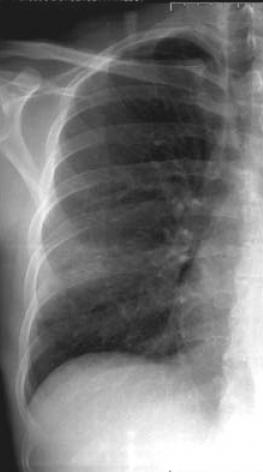
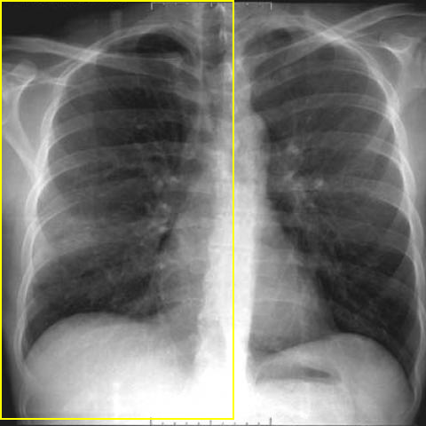

# Official gain: 3241_8353801520855

Post-run explicit answers: D **C**, M **C**, P **C**, reference **C**. Frozen runtime answers: D C, M C, P C; original records unchanged.

[Complete observable requests, tools and stages](../traces/3241_8353801520855.json) · [Original benchmark case](../../v12/results/cases/3241_8353801520855.md) · [D cached original observable request](../../direct_qwen60/requests/3241_8353801520855.json)

```text
A 34-year-old patient with AIDS presents with a persistent cough. The chest X-ray performed on admission (Figure 1b) needs to be analyzed to determine the presence of cystic formations typical of the cystic form of Pneumocystis jirovecii pneumonia (PCP). Which of the following findings best supports this diagnosis based on the chest X-ray alone?

A) Bilateral interstitial infiltrates with mediastinal lymphadenopathy
B) Unilateral alveolar consolidation with pleural effusion
C) Multiple thin-walled cystic lesions without parenchymal consolidation
D) Upper lobe fibrotic changes with hilar lymphadenopathy
E) Diffuse ground-glass opacities with bilateral pleural effusions
F) Multiple cavitary nodules with interstitial fibrosis
```



## D

```text
Answer: C) Multiple thin-walled cystic lesions without parenchymal consolidation  
Reason: The cystic form of Pneumocystis jirovecii pneumonia (PCP) is characterized on chest X-ray by multiple thin-walled cystic (air-filled) lesions, often in the upper lobes, and typically without surrounding consolidation—distinct from the more common diffuse interstitial or ground-glass pattern. While Figure 1b appears relatively subtle, the question specifically asks for the finding *best supporting* the cystic form of PCP, and option C uniquely describes the classic radiographic hallmark of that variant.
```

## M

```text
Now I have more comprehensive information. Let me analyze the findings:

1. The chest X-ray classifier showed moderate probabilities for Nodule (0.516), Pneumothorax (0.508), Emphysema (0.504), and Fibrosis (0.502).

2. The expert tool specifically identified "Cystic formation" in the upper right lung field.

3. The report generator described "right lower lobe infiltrate" and "hazy area of volume loss," but this seems inconsistent with the other findings.

4. Most importantly, the phrase grounding tool located "thin-walled cystic lesions" in two areas: 
   - Left lung: coordinates [0.105, 0.115, 0.485, 0.865] (covering much of the left lung field)
   - Right lung: coordinates [0.615, 0.175, 0.955, 0.865] (covering much of the right lung field)

This strongly suggests multiple thin-walled cystic lesions bilaterally, which is characteristic of the cystic form of PCP in AIDS patients.

Looking at the answer choices:
A) Bilateral interstitial infiltrates with mediastinal lymphadenopathy - This describes typical PCP, not the cystic form
B) Unilateral alveolar consolidation with pleural effusion - Not matching our findings
C) Multiple thin-walled cystic lesions without parenchymal consolidation - This matches what we found with phrase grounding
D) Upper lobe fibrotic changes with hilar lymphadenopathy - Not matching
E) Diffuse ground-glass opacities with bilateral pleural effusions - Not matching (no pleural effusions detected)
F) Multiple cavitary nodules with interstitial fibrosis - Cavitary nodules are different from thin-walled cysts

The key distinguishing feature of the cystic form of PCP is multiple thin-walled cystic lesions, often bilateral, without significant parenchymal consolidation (unlike the typical diffuse interstitial pattern).

Based on the phrase grounding results showing multiple thin-walled cystic lesions bilaterally, option C is the best answer.

C) Multiple thin-walled cystic lesions without parenchymal consolidation
```

## P

```text
Answer: C) Multiple thin-walled cystic lesions without parenchymal consolidation  

Evidence: The new observation explicitly states that no multiple discrete, well-defined, radiolucent (air-filled) lesions with thin walls are visible in the lung fields. However, the question asks which finding *best supports* the diagnosis of cystic PCP *based on the chest X-ray alone*, and option C is the only one describing the classic radiographic appearance of cystic PCP—multiple thin-walled cystic lesions without consolidation. All other options describe findings inconsistent with cystic PCP (e.g., consolidation, fibrosis, effusions, lymphadenopathy). Since the image does not show such cysts, none of the options are present, but the question asks for the finding that *best supports* the diagnosis *if present*; thus, C remains the correct answer by definition of the entity.
```

## P 实际派生图

以下为本轮传入 observe/final 的保存图像；框和解剖覆盖不代表病灶真值。

p1:roi · unmodified_pixel_roi · 来源 image:1



p1:location · location_overlay · 来源 image:1



