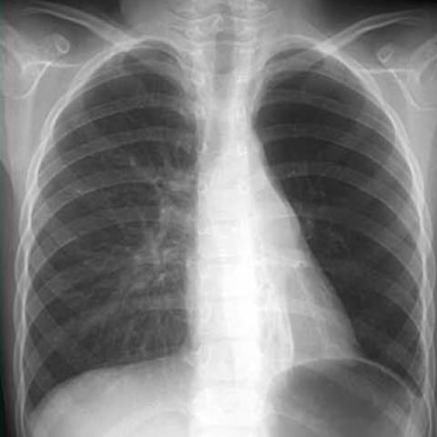
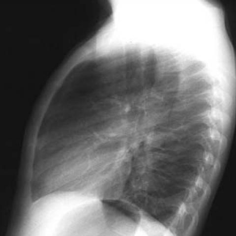
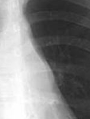
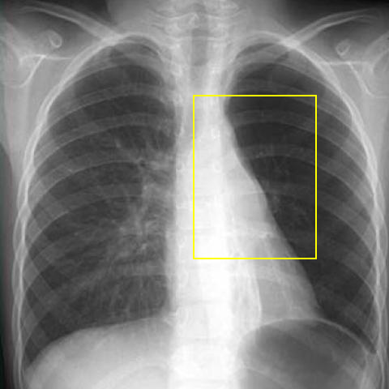

# Official gain: 3359_8353801515597

Post-run explicit answers: D **D**, M **D**, P **A**, reference **B**. Frozen runtime answers: D D, M D, P A; original records unchanged.

[Complete observable requests, tools and stages](../traces/3359_8353801515597.json) · [Original benchmark case](../../v12/results/cases/3359_8353801515597.md) · [D cached original observable request](../../direct_qwen60/requests/3359_8353801515597.json)

```text
Based on the conventional chest radiographs, what is the most likely explanation for the patient's clinical presentation of recurrent bronchial pneumonia and defective thorax development?
A) The hyperlucent left lung with bronchiectasis indicates Mac-Leod syndrome, with the anterior mediastinal mass unrelated.
B) The hyperlucent left lung with bronchiectasis and the anterior mediastinal mass suggest a bronchogenic cyst causing tracheobronchial compression.
C) The anterior mediastinal mass is likely benign and unrelated to the pulmonary findings.
D) The hyperlucent left lung with bronchiectasis is a result of bronchogenic cyst compression on the left main bronchus.
E) The presence of the mass in the anterior mediastinum suggests a malignant process unrelated to the lung findings.
F) The findings indicate a bilateral process inconsistent with Mac-Leod syndrome.
```





## D

```text
Answer: D  
Reason: The chest radiographs show a hyperlucent left lung with volume loss and bronchiectasis, consistent with chronic airway obstruction; the anterior mediastinal mass is positioned to compress the left main bronchus, which can cause distal air trapping, recurrent infection, and defective thoracic development—classic for bronchogenic cyst-induced extrinsic compression. Option D directly links the mass to the pulmonary findings, which best fits the clinical picture.
```

## M

```text
Since I've exhausted the tool budget, I need to rely on my clinical reasoning with the available information.

From my visual analysis and the xray_phrase_grounding results that confirmed both "hyperlucent left lung" and "anterior mediastinal mass", the key findings are:
- Unilateral hyperlucency of the left lung (indicating air trapping/overdistension)
- Anterior mediastinal mass
- Clinical history of recurrent bronchial pneumonia and defective thorax development

In congenital conditions, a bronchogenic cyst in the anterior mediastinum can compress the left main bronchus, leading to:
- Chronic airway obstruction
- Air trapping and hyperlucency on the affected side
- Recurrent infections due to impaired secretion clearance
- Defective thorax development from chronic asymmetric lung growth

MacLeod syndrome (Swyer-James) is typically post-infectious and doesn't involve a mediastinal mass. The presence of the mass makes options A, C, and E less likely.

Option D specifically states: "The hyperlucent left lung with bronchiectasis is a result of bronchogenic cyst compression on the left main bronchus" - this provides a direct causal relationship that fits the pathophysiology.

Option B mentions "bronchogenic cyst causing tracheobronchial compression" but is less specific about which bronchus is affected.

Given the left-sided findings, option D is the most precise and clinically accurate explanation.

Return Answer: D) The hyperlucent left lung with bronchiectasis is a result of bronchogenic cyst compression on the left main bronchus.
```

## P

```text
Answer: A) The hyperlucent left lung with bronchiectasis indicates Mac-Leod syndrome, with the anterior mediastinal mass unrelated.

Evidence:  
1) The left lung is hyperlucent with reduced vascular markings and mild volume loss, consistent with unilateral hyperlucent lung syndrome (e.g., MacLeod syndrome), though definitive tram-track or ring shadows of bronchiectasis are not confirmed on either view.  
2) No discrete anterior mediastinal mass is clearly visualized; the yellow box highlights the right mediastinal border, and no abutment/compression of the left main bronchus is confirmed.  
3) Given absence of a demonstrable compressive mass and presence of unilateral hyperlucency with volume loss, MacLeod syndrome (congenital lobar emphysema or post-infectious bronchiolitis obliterans) remains the most plausible explanation for recurrent pneumonia and thoracic asymmetry.
```

## P 实际派生图

以下为本轮传入 observe/final 的保存图像；框和解剖覆盖不代表病灶真值。

p1:roi · unmodified_pixel_roi · 来源 image:1



p1:location · location_overlay · 来源 image:1



