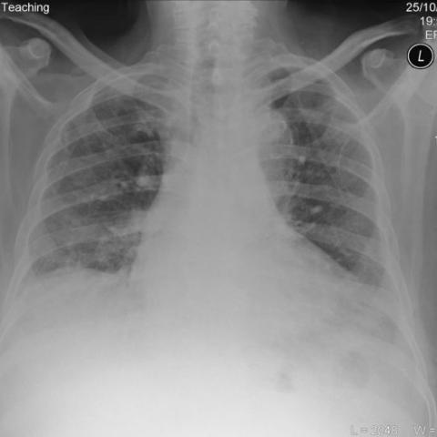
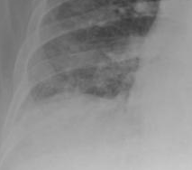
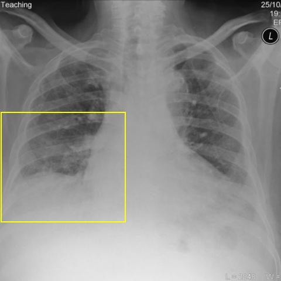
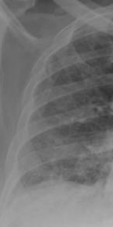
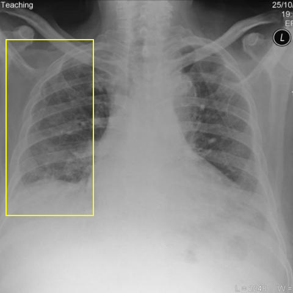

# Official gain: 3397_8353801520783

Post-run explicit answers: D **C**, M **C**, P **C**, reference **C**. Frozen runtime answers: D C, M C, P C; original records unchanged.

[Complete observable requests, tools and stages](../traces/3397_8353801520783.json) · [Original benchmark case](../../v12/results/cases/3397_8353801520783.md) · [D cached original observable request](../../direct_qwen60/requests/3397_8353801520783.json)

```text
Based on the chest X-ray findings in Figure 1, which of the following best describes the location and characteristics of the lung abnormalities observed, and how do they correlate with the patient's clinical presentation?
A) Bibasal reticulonodular shadowing with predominantly central distribution, suggesting pulmonary edema.
B) Upper lobe reticulonodular shadowing with cavitations, indicating possible pulmonary tuberculosis.
C) Bibasal interstitial reticulonodular shadowing with peripheral distribution, consistent with interstitial lung disease.
D) Diffuse alveolar opacities with ground glass appearance, typical of acute respiratory distress syndrome.
E) Unilateral upper lobe reticulonodular pattern, raising suspicion for a malignant process.
F) Central perihilar opacities with nodular characteristics, suggesting sarcoidosis.
```



## D

```text
Answer: C) Bibasal interstitial reticulonodular shadowing with peripheral distribution, consistent with interstitial lung disease.  
Reason: The chest X-ray (Figure 1) shows bilateral, predominantly basal reticulonodular opacities with a peripheral (subpleural) predominance and relative sparing of the upper lobes—classic for interstitial lung disease (e.g., idiopathic pulmonary fibrosis or connective tissue disease–associated ILD). This pattern differs from the central/perihilar distribution of edema or sarcoidosis, upper-lobe cavitary disease of TB, or diffuse alveolar patterns of ARDS.
```

## M

```text
Looking at the tool outputs, I need to critically evaluate them against my visual assessment:

The classifier shows high probabilities for:
- Lung Opacity (0.806) - confirms significant abnormalities
- Fibrosis (0.550) - suggests interstitial process
- Effusion (0.654) - but the report generator says "no definite pleural effusion"
- Atelectasis (0.574) and Infiltration (0.589)

However, the report generator states "the lungs appear clear" and "mild pulmonary edema" - this contradicts my visual assessment of clear bibasal reticulonodular shadowing.

The xray_phrase_grounding tool successfully located "Bibasal reticulonodular shadowing" with bounding boxes in both lower lung zones (left: 0.055-0.365 x 0.515-0.745, right: 0.595-0.895 x 0.485-0.745), confirming my visual observation.

The segmentation shows the lung fields but with low confidence scores (0.18), likely because this is a JPEG image rather than DICOM.

My visual analysis remains consistent: bilateral basal reticulonodular opacities with peripheral distribution. This pattern is classic for interstitial lung disease (ILD), particularly conditions like idiopathic pulmonary fibrosis or connective tissue disease-associated ILD.

Option C states: "Bibasal interstitial reticulonodular shadowing with peripheral distribution, consistent with interstitial lung disease" - this matches my findings perfectly.

The other options don't fit:
- A) Pulmonary edema would be more central/perihilar, not peripheral
- B) TB would show upper lobe predominance with cavitations
- D) ARDS shows diffuse ground-glass, not reticulonodular
- E) Malignancy would be unilateral
- F) Sarcoidosis shows perihilar lymphadenopathy

Return Answer: C) Bibasal interstitial reticulonodular shadowing with peripheral distribution, consistent with interstitial lung disease.
```

## P

```text
Answer: C) Bibasal interstitial reticulonodular shadowing with peripheral distribution, consistent with interstitial lung disease.

Evidence: Reticulonodular opacities are confirmed in bilateral lower lung zones (pixel boxes [26,213,189,357] and [266,223,429,367]) and also in peripheral/subpleural regions ([26,98,136,319] and [324,160,429,319]). The pattern lacks central/perihilar predominance and shows mixed but predominantly basal and peripheral involvement—key features of interstitial lung disease. No cavitations, ground-glass opacities, or unilateral/malignant features are present to support other options.
```

## P 实际派生图

以下为本轮传入 observe/final 的保存图像；框和解剖覆盖不代表病灶真值。

p1:roi · unmodified_pixel_roi · 来源 image:1



p1:location · location_overlay · 来源 image:1



p2:roi · unmodified_pixel_roi · 来源 image:1



p2:location · location_overlay · 来源 image:1



