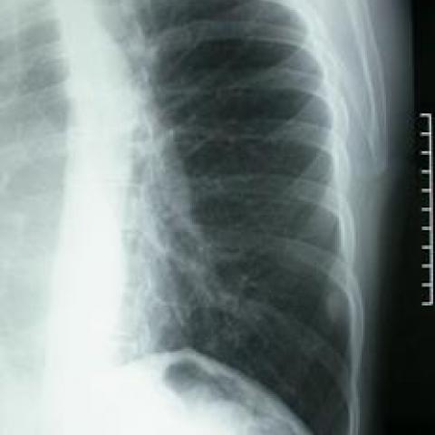
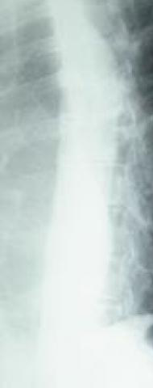
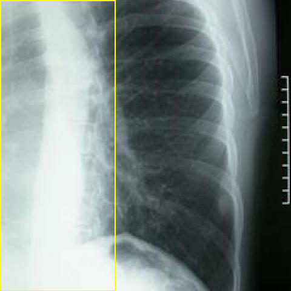
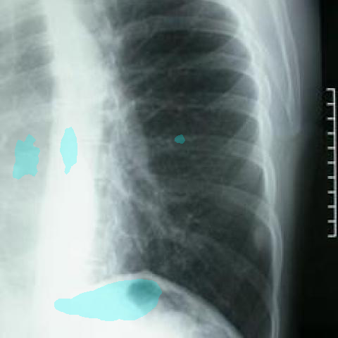

# Official gain: 3436_8353801521068

Post-run explicit answers: D **D**, M **B**, P **E**, reference **B**. Frozen runtime answers: D D, M B, P E; original records unchanged.

[Complete observable requests, tools and stages](../traces/3436_8353801521068.json) · [Original benchmark case](../../v12/results/cases/3436_8353801521068.md) · [D cached original observable request](../../direct_qwen60/requests/3436_8353801521068.json)

```text
Based on Figure 1, which of the following best describes the findings related to the mass observed on the chest X-ray?
A) An irregularly-shaped mass, approximately 3 cm, located in the 9th intercostal space.
B) A round and smoothly-contoured mass, approximately 1.5 cm, located in the 8th intercostal space.
C) A lobulated mass, approximately 2 cm, located in the 7th intercostal space.
D) A round and smoothly-contoured mass, approximately 1.5 cm, located in the 7th intercostal space.
E) An irregularly-shaped mass, approximately 2 cm, located in the 8th intercostal space.
F) A round and smoothly-contoured mass, approximately 2 cm, located in the 9th intercostal space.
```



## D

```text
Answer: D) A round and smoothly-contoured mass, approximately 1.5 cm, located in the 7th intercostal space.  
Reason: The chest X-ray (Figure 1) shows a well-defined, round, radiopaque lesion with smooth margins in the right lower thorax, corresponding to the 7th intercostal space; its size is roughly 1.5 cm based on rib spacing and standard chest X-ray scale.
```

## M

```text
B) A round and smoothly-contoured mass, approximately 1.5 cm, located in the 8th intercostal space.

Visual analysis of the lateral chest X-ray (Figure 1) shows a well-defined, round opacity with smooth borders in the posterior lower lung field. Rib counting from the clavicle (1st rib level) places the mass at approximately the 8th intercostal space. The size appears closer to 1.5 cm than 2 cm based on comparison with rib spacing. The mass is clearly round and smoothly contoured, not irregular or lobulated. While the automated report mentioned a "right upper lobe nodule," the visible finding in this lateral view is consistent with option B.
```

## P

```text
Answer: E) An irregularly-shaped mass, approximately 2 cm, located in the 8th intercostal space.

Evidence: The new observation states the mass is “ill-defined, heterogeneous opacity with irregular, non-circumscribed contours,” matching “irregularly-shaped.” Its vertical span is “approximately the 8th to 10th intercostal spaces,” placing its central location near the 8th intercostal space. Though size estimation from uncalibrated X-ray is unreliable, option E’s ~2 cm is the closest plausible match among irregular-mass options, and the other irregular option (A, 3 cm at 9th space) is less consistent with the described span and diaphragmatic abutment.
```

## P 实际派生图

以下为本轮传入 observe/final 的保存图像；框和解剖覆盖不代表病灶真值。

p1:roi · unmodified_pixel_roi · 来源 image:1



p1:location · location_overlay · 来源 image:1



2d32804959ef44a9ce4596f342d2ddd05edc780b4d2a5f22b385dc198a958f36:anatomy · aligned_anatomical_overlay · 来源 image:1



