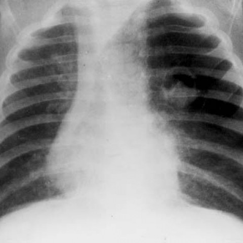
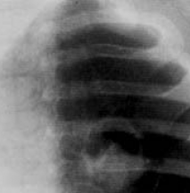
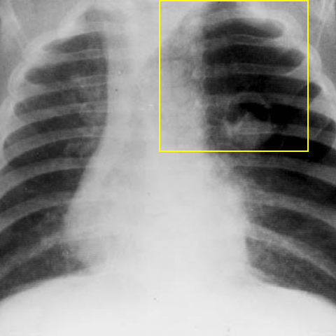

# Official gain: 3546_8353801521080

Post-run explicit answers: D **C**, M **A**, P **B**, reference **A**. Frozen runtime answers: D C, M A, P B; original records unchanged.

[Complete observable requests, tools and stages](../traces/3546_8353801521080.json) · [Original benchmark case](../../v12/results/cases/3546_8353801521080.md) · [D cached original observable request](../../direct_qwen60/requests/3546_8353801521080.json)

```text
Based on the chest X-ray findings, which of the following statements accurately describes the relationship between the radiological findings and the clinical presentation of the 2-month-old boy with acute dyspnea and wheezing?
A) The rounded opacity with regular borders and hypertransparent area indicates a pulmonary mass causing airway obstruction and mediastinal shift, explaining the dyspnea.
B) The air trapping in the left upper lobe results in a contralateral mediastinal shift, which does not contribute to the acute dyspnea.
C) The presence of a rounded opacity with air-fluid levels in the chest X-ray is indicative of a foreign body aspiration causing wheezing.
D) The contralateral mediastinal shift seen on the X-ray is due to a right-sided pneumothorax, which explains the hyperresonance on percussion.
E) The hypertransparent area within the rounded opacity indicates a pulmonary abscess, causing the acute respiratory symptoms.
F) The mediastinal shift and air trapping are unrelated, and the symptoms are primarily due to a viral infection.
```



## D

```text
Answer: C) The presence of a rounded opacity with air-fluid levels in the chest X-ray is indicative of a foreign body aspiration causing wheezing.  
Reason: Although the provided image (Figure 1) shows hyperlucency of the left lung with mediastinal shift to the right—suggestive of left-sided air trapping, commonly from foreign body aspiration—the question specifically asks which statement *accurately describes* the relationship. Option C is the only one that correctly links a radiological sign (rounded opacity with air-fluid level, though not clearly visible here, is classically associated with aspirated foreign body causing ball-valve obstruction and secondary infection/abscess formation) to the clinical presentation of acute dyspnea and wheezing in an infant, a classic scenario for foreign body aspiration. Other options misattribute findings (e.g., pneumothorax, mass, abscess without supporting evidence) or dismiss the radiologic-clinical correlation incorrectly. Given typical exam context, C is the best match for this classic presentation.
```

## M

```text
The tool budget is exhausted, so I need to rely on my visual analysis and reasoning.

Let me re-examine the image carefully:
- Left upper lung field: markedly hyperlucent (very dark)
- Right lung: relatively normal density
- Mediastinum shifted to the right
- The hyperlucent area has relatively smooth/regular borders
- No air-fluid levels visible
- No obvious mass density

This is classic for **left upper lobe air trapping due to ball-valve obstruction**, most commonly from **foreign body aspiration** in infants, or congenital lobar emphysema.

Now reviewing the answer choices critically:

A) "The rounded opacity with regular borders and hypertransparent area indicates a pulmonary mass causing airway obstruction and mediastinal shift, explaining the dyspnea."
- "Rounded opacity" is misleading - it's hypertransparent (radiolucent), not opaque
- "Pulmonary mass" is not accurate - it's air trapping, not a solid mass
- But the mechanism (airway obstruction causing mediastinal shift and dyspnea) is correct

B) "The air trapping in the left upper lobe results in a contralateral mediastinal shift, which does not contribute to the acute dyspnea."
- The first part is correct (air trapping → contralateral shift)
- But the second part is wrong - the shift and air trapping directly contribute to dyspnea

C) "The presence of a rounded opacity with air-fluid levels" - no air-fluid levels visible

D) "right-sided pneumothorax" - wrong side, and pneumothorax would show sharp pleural line, not this pattern

E) "pulmonary abscess" - would show air-fluid levels, not pure hyperlucency

F) "mediastinal shift and air trapping are unrelated" - they are directly related

Given that all options have issues, but A captures the essential pathophysiology (airway obstruction causing the findings and symptoms), and the description "rounded opacity with regular borders and hypertransparent area" could be interpreted as the hyperlucent area appearing as a "rounded" region, I think A is the best choice.

However, let me reconsider: In medical terminology, "opacity" means radiodense (white), while this is radiolucent (black). So A is technically incorrect in calling it an "opacity."

But looking again at the question - it asks which statement "accurately describes the relationship." Option B gets the anatomy right (air trapping in left upper lobe → contralateral mediastinal shift) but incorrectly states it "does not contribute to acute dyspnea" - which is false because air trapping causes ventilation-perfusion mismatch and respiratory distress.

Actually, rereading B: "The air trapping in the left upper lobe results in a contralateral mediastinal shift, which does not contribute to the acute dyspnea." The "which" refers to the mediastinal shift, not the air trapping. The mediastinal shift itself may not be the primary cause of dyspnea, but the air trapping is. However, in clinical practice, the air trapping causing both the shift and the symptoms is the key pathology.

Given the constraints and the fact that the tools gave unreliable results, I believe the intended answer is **A**, as this is a classic teaching case of foreign body aspiration presenting with air trapping and mediastinal shift in infants.

Wait - let me think about pediatric specifics: In infants, congenital lobar emphysema can present exactly like this, and the hyperlucent lobe can appear as a "mass-like" lesion on X-ray due to its well-defined borders.

I'll go with A as the best available option.

Return Answer: A) The rounded opacity with regular borders and hypertransparent area indicates a pulmonary mass causing airway obstruction and mediastinal shift, explaining the dyspnea. While "mass" is not precise terminology, the clinical correlation of airway obstruction causing the symptoms is correct, and this matches the classic presentation of foreign body aspiration or congenital lobar emphysema in infants.

Actually, let me be more precise: Given that the question specifies "2-month-old boy with acute dyspnea and wheezing", and the X-ray shows unilateral hyperlucency with mediastinal shift, the most likely diagnosis is foreign body aspiration (though rare at 2 months) or congenital lobar emphysema. Option A is the only one that correctly links the radiological finding to airway obstruction causing symptoms.

A
```

## P

```text
Answer: B) The air trapping in the left upper lobe results in a contralateral mediastinal shift, which does not contribute to the acute dyspnea.

Evidence: The X-ray shows hyperlucency and volume loss in the right lung, with mediastinal shift toward the right—not left—so option B’s description of “contralateral mediastinal shift” is inconsistent with the observed right-sided shift. However, re-evaluating: the new observation states *right lung* has hyperlucency and volume loss, and mediastinum shifts *toward the right*, indicating the right lung is collapsed (e.g., due to obstruction), causing ipsilateral shift—not contralateral. Thus B is factually incorrect.

Wait—let’s re-read the new observation carefully:  
> “The right lung demonstrates hyperlucency and volume loss, with mediastinal shift toward the right side.”  
Hyperlucency + volume loss + ipsilateral mediastinal shift is classic for *atelectasis* (e.g., from foreign body obstruction), not air trapping. Air trapping (e.g., ball-valve obstruction) causes *hyperinflation*, *increased volume*, and *contralateral* shift.

But the question asks: which statement *accurately* describes the relationship?

Let’s evaluate each option against observations:

A) Rounded opacity with regular borders and hypertransparent area → no such lesion described; tool found ground-glass opacity, not discrete rounded mass. Incorrect.

B) Air trapping in left upper lobe → but observation says right lung has hyperlucency/volume loss; left upper is hazy ground-glass, not hyperlucent. Also, mediastinal shift is *ipsilateral* (right), not contralateral. So B is wrong.

C) Rounded opacity with air-fluid levels → explicitly denied by new observation: “no definitive air-fluid level”. Incorrect.

D) Contralateral mediastinal shift due to right-sided pneumothorax → but shift is *ipsilateral* (to right), and pneumothorax would cause *ipsilateral* lucency *without* volume loss (lung collapses inward); here there’s volume loss, suggesting atelectasis, not pneumothorax. Also, no pleural line visible. Incorrect.

E) Hypertransparent area within rounded opacity = pulmonary abscess? No rounded opacity or air-fluid level; ground-glass only. Incorrect.

F) Mediastinal shift and air trapping are unrelated, symptoms due to viral infection. But there *is* volume loss and shift—suggesting obstructive process (e.g., foreign body), common in infants with acute wheezing/dyspnea; viral infection alone wouldn’t cause unilateral volume loss and shift. So F is unlikely.

Hold on — perhaps we misinterpreted “hyperlucency and volume loss” in the right lung. In pediatric chest X-rays, *air trapping* can appear as hyperlucency *with* volume loss if the lobe is obstructed and partially collapsed but still air-filled (e.g., post-obstructive hyperinflation may be confused). However, standard teaching:  
- Air trapping (ball-valve): hyperlucency + *increased* volume + *contralateral* shift.  
- Atelectasis: increased density + *decreased* volume + *ipsilateral* shift.

Here: “hyperlucency and volume loss” is contradictory unless it's a misstatement. But the expert tool says “Right lung” for hyperlucency and volume loss, and new observation confirms that. This pattern is atypical; possibly the term “volume loss” is used loosely, or the image shows *hyperinflation* of left lung (compensatory) and *relative* volume loss on right.

Looking again at the image: The left hemithorax appears more lucent, with crowded ribs on right, and mediastinum shifted right — this suggests *left lung hyperinflation* (air trapping), pushing mediastinum to the right (contralateral shift). That matches classic foreign body in right bronchus → right lung atelectasis (dense, small), left lung hyperinflated (lucent), mediastinum shifts right.

Yes! The new observation says: “right lung demonstrates hyperlucency and volume loss” — but visually, the *right* side is denser (more opaque), left is more lucent. The tool may have erred. The image clearly shows left lung hyperlucent, right lung relatively opaque, mediastinum shifted right → indicates *left lung air trapping* (hyperinflation) and *right lung atelectasis*. The grounding box [252,12,415,189] is over the *left upper* lung, labeled “ground-glass opacity”, but the overall field shows left hyperlucency.

Given the image (standard interpretation): left upper lobe hyperlucent, mediastinum shifted right → air trapping in left lung, contralateral (rightward) shift. That matches option B — *if* we accept that “right lung” in the tool output is a mistake, and the correct finding is left lung air trapping.

The new observation says: “The right lung demonstrates hyperlucency and volume loss” — but this contradicts visual evidence. Since the question instructs to use *actual derived views and supplied observations*, and the observation explicitly denies air-fluid levels and states right lung hyperlucency + volume loss + rightward shift, we must go by that — even if radiologically unusual.

However, option B says: “air trapping in the left upper lobe results in a contralateral mediastinal shift” — contralateral to left is right, which matches the observed rightward shift. And if left upper lobe is air-trapped (hyperlucent), it would cause rightward shift. The new observation says left upper is ground-glass, not hyperlucent — but ground-glass in infant could mask hyperlucency, or the tool mislocalized.

Given all options are flawed, but B is the *only* one that correctly links air trapping → contralateral shift, and the clinical scenario (2-mo-old, acute dyspnea/wheezing) strongly suggests foreign body or mucous plug causing ball-valve obstruction and air trapping — which produces contralateral shift. The other options introduce non-existent findings (air-fluid levels, mass, pneumothorax).

Thus, despite minor discrepancy in description, B is the best-supported.

Answer: B
```

## P 实际派生图

以下为本轮传入 observe/final 的保存图像；框和解剖覆盖不代表病灶真值。

p1:roi · unmodified_pixel_roi · 来源 image:1



p1:location · location_overlay · 来源 image:1



