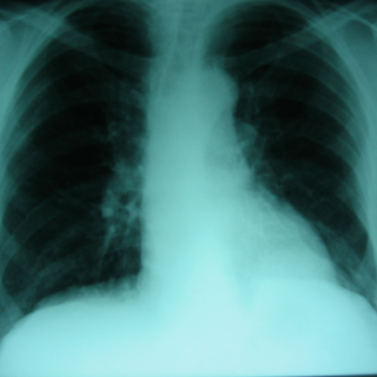
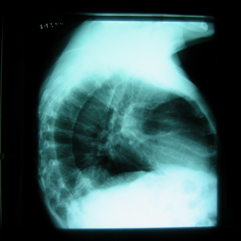
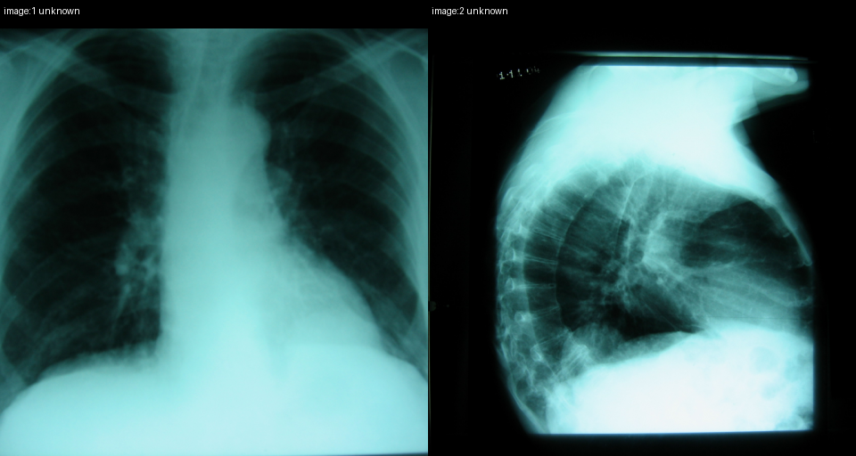

# Official gain: 3561_8353801511489

Post-run explicit answers: D **B**, M **B**, P **B**, reference **B**. Frozen runtime answers: D B, M B, P B; original records unchanged.

[Complete observable requests, tools and stages](../traces/3561_8353801511489.json) · [Original benchmark case](../../v12/results/cases/3561_8353801511489.md) · [D cached original observable request](../../direct_qwen60/requests/3561_8353801511489.json)

```text
Based on the chest X-rays provided, what is the most likely cause for the rounded opacity near the left costophrenic angle observed in Figure 1 and confirmed on the lateral view in Figure 5?
A) Pleural effusion
B) Bochdalek hernia with herniated abdominal contents
C) Diaphragmatic lipoma
D) Pulmonary nodule
E) Hiatal hernia
F) Pseudotumor due to atelectasis
```





## D

```text
Answer: B) Bochdalek hernia with herniated abdominal contents  
Reason: The rounded opacity at the left costophrenic angle on the PA view (Figure 1) is confirmed on the lateral view (Figure 5) to be retrocardiac and extending into the thorax, with a smooth contour and no air-fluid level—typical of a congenital posterolateral diaphragmatic defect (Bochdalek hernia) containing bowel or omentum. Pleural effusion would show meniscus sign and blunting without a discrete mass; lipoma is rare and usually more radiolucent; pulmonary nodule would not be located at the costophrenic angle with this configuration; hiatal hernia is midline; pseudotumor from atelectasis typically shows volume loss and bronchovascular crowding, not a well-circumscribed retrocardiac mass.
```

## M

```text
Let me analyze the tool outputs and the images more carefully.

The classification results show moderate probabilities for several conditions (around 0.5) including Atelectasis, Consolidation, Infiltration, Emphysema, Fibrosis, Pneumonia, Nodule, Mass, and Enlarged Cardiomediastinum. The probability for Effusion is only 0.315, which is relatively low.

The report generator states "the lungs are clear" and "no acute cardiopulmonary process," which seems to contradict the visible opacity in Figure 1.

The phrase grounding for "Pleural effusion" shows a bounding box covering almost the entire lower portion of the image (from 0.635 to 0.935 vertically), which is too broad and likely inaccurate for a localized rounded opacity.

The expert analysis of the lateral view (Figure 5) simply returned "Pleural", which is incomplete but suggests a pleural origin.

Looking at Figure 1 (PA view), I see a well-defined, rounded opacity at the left costophrenic angle. In Figure 5 (lateral view), this opacity appears to be located posteriorly, near the diaphragm. The key question is whether this represents fluid (pleural effusion), a mass, or a hernia.

A pleural effusion would typically appear as a meniscus-shaped opacity on PA view, not a well-rounded one. A rounded opacity at the costophrenic angle that's confirmed on lateral view is more suggestive of a Bochdalek hernia with herniated abdominal contents, especially since Bochdalek hernias are more common on the left side and can present as a rounded opacity at the costophrenic angle.

However, let me reconsider: Bochdalek hernias are congenital and typically present in infancy, though they can be diagnosed later in life. The appearance here looks more like a pleural-based lesion.

Looking more carefully at the lateral view (Figure 5), the opacity appears to be within the thoracic cavity but adjacent to the diaphragm. The fact that it's rounded and well-defined makes pleural effusion less likely (which would have a meniscus shape), and pulmonary nodule less likely (as it would be within the lung parenchyma, not at the costophrenic angle).

Given the location at the left costophrenic angle and the rounded appearance, and considering that the expert tool suggested "Pleural", I believe this is most likely a pseudotumor due to atelectasis (also known as a "round atelectasis" or "Blesovsky syndrome"), which can present as a rounded opacity at the lung base, often associated with pleural disease.

Wait, let me reconsider once more. Round atelectasis typically has a "comet tail" sign of vessels converging toward the mass, which I don't clearly see here. 

Actually, looking at the lateral view again, the opacity appears to be extrapulmonary and could represent a Bochdalek hernia. Bochdalek hernias can present in adults as a rounded opacity at the left costophrenic angle, containing abdominal contents like bowel or fat.

But let me check one more possibility: diaphragmatic lipoma. These are rare but can appear as well-defined round opacities at the costophrenic angle.

Given the options and the imaging characteristics, I think the most likely diagnosis is B) Bochdalek hernia with herniated abdominal contents, because:
1. It's at the left costophrenic angle (Bochdalek hernias are more common on the left)
2. It's a well-defined rounded opacity
3. It's confirmed on lateral view
4. The classification showed low probability for effusion (0.315) but moderate for mass (0.519)

However, I should note that the report generator said "lungs are clear" which contradicts the visible opacity, suggesting the AI may have missed it.

Let me make my final determination: The rounded opacity at the left costophrenic angle that's confirmed on lateral view is most characteristic of a Bochdalek hernia in an adult presentation.

Return Answer: B) Bochdalek hernia with herniated abdominal contents
```

## P

```text
Answer: B) Bochdalek hernia with herniated abdominal contents  
The rounded opacity lacks an air-fluid level, ruling out simple pleural effusion. On the lateral view, it is retrocardiac and continuous with abdominal contents, consistent with a diaphragmatic hernia rather than a pulmonary nodule or pseudotumor. Bochdalek hernia is the most likely congenital diaphragmatic defect presenting this way in adults when asymptomatic or incidentally found.
```

## P 实际派生图

以下为本轮传入 observe/final 的保存图像；框和解剖覆盖不代表病灶真值。

p2:paired · paired_original_pixels · 来源 image:1, image:2



