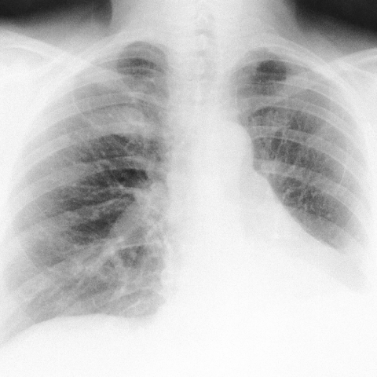
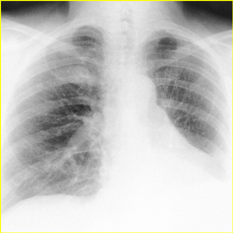

# Official gain: 3686_8353801520174

Post-run explicit answers: D **B**, M **B**, P **B**, reference **B**. Frozen runtime answers: D B, M B, P B; original records unchanged.

[Complete observable requests, tools and stages](../traces/3686_8353801520174.json) · [Original benchmark case](../../v12/results/cases/3686_8353801520174.md) · [D cached original observable request](../../direct_qwen60/requests/3686_8353801520174.json)

```text
Based on the chest X-ray findings in Figure 1, what is the most likely diagnosis for the patient’s pulmonary condition, considering her clinical history and previous surgical interventions? 
A) Primary lung cancer
B) Pulmonary metastasis from a previous uterine leiomyoma
C) Infectious granuloma
D) Pulmonary hamartoma
E) Tuberculosis
F) Bronchiectasis-related pulmonary changes
```


## D

```text
Answer: B) Pulmonary metastasis from a previous uterine leiomyoma  
Reason: The chest X-ray shows multiple bilateral pulmonary nodules, which—combined with a history of uterine leiomyoma (a benign smooth muscle tumor)—raise suspicion for benign metastasizing leiomyoma, a rare condition where histologically benign leiomyoma spreads to the lungs via hematogenous route. This diagnosis is favored over malignancy or infection in the appropriate clinical context, and the nodular pattern fits better than the other options listed.
```

## M

```text
The tool outputs are not providing the specificity I need. Let me use my own visual analysis of the image:

Looking at Figure 1 carefully, I see:
- Bilateral lung fields with multiple small nodular opacities
- The pattern appears to be diffuse and somewhat symmetric
- There are no large mass lesions
- The opacities are more prominent in the lower lung zones
- The overall appearance suggests multiple discrete pulmonary nodules

Given the multiple-choice options and the clinical context hint (mentioning "previous uterine leiomyoma"), option B "Pulmonary metastasis from a previous uterine leiomyoma" is likely referring to the rare condition of benign metastasizing leiomyoma, where benign smooth muscle tissue from uterine leiomyomas can spread to the lungs and present as multiple pulmonary nodules.

This is a classic teaching case - benign metastasizing leiomyoma presents with multiple pulmonary nodules on chest X-ray in women with a history of uterine leiomyomas, and despite the term "metastasis," the lesions are histologically benign.

The other options are less likely:
- A) Primary lung cancer typically presents as a single mass
- C) Infectious granuloma could cause nodules but usually has other features
- D) Pulmonary hamartoma is usually solitary
- E) Tuberculosis can cause nodules but often has upper lobe predominance
- F) Bronchiectasis shows tram-track opacities and cystic changes, not this pattern

Return Answer: B) Pulmonary metastasis from a previous uterine leiomyoma - the bilateral multiple nodular pattern is characteristic of benign metastasizing leiomyoma, a rare condition where benign uterine smooth muscle tissue spreads to the lungs.
```

## P

```text
Answer: B) Pulmonary metastasis from a previous uterine leiomyoma  
Evidence: The chest X-ray shows multiple discrete pulmonary nodules distributed throughout both lung fields. Bilateral, numerous small nodules are classic for hematogenous metastases, and uterine leiomyoma—though typically benign—can rarely metastasize (leiomyosarcoma or benign metastasizing leiomyoma). Clinical history of prior uterine surgery makes this diagnosis more plausible than primary malignancy, infection, or hamartoma, which usually present with fewer or solitary lesions.
```

## P 实际派生图

以下为本轮传入 observe/final 的保存图像；框和解剖覆盖不代表病灶真值。

p1:roi · unmodified_pixel_roi · 来源 image:1



p1:location · location_overlay · 来源 image:1



