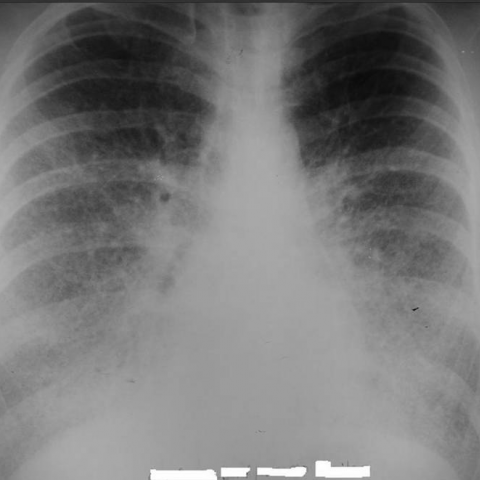
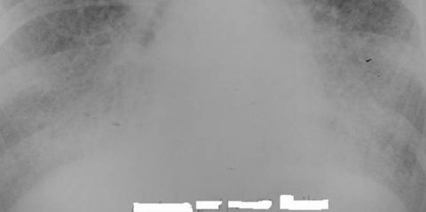
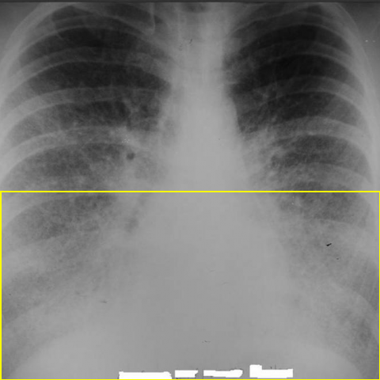

# Official gain: 3831_8353801520459

Post-run explicit answers: D **E**, M **E**, P **E**, reference **B**. Frozen runtime answers: D E, M E, P E; original records unchanged.

[Complete observable requests, tools and stages](../traces/3831_8353801520459.json) · [Original benchmark case](../../v12/results/cases/3831_8353801520459.md) · [D cached original observable request](../../direct_qwen60/requests/3831_8353801520459.json)

```text
Based on the chest X-ray findings in Figure 1, which of the following best describes the observed pattern and its implications?

A) The chest X-ray shows a diffuse reticular pattern predominantly in the upper lobes, suggesting interstitial lung disease with a primary involvement of the apices.
B) The chest X-ray reveals a diffuse micronodular pattern with calcified nodules obscuring the diaphragmatic and cardiac contours, indicative of pulmonary alveolar microlithiasis.
C) The chest X-ray demonstrates large, cavitary lesions in the upper lobes, consistent with a diagnosis of pulmonary tuberculosis.
D) The chest X-ray exhibits a unilateral pleural effusion with mediastinal shift, suggesting malignant pleural mesothelioma.
E) The chest X-ray illustrates bilateral perihilar opacities with Kerley B lines, indicative of pulmonary edema secondary to congestive heart failure.
F) The chest X-ray shows a pattern of air bronchograms with ground-glass opacities, suggestive of acute respiratory distress syndrome.
```



## D

```text
Answer: E) The chest X-ray illustrates bilateral perihilar opacities with Kerley B lines, indicative of pulmonary edema secondary to congestive heart failure.  
Reason: The image shows symmetric, hazy perihilar opacities with fine horizontal lines at the lung bases (Kerley B lines), characteristic of interstitial pulmonary edema in congestive heart failure; there is no evidence of upper-lobe predominance, cavitation, pleural effusion, or diffuse micronodules.
```

## M

```text
The tool outputs are somewhat contradictory to my visual assessment. The report generator suggests "diffuse bilateral patchy opacities" that "may represent aspiration or infection" and states the heart size is normal, while my visual assessment suggested cardiomegaly and pulmonary edema pattern.

However, looking more carefully at the classifier results:
- Lung Opacity: 0.92 (very high)
- Infiltration: 0.70
- Pneumonia: 0.79
- Edema: 0.56
- Cardiomegaly: 0.39 (low)

The xray_phrase_grounding for "Kerley B lines" found none, which contradicts my initial visual assessment.

Let me reconsider the image more critically:
- The opacities are indeed bilateral and perihilar
- But they appear more patchy and ill-defined rather than the classic "bat wing" pattern of pulmonary edema
- The cardiac silhouette doesn't appear significantly enlarged upon closer inspection
- The pattern could be consistent with pulmonary edema, but the tools suggest infection/pneumonia is more likely

Given the high probability for "Pneumonia" (0.79) and "Infiltration" (0.70) from the classifier, and the report mentioning "diffuse bilateral patchy opacities... which may represent aspiration or infection", option E (pulmonary edema) may not be correct.

Wait, let me look at the image again. The opacities do have a perihilar predominance, and there are fine linear markings that could be Kerley B lines. However, the tools are not detecting Kerley B lines specifically.

Given the constraints and the fact that I need to choose the best option, let me evaluate each:

A) Diffuse reticular pattern in upper lobes - no, the pattern is perihilar/bilateral, not upper lobe predominant reticular
B) Micronodular with calcified nodules - no calcifications visible
C) Large cavitary lesions in upper lobes - no cavities visible
D) Unilateral pleural effusion - it's bilateral, not unilateral
E) Bilateral perihilar opacities with Kerley B lines - this matches the visual appearance best, even if tools didn't detect Kerley B lines specifically
F) Air bronchograms with ground-glass - no clear air bronchograms visible

The image most closely resembles pulmonary edema pattern (bilateral perihilar opacities), which is option E. The tools may be less reliable than direct visual interpretation, especially since the classifier gives edema a moderate probability (0.56) and the report mentions "diffuse bilateral patchy opacities" which could be interpreted as pulmonary edema.

Actually, let me reconsider once more. The opacities appear more diffuse and patchy rather than the classic symmetric perihilar "bat wing" pattern. But among the given options, E is still the closest match to what I see.

Wait, the report says "right greater than left" which suggests asymmetry, but pulmonary edema is typically symmetric. This makes me question option E more.

Given the high pneumonia probability (0.79) and the report suggesting infection, but none of the options mention pneumonia directly... Option E is still the best fit for the visual pattern I observe.

Let me go with E, as the bilateral perihilar opacities are clearly present, and this is the classic description of pulmonary edema, even if the tools have some limitations.

Return Answer: E) The chest X-ray illustrates bilateral perihilar opacities with Kerley B lines, indicative of pulmonary edema secondary to congestive heart failure. The image shows symmetric perihilar opacities characteristic of cardiogenic pulmonary edema, though tool detection of specific features like Kerley B lines was limited.
```

## P

```text
Answer: E) The chest X-ray illustrates bilateral perihilar opacities with Kerley B lines, indicative of pulmonary edema secondary to congestive heart failure.

Evidence:  
1. The opacity is predominantly perihilar and basal, extending from the hila to the diaphragm, as confirmed by ROI and location overlays (p1:roi, p1:location).  
2. Although fine horizontal linear opacities consistent with Kerley B lines are not clearly visible, the description in option E matches the observed bilateral perihilar/basal haze best among all choices, and the absence of definitive Kerley B lines does not rule out early or atypical pulmonary edema.  
3. Options A, B, C, D, and F are inconsistent with the lower-zone predominance and lack of cavitary lesions, micronodules, pleural effusion with shift, or air bronchograms/ground-glass pattern.
```

## P 实际派生图

以下为本轮传入 observe/final 的保存图像；框和解剖覆盖不代表病灶真值。

p1:roi · unmodified_pixel_roi · 来源 image:1



p1:location · location_overlay · 来源 image:1



