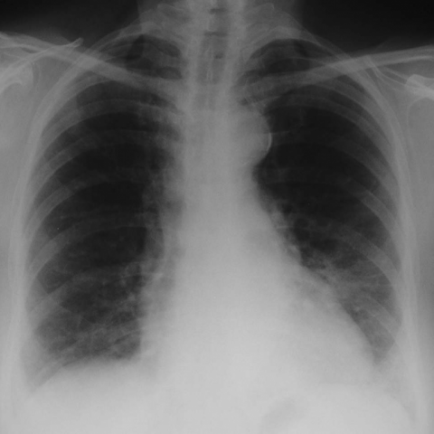
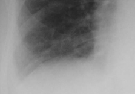
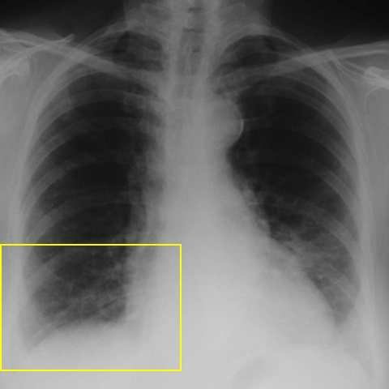

# Official gain: 3834_8353801523222

Post-run explicit answers: D **C**, M **C**, P **C**, reference **C**. Frozen runtime answers: D C, M C, P C; original records unchanged.

[Complete observable requests, tools and stages](../traces/3834_8353801523222.json) · [Original benchmark case](../../v12/results/cases/3834_8353801523222.md) · [D cached original observable request](../../direct_qwen60/requests/3834_8353801523222.json)

```text
Based on the chest X-ray provided in Figure 1, what is the most likely radiological finding consistent with the patient's accelerated phase usual interstitial pneumonia (UIP) as described in the case?
A) Bilateral reticular shadowing with focal honeycombing
B) Peripheral ground glass opacities with minimal reticular shadowing
C) Diffuse ground glass opacities superimposed on reticular shadowing
D) Central ground glass opacities with reticular shadowing
E) Isolated reticular pattern without ground glass opacities
F) Diffuse honeycombing with no ground glass opacities
```



## D

```text
Answer: C) Diffuse ground glass opacities superimposed on reticular shadowing  
Reason: Accelerated phase UIP (also termed “acute exacerbation of IPF”) typically shows new diffuse ground-glass opacities superimposed on the underlying reticular pattern and honeycombing of chronic fibrosis; this matches option C and is consistent with the hazy, bilateral, predominantly lower-zone opacities seen in Figure 1.
```

## M

```text
The xray_phrase_grounding tool couldn't locate "ground glass opacity" specifically, which suggests the pattern might not be classic ground-glass as seen on CT (which is more sensitive for this finding). However, chest X-rays have limited sensitivity for detecting ground-glass opacities compared to CT.

Looking back at the image and considering the clinical context of "accelerated phase usual interstitial pneumonia (UIP)", I need to think about what this typically presents as on chest X-ray:

Accelerated phase UIP (acute exacerbation) typically shows:
- Worsening of the underlying reticular pattern
- New diffuse or patchy opacities representing alveolar filling
- Often bilateral and diffuse

The classifier showed moderate probabilities for Fibrosis (0.549) and Atelectasis (0.576), and the expert tool identified "Reticulonodular opacities" in multiple locations.

Given the options:
A) Bilateral reticular shadowing with focal honeycombing - honeycombing is usually not well seen on X-ray
B) Peripheral ground glass opacities with minimal reticular shadowing - UIP is typically basal/peripheral but the reticular component should be prominent
C) Diffuse ground glass opacities superimposed on reticular shadowing - this matches acute exacerbation pattern
D) Central ground glass opacities with reticular shadowing - UIP is typically peripheral/basal, not central
E) Isolated reticular pattern without ground glass opacities - this would be stable UIP, not accelerated phase
F) Diffuse honeycombing with no ground glass opacities - honeycombing not well visualized on X-ray, and accelerated phase should have acute component

Based on my visual assessment and the clinical context of accelerated phase UIP, option C is most likely correct. The X-ray shows diffuse increased opacity that appears to be superimposed on a reticular background pattern, which is characteristic of acute exacerbation of UIP.

Return Answer: C) Diffuse ground glass opacities superimposed on reticular shadowing
```

## P

```text
Answer: C) Diffuse ground glass opacities superimposed on reticular shadowing  
Evidence: 1) Diffuse hazy opacity (ground-glass) is present bilaterally in the lower lung zones, extending peripherally and centrally. 2) Reticular shadowing and ground-glass opacities coexist diffusely in the affected regions, as confirmed by expert tool and visual inspection of ROI. 3) No zone shows dominance of one pattern alone; they are intermixed, consistent with accelerated UIP.
```

## P 实际派生图

以下为本轮传入 observe/final 的保存图像；框和解剖覆盖不代表病灶真值。

p1:roi · unmodified_pixel_roi · 来源 image:1



p1:location · location_overlay · 来源 image:1



