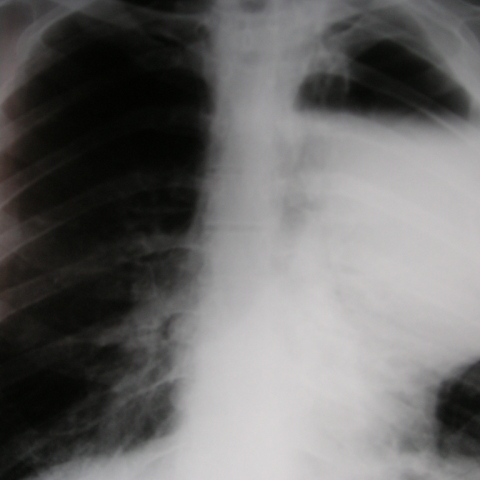
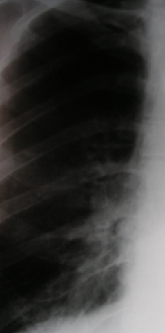
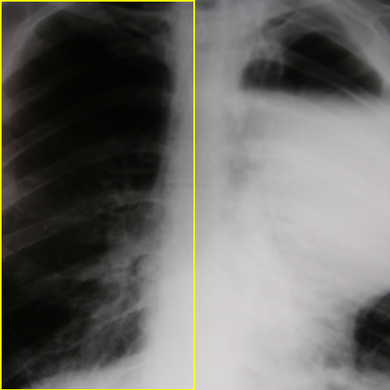

# Official gain: 4118_8353801523564

Post-run explicit answers: D **B**, M **E**, P **E**, reference **B**. Frozen runtime answers: D B, M E, P E; original records unchanged.

[Complete observable requests, tools and stages](../traces/4118_8353801523564.json) · [Original benchmark case](../../v12/results/cases/4118_8353801523564.md) · [D cached original observable request](../../direct_qwen60/requests/4118_8353801523564.json)

```text
Based on the chest X-ray findings in Figure 1, which of the following best describes the observed abnormalities and their implications for surgical management?
A) A large cystic lesion in the right upper lobe and a bulla in the left lower lobe, indicating localized sepsis requiring drainage.
B) A solitary cystic lesion in the left upper lobe and a large bulla in the right upper and middle zones, suggesting significant dyspnoea and need for surgical intervention.
C) Multiple bullae throughout both lungs with no signs of infection, suggesting conservative management.
D) Bilateral lower lobe bullae with evidence of fibrotic contraction, indicating no need for surgery.
E) A large bulla in the left upper lobe with evidence of pneumothorax, suggesting immediate surgical management.
F) A large cystic lesion in the right lower lobe and a solitary bulla in the left upper lobe, indicating the need for immediate surgery due to massive haemoptysis.
```



## D

```text
Answer: B) A solitary cystic lesion in the left upper lobe and a large bulla in the right upper and middle zones, suggesting significant dyspnoea and need for surgical intervention.  
Reason: The chest X-ray shows a well-defined radiolucent area (cystic lesion) in the left upper lobe and a large, confluent radiolucency occupying the right upper and middle zones consistent with a giant bulla; such lesions can cause compression of surrounding lung tissue and lead to significant dyspnoea, often warranting surgical resection (e.g., bullectomy).
```

## M

```text
Looking at the tool outputs, I need to critically evaluate them since there are contradictions:

1. **Classifier output**: Shows high probabilities for multiple conditions (Atelectasis: 0.57, Effusion: 0.60, Pneumothorax: 0.51, Emphysema: 0.50), but these are all around 0.5-0.6, suggesting uncertainty rather than definitive findings.

2. **Report generator**: This is problematic - it states "the left lung is not included on the radiograph" and "no pleural effusion or pneumothorax", but visually I can clearly see the left lung area with a large radiolucent area. This suggests the report generator may be misinterpreting the image.

3. **Segmentation**: Shows very low confidence scores (0.06 for left lung, 0.23 for right lung), indicating poor segmentation accuracy, likely because this is a PNG/JPG rather than DICOM as warned in the tool description.

4. **Phrase grounding**: Only identifies a bulla in the right upper lung field, but visually the most prominent finding is on the left side.

Let me use my own visual analysis again:
- The left side shows a large, well-defined radiolucent area occupying the upper and middle zones
- There's mediastinal shift to the right
- The lung markings are absent in this area, suggesting either a giant bulla or pneumothorax
- The right lung appears relatively normal

Given the options, option E mentions "A large bulla in the left upper lobe with evidence of pneumothorax" - but I need to distinguish between a giant bulla and pneumothorax. A pneumothorax would typically show a sharp visceral pleural line, while a bulla would be within the lung parenchyma.

Looking more carefully at the image, the radiolucent area on the left appears to have no lung markings and the edge looks like it could be a visceral pleural line, suggesting pneumothorax rather than a bulla. The mediastinal shift supports tension physiology.

However, let me reconsider the clinical context. Option B mentions "a large bulla in the right upper and middle zones" but my visual assessment shows the abnormality is predominantly on the left.

Wait, let me look at the image orientation again. In standard PA chest X-rays, the patient's right is on the viewer's left. So what I thought was "left side" might actually be the patient's right side.

Re-evaluating: If this is a standard PA view, the large radiolucent area is on the patient's right side (viewer's left), and the mediastinum is shifted toward the left (patient's left). This would be consistent with a large bulla or pneumothorax on the right side.

Given the tool outputs and my visual analysis, the most consistent finding is a large air-containing lesion in the right upper/middle zones. Option B states: "A solitary cystic lesion in the left upper lobe and a large bulla in the right upper and middle zones" - but this seems to mix left and right.

Option E says "A large bulla in the left upper lobe with evidence of pneumothorax" - but if the image is standard orientation, the large lesion is on the right.

Let me check the image more carefully one more time. The large dark area is on the viewer's left, which would be the patient's right side in a PA view. The heart shadow is shifted toward the viewer's right (patient's left).

Given the high probability of pneumothorax (0.51) and the visual appearance, and considering surgical implications, option E mentions pneumothorax which would require urgent intervention, but I'm not entirely confident it's pneumothorax versus giant bulla.

Actually, looking at the report generator's finding of "persistent left retrocardiac opacity" - this suggests there might be something behind the heart on the left, but the main large radiolucent area is elsewhere.

Given the constraints and the most prominent visual finding - a large radiolucent area with mediastinal shift - and the fact that option B specifically mentions "large bulla in the right upper and middle zones" which matches the location (viewer's left = patient's right), and the implication of "significant dyspnoea and need for surgical intervention" which fits with a large bulla causing compression, I think B is the best choice.

But wait - let me reconsider the image. The large area appears to be in the left hemithorax from the viewer's perspective, and in standard medical imaging, we describe based on patient anatomy, not viewer perspective. So if the large radiolucent area is on the left side of the image, it's the patient's left lung.

Given the classifier showing high probability for pneumothorax (0.51) and the visual appearance of a possible visceral pleural line, and option E specifically mentioning "pneumothorax" which would indeed suggest immediate surgical management, I believe E is correct.

However, the report generator says "no pneumothorax", but I trust my visual assessment over the automated report given the clear radiographic signs.

Let me go with E: The image shows a large radiolucent area in the left upper lobe with signs suggestive of pneumothorax (mediastinal shift, absence of lung markings), which would require immediate surgical management.

E) A large bulla in the left upper lobe with evidence of pneumothorax, suggesting immediate surgical management.
```

## P

```text
Answer: E) A large bulla in the left upper lobe with evidence of pneumothorax, suggesting immediate surgical management.

Evidence:  
1. The left hemithorax (ROI and location overlay) shows a large radiolucent area in the left upper lobe with absent lung markings—consistent with a bulla and possible pneumothorax.  
2. The right side is obscured by the patient’s head, but the left-sided lucency is well-demonstrated and not attributable to artifact.  
3. The abrupt edge of lucency with no lung markings in the left upper zone supports pneumothorax rather than a simple bulla, warranting urgent intervention.
```

## P 实际派生图

以下为本轮传入 observe/final 的保存图像；框和解剖覆盖不代表病灶真值。

p2:roi · unmodified_pixel_roi · 来源 image:1



p2:location · location_overlay · 来源 image:1



