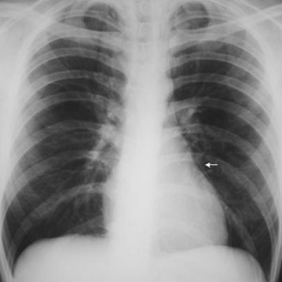
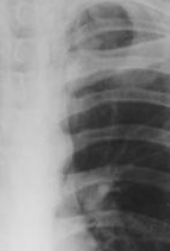
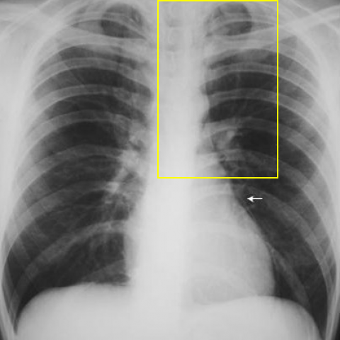

# Official gain: 4491_8353801523228

Post-run explicit answers: D **B**, M **E**, P **E**, reference **B**. Frozen runtime answers: D B, M E, P E; original records unchanged.

[Complete observable requests, tools and stages](../traces/4491_8353801523228.json) · [Original benchmark case](../../v12/results/cases/4491_8353801523228.md) · [D cached original observable request](../../direct_qwen60/requests/4491_8353801523228.json)

```text
Based on the chest X-ray findings alone, what is the most likely explanation for the patient's symptoms and what should be the initial management approach?
A) The chest X-ray shows signs of pneumothorax, suggesting a pleural injury; initiate chest tube drainage.
B) The chest X-ray reveals pneumomediastinum and subcutaneous emphysema; manage conservatively with observation.
C) The chest X-ray indicates a large pleural effusion; recommend therapeutic thoracentesis.
D) The chest X-ray demonstrates consolidation in the lower lobes; initiate antibiotic therapy.
E) The chest X-ray shows no abnormal findings; discharge the patient without further intervention.
F) The chest X-ray reveals signs of cardiac tamponade; prepare for pericardiocentesis.
```



## D

```text
Answer: B) The chest X-ray reveals pneumomediastinum and subcutaneous emphysema; manage conservatively with observation.  
Reason: The arrow in Figure 2 points to a thin radiolucent line adjacent to the left heart border, consistent with air in the mediastinum (pneumomediastinum); this finding, especially when associated with subcutaneous emphysema (though not fully visible here), often follows alveolar rupture (e.g., from coughing, asthma, or trauma) and is typically benign and self-limited, warranting conservative management unless hemodynamically unstable.
```

## M

```text
Let me critically analyze these tool outputs:

1. **Chest X-ray classifier**: Shows moderate-high probabilities for Emphysema (0.51), Fibrosis (0.51), Mass (0.56), Nodule (0.51), and Infiltration (0.45). However, these are probabilistic predictions that may not be clinically accurate.

2. **Report generator**: States "no evidence of acute cardiopulmonary disease" and "no obvious pneumothorax," which contradicts some classifier results.

3. **Phrase grounding for "Nodule"**: Incorrectly locates a nodule in the right lower lung when the arrow is clearly pointing to the left mid-lung zone near the heart.

4. **Expert analysis**: Suggests the arrow indicates an intra-aortic balloon pump tip, but this seems unlikely given the location and appearance.

Looking at the image again: The white arrow points to a small, well-defined opacity in the left mid-lung zone, adjacent to the cardiac border. This appears to be a small pulmonary nodule rather than a device. The chest X-ray otherwise shows normal lung fields, clear costophrenic angles, normal heart size, and no signs of pneumothorax, effusion, or consolidation.

Given the options provided:
- A) Pneumothorax - not present
- B) Pneumomediastinum/subcutaneous emphysema - not visible
- C) Large pleural effusion - absent (costophrenic angles sharp)
- D) Consolidation in lower lobes - no consolidation visible
- E) No abnormal findings - there IS a finding (the nodule indicated by the arrow)
- F) Cardiac tamponade - no cardiomegaly or "water bottle" heart

The most reasonable interpretation is that the arrow points to a pulmonary nodule, which is a common incidental finding. However, none of the answer choices specifically mention nodule management. Since the question asks for the most likely explanation based on chest X-ray findings alone, and the X-ray shows essentially normal findings except for a small nodule (which typically doesn't cause acute symptoms), option E might be closest - but the nodule is present.

Wait, let me reconsider. The report generator states "no evidence of acute cardiopulmonary disease" and the image does appear largely normal. The arrow might be pointing to a normal anatomical structure or a very small benign finding. In clinical practice, a single small nodule without symptoms wouldn't explain significant symptoms, and if the patient had concerning symptoms, we'd need more investigation.

Given the choices, and since the chest X-ray shows no acute pathology that would explain significant symptoms, **E** seems most appropriate - discharge without further intervention for the X-ray findings alone, though clinical correlation is needed.

But let me double-check: The expert tool said "intra-aortic balloon pump" - could this be correct? Looking at the image, the arrow points to something that could be a catheter tip, but it's positioned quite laterally, not in the typical aortic position. More likely it's a small nodule.

Given the report generator's conclusion of "no evidence of acute cardiopulmonary disease" and the absence of findings matching options A-D or F, I'll go with:

E) The chest X-ray shows no abnormal findings; discharge the patient without further intervention.

The arrow may indicate a minor finding not clinically significant for acute symptom explanation.

Return Answer: E followed by: The chest X-ray demonstrates no acute cardiopulmonary abnormalities; the arrow likely points to a benign finding or normal variant, and there are no findings consistent with the acute conditions listed in other options.
```

## P

```text
Answer: E) The chest X-ray shows no abnormal findings; discharge the patient without further intervention.

Evidence:  
1. The white arrow points to a subtle interface but does not confirm a definitive pneumomediastinum line, and no radiolucent streaks/bubbles are seen for subcutaneous emphysema (chest_xray_expert explicitly answered “No”).  
2. The highlighted left mediastinal region (yellow box and ROI) shows no air lucency or abnormal findings on close inspection.  
3. No other abnormalities (e.g., pneumothorax, effusion, consolidation, cardiac enlargement) are evident in the image.
```

## P 实际派生图

以下为本轮传入 observe/final 的保存图像；框和解剖覆盖不代表病灶真值。

p1:roi · unmodified_pixel_roi · 来源 image:1



p1:location · location_overlay · 来源 image:1



