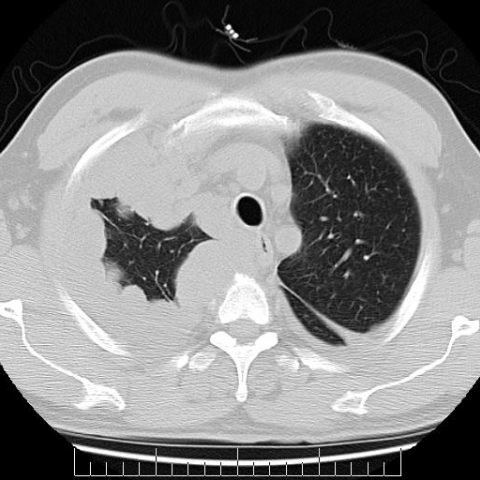
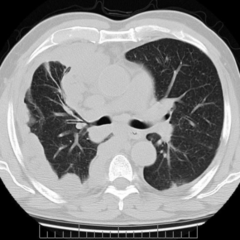
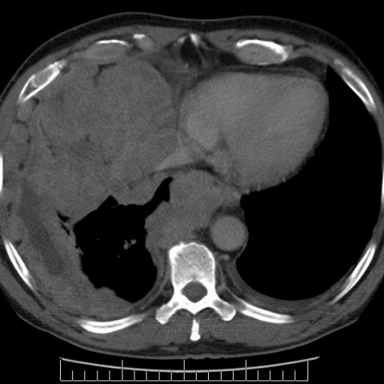

# Official gain: 4734_8353801532720

Post-run explicit answers: D **B**, M **B**, P **B**, reference **B**. Frozen runtime answers: D B, M B, P B; original records unchanged.

[Complete observable requests, tools and stages](../traces/4734_8353801532720.json) · [Original benchmark case](../../v12/results/cases/4734_8353801532720.md) · [D cached original observable request](../../direct_qwen60/requests/4734_8353801532720.json)

```text
Based on the chest X-ray figures, which feature most strongly supports the diagnosis of malignant pleural mesothelioma in this patient?
A) Bilateral pleural effusion
B) Thick nodular pleural mass impinging on mediastinal structures
C) Bilateral lung volume reduction
D) Large central pulmonary mass
E) Diffuse interstitial lung disease
F) Osteolytic lesion of the sternum
```







## D

```text
Answer: B) Thick nodular pleural mass impinging on mediastinal structures  
Reason: Malignant pleural mesothelioma typically presents with diffuse, irregular (nodular) pleural thickening that encases the lung and may invade or compress mediastinal structures—exactly as seen in the CT images (especially Figure 3 showing a large pleural-based mass with mediastinal shift/impingement). While pleural effusion (A) is common, it is nonspecific; the nodular, circumferential pleural mass is more characteristic of mesothelioma versus other malignancies or benign processes.
```

## M

```text
B) Thick nodular pleural mass impinging on mediastinal structures

The CT images (despite being mislabeled as X-rays in the question) show a large, irregular, nodular pleural-based mass on the left side that encases lung tissue and causes mediastinal shift—classic for malignant pleural mesothelioma. This feature is more specific than bilateral effusion (A), which is common but non-specific; lung volume reduction (C) is secondary; a central pulmonary mass (D) would suggest primary lung cancer (mesothelioma arises from pleura, not lung parenchyma); interstitial disease (E) and sternal lytic lesions (F) are not present or characteristic. The nodular pleural thickening with mediastinal impingement is the hallmark imaging finding of mesothelioma.
```

## P

```text
Answer: B) Thick nodular pleural mass impinging on mediastinal structures  
Reason: Malignant pleural mesothelioma typically presents with diffuse, irregular (nodular) pleural thickening that encases the lung and may invade or compress mediastinal structures—exactly as seen in the CT images (especially Figure 3 showing a large pleural-based mass with mediastinal shift/impingement). While pleural effusion (A) is common, it is nonspecific; the nodular, circumferential pleural mass is more characteristic of mesothelioma versus other malignancies or benign processes.
```

