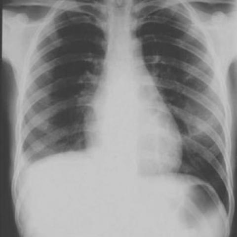
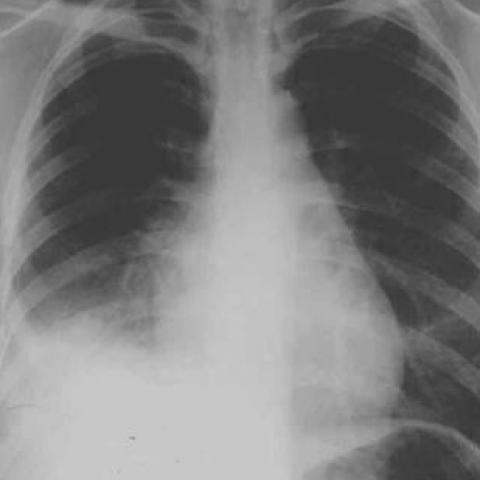
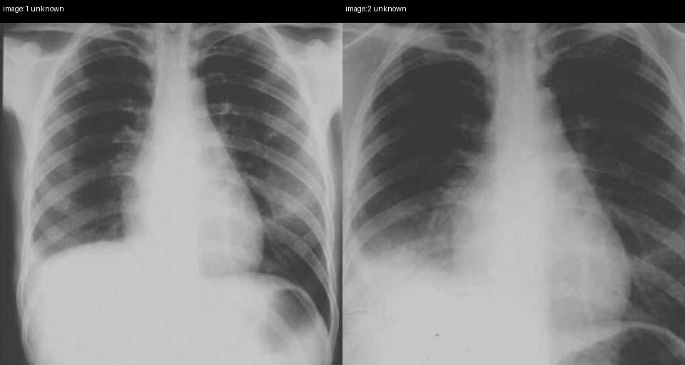

# Official gain: 528_8353802130481

Post-run explicit answers: D **B**, M **B**, P **B**, reference **B**. Frozen runtime answers: D B, M B, P B; original records unchanged.

[Complete observable requests, tools and stages](../traces/528_8353802130481.json) · [Original benchmark case](../../v12/results/cases/528_8353802130481.md) · [D cached original observable request](../../direct_qwen60/requests/528_8353802130481.json)

```text
Based on the chest X-ray findings from the first and second admissions, which of the following best describes the progression of the patient's condition and the most likely diagnosis?

A) The right costophrenic angle became more pronounced, indicating resolution of pleural effusion; likely diagnosis is resolved pneumonia.
B) The right hemidiaphragm is elevated and there is a noticeable increase in pleural effusion, suggesting progression to pulmonary angiosarcoma.
C) There is no significant change in the right lung findings, indicating chronic stable condition; likely diagnosis is chronic pulmonary embolism.
D) The vascular markings in the right lung improved, suggesting successful thrombolysis; likely diagnosis is resolved pulmonary embolism.
E) There is a decrease in right pleural effusion, indicating effective treatment; likely diagnosis is resolved heart failure.
F) The right lung shows new infiltrates and decreased vascular markings, suggesting development of a secondary infection; likely diagnosis is secondary bacterial pneumonia.
```





## D

```text
Answer: B  
Reason: Comparing Figure 1a (first admission) and Figure 1b (second admission), the right hemidiaphragm appears elevated in Figure 1b, and the right costophrenic angle is blunted with increased opacity—indicating worsening pleural effusion. This progression, especially with diaphragmatic elevation and increasing effusion without clear infectious or cardiac cause, raises suspicion for a malignant process such as pulmonary angiosarcoma (a rare but aggressive tumor that can present with hemorrhagic pleural effusion and rapid progression). Other options are inconsistent with the imaging changes (e.g., no resolution of effusion, no improvement in vascular markings, no new infiltrates typical of bacterial pneumonia).
```

## M

```text
B) The right hemidiaphragm is elevated and there is a noticeable increase in pleural effusion, suggesting progression to pulmonary angiosarcoma.

Reason: Comparing the two X-rays, Figure 1b shows increased opacity and more blunted right costophrenic angle compared to Figure 1a, indicating worsening pleural effusion. The chest_xray_classifier confirms increased effusion probability (0.53 → 0.63) and lung opacity (0.62 → 0.71). While pulmonary angiosarcoma is rare, the progressive unilateral pleural effusion with increasing opacity without clear infectious features (low pneumonia probability: 0.003 → 0.077) and the absence of resolution suggests a malignant process rather than resolving infection or heart failure. Option B is the only one describing progression with increased effusion, which matches the imaging findings.
```

## P

```text
Answer: B) The right hemidiaphragm is elevated and there is a noticeable increase in pleural effusion, suggesting progression to pulmonary angiosarcoma.

Evidence: In image 1, the right hemidiaphragm is at normal level and the costophrenic angle is sharp; in image 2, the right hemidiaphragm is elevated and the costophrenic angle is blunted/obscured by increased opacity. Vascular markings in the right lower lung are less distinct in image 2, and the homogeneous opacity suggests increasing pleural fluid or mass effect—consistent with worsening effusion, not resolution. The expert tool’s “no significant changes” statement is contradicted by these objective findings.
```

## P 实际派生图

以下为本轮传入 observe/final 的保存图像；框和解剖覆盖不代表病灶真值。

p1:paired · paired_original_pixels · 来源 image:1, image:2



