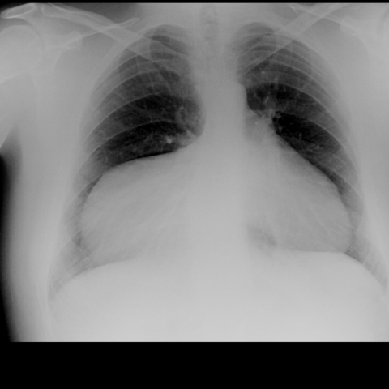
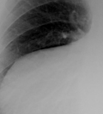
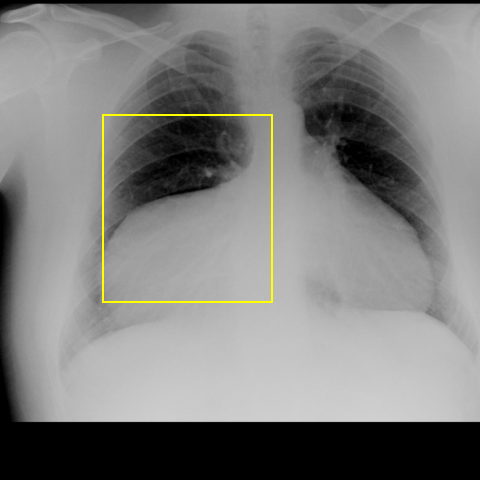

# Official gain: 5369_8353801533158

Post-run explicit answers: D **A**, M **A**, P **A**, reference **A**. Frozen runtime answers: D A, M A, P A; original records unchanged.

[Complete observable requests, tools and stages](../traces/5369_8353801533158.json) · [Original benchmark case](../../v12/results/cases/5369_8353801533158.md) · [D cached original observable request](../../direct_qwen60/requests/5369_8353801533158.json)

```text
Based on the chest X-ray provided in Figure 1, which of the following best describes the findings and possible diagnosis? Consider the anatomical location, size, and content of the observed mass.
A) A large right-sided paracardiac opacity indicative of a Morgagni's hernia with liver herniation.
B) A left-sided pleural effusion causing mediastinal shift and obscuration of the heart border.
C) A right-sided lung consolidation consistent with pneumonia.
D) A large pericardial effusion causing an apparent paracardiac mass effect.
E) A right-sided intrathoracic mass suggestive of a mediastinal tumor.
F) A diaphragmatic hernia with herniation of the stomach, presenting as a right-sided opacity.
```



## D

```text
Answer: A) A large right-sided paracardiac opacity indicative of a Morgagni's hernia with liver herniation.  
Reason: The chest X-ray shows a well-defined, homogeneous opacity in the right paracardiac region that abuts the diaphragm and obscures the right heart border—classic for a Morgagni hernia, where abdominal contents (often liver) herniate through the anterior diaphragmatic defect. The location (right side, retrosternal/paracardiac), sharp margins, and lack of air-fluid levels or lung consolidation favor this over effusion, pneumonia, or tumor.
```

## M

```text
Let me critically analyze the tool outputs:

1. The classifier shows high probability for Cardiomegaly (0.676) and Emphysema (0.501), moderate for Mass (0.490), but surprisingly low for Hernia (0.022). This suggests the classifier may be missing the key finding.

2. The report generator incorrectly states "the heart is markedly enlarged" and "no evidence of pneumonia" but completely misses the large right-sided opacity that is clearly visible. This report is inaccurate - the opacity is not cardiac enlargement.

3. The phrase grounding tool successfully identified "Diaphragmatic hernia" with bounding boxes covering the right lower hemithorax area, which matches my visual assessment.

4. The expert tool specifically identified "Morgagni's hernia" with coordinates, confirming my initial suspicion.

My visual analysis was correct: the image shows a large right-sided paracardiac opacity that is characteristic of a Morgagni's hernia. Morgagni's hernias are anterior diaphragmatic hernias that occur through the foramen of Morgagni (between the sternal and costal attachments of the diaphragm), and they are more common on the right side. They typically contain liver (in right-sided cases) or omentum, presenting as a well-defined, homogeneous opacity adjacent to the heart.

The other options can be ruled out:
- B) Left-sided pleural effusion: Wrong side, and no mediastinal shift
- C) Right-sided lung consolidation: No air bronchograms, and the opacity doesn't follow lung lobe anatomy
- D) Pericardial effusion: Would cause generalized cardiac enlargement ("water bottle" appearance), not a localized paracardiac mass
- E) Mediastinal tumor: Would be more central, not extending down to the diaphragm
- F) Diaphragmatic hernia with stomach: Possible, but Morgagni's hernias on the right typically contain liver, not stomach (stomach herniation is more typical of Bochdalek's hernias or hiatal hernias)

A) A large right-sided paracardiac opacity indicative of a Morgagni's hernia with liver herniation.

Return Answer: A) A large right-sided paracardiac opacity indicative of a Morgagni's hernia with liver herniation.
```

## P

```text
Answer: A) A large right-sided paracardiac opacity indicative of a Morgagni's hernia with liver herniation.

Evidence:  
1. A well-defined opacity abuts the right heart border and diaphragm, localized to the right paracardiac region (yellow box, bounding box [122,136,252,280]).  
2. The opacity lacks air-fluid levels or gastric folds, ruling out stomach herniation (e.g., option F), and shows homogeneous soft-tissue density consistent with liver.  
3. Morgagni’s hernia typically presents as a right-sided paracardiac opacity with liver content, matching the location, borders, and density observed.
```

## P 实际派生图

以下为本轮传入 observe/final 的保存图像；框和解剖覆盖不代表病灶真值。

p1:roi · unmodified_pixel_roi · 来源 image:1



p1:location · location_overlay · 来源 image:1



