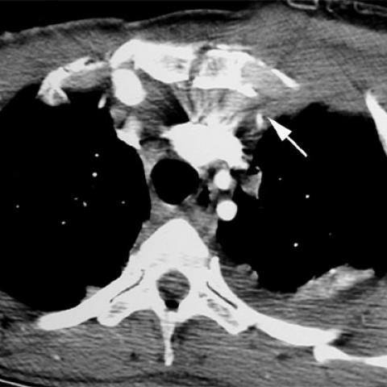
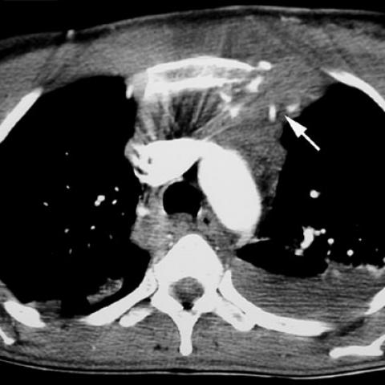

# Official gain: 548_8353802023456

Post-run explicit answers: D **D**, M **D**, P **D**, reference **D**. Frozen runtime answers: D D, M D, P D; original records unchanged.

[Complete observable requests, tools and stages](../traces/548_8353802023456.json) · [Original benchmark case](../../v12/results/cases/548_8353802023456.md) · [D cached original observable request](../../direct_qwen60/requests/548_8353802023456.json)

```text
A 47-year-old female patient presented after a fall from a height of 20 meters, with a history suggestive of a suicide attempt. Based on the chest X-ray, which of the following findings would most likely necessitate further investigation to rule out major vascular injury?

A) Isolated sternal fracture without mediastinal widening
B) Sternal fracture with retrosternal hematoma but no mediastinal widening
C) Mediastinal widening with no visible sternal fracture
D) Mediastinal widening in the presence of a sternal fracture
E) Isolated left hemothorax without mediastinal changes
F) Anterior soft tissue swelling without sternal fracture or mediastinal widening
```





## D

```text
Answer: D) Mediastinal widening in the presence of a sternal fracture  
Reason: Mediastinal widening with a sternal fracture is highly suggestive of blunt aortic injury (e.g., aortic rupture or pseudoaneurysm), especially after high-speed trauma like a fall from height; this combination warrants urgent CT angiography to rule out major vascular injury.
```

## M

```text
D) Mediastinal widening in the presence of a sternal fracture

Reason: In high-speed blunt trauma (20-meter fall), the combination of mediastinal widening and sternal fracture is highly suggestive of significant force transmission through the chest, which increases suspicion for traumatic aortic injury. While isolated mediastinal widening (C) is concerning, the presence of both findings (D) carries higher predictive value for major vascular injury and would most definitively warrant further investigation (e.g., CT angiography). The other options lack this high-risk combination: isolated sternal fracture (A), retrosternal hematoma without mediastinal widening (B), isolated hemothorax (E), and soft tissue swelling alone (F) are less specific for major vascular injury.
```

## P

```text
Answer: D) Mediastinal widening in the presence of a sternal fracture  
Reason: Mediastinal widening with a sternal fracture is highly suggestive of blunt aortic injury (e.g., aortic rupture or pseudoaneurysm), especially after high-speed trauma like a fall from height; this combination warrants urgent CT angiography to rule out major vascular injury.
```

