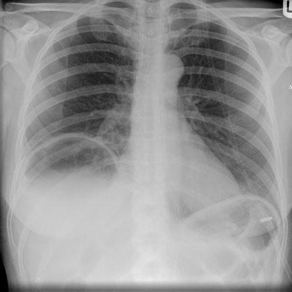
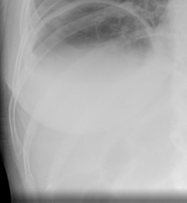
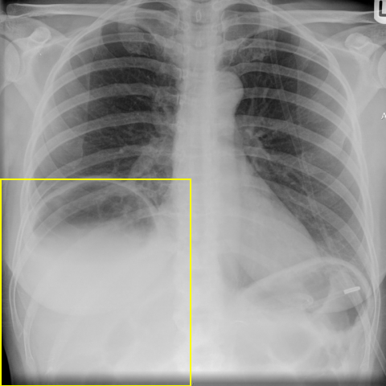

# Official gain: 5533_8353801540251

Post-run explicit answers: D **B**, M **B**, P **A**, reference **B**. Frozen runtime answers: D B, M B, P A; original records unchanged.

[Complete observable requests, tools and stages](../traces/5533_8353801540251.json) · [Original benchmark case](../../v12/results/cases/5533_8353801540251.md) · [D cached original observable request](../../direct_qwen60/requests/5533_8353801540251.json)

```text
Based on the chest X-ray in Figure 1b, which of the following is the most accurate interpretation of the findings under the right hemidiaphragm?
A. Presence of air suggestive of a perforated viscus with pneumoperitoneum, indicated by the absence of haustral folds and uniform diaphragm thickness.
B. Chilaiditi's sign indicated by the presence of haustral folds and increased thickness of the right hemidiaphragm compared to the left, suggesting interposition of the bowel.
C. Pneumothorax on the right side indicated by air under the diaphragm and absence of lung markings.
D. Normal anatomical variant, as indicated by the symmetric thickness of both hemidiaphragms and presence of lung markings.
E. Perforated gastric ulcer indicated by free air under the diaphragm with varying diaphragm thickness.
F. Interstitial lung disease indicated by diffuse reticular markings and air under the diaphragm.
```



## D

```text
Answer: B  
Reason: The image shows air under the right hemidiaphragm with visible haustral folds, and the right hemidiaphragm appears thicker than the left—classic features of Chilaiditi’s sign, where the colon is interposed between the liver and diaphragm. This is a benign anatomical variant, not pneumoperitoneum (which lacks bowel gas patterns) or pneumothorax (which would show absent lung markings in the pleural space, not subdiaphragmatic).
```

## M

```text
B. Chilaiditi's sign indicated by the presence of haustral folds and increased thickness of the right hemidiaphragm compared to the left, suggesting interposition of the bowel.

The chest X-ray shows air under the right hemidiaphragm with visible haustral folds (characteristic of colon), which distinguishes it from free air in pneumoperitoneum. The report explicitly mentions "elevation of the right hemidiaphragm with interposition of the colon between the liver and the [diaphragm]" and the expert analysis confirms Chilaiditi's sign. This is a benign anatomical variant where the colon is positioned between the liver and diaphragm, not a pathological condition like perforated viscus.
```

## P

```text
Answer: A. Presence of air suggestive of a perforated viscus with pneumoperitoneum, indicated by the absence of haustral folds and uniform diaphragm thickness.

Evidence:  
1. The radiolucent area under the right hemidiaphragm shows smooth, homogeneous opacity without haustral folds, consistent with free intraperitoneal air rather than bowel gas.  
2. The right hemidiaphragm is not thicker than the left (confirmed by expert tool and visual assessment), ruling out Chilaiditi’s sign (which requires visible haustra and often diaphragmatic asymmetry).  
3. Air under the diaphragm without lung markings in that region supports pneumoperitoneum over pneumothorax, and the absence of haustral folds makes bowel interposition unlikely.
```

## P 实际派生图

以下为本轮传入 observe/final 的保存图像；框和解剖覆盖不代表病灶真值。

p1:roi · unmodified_pixel_roi · 来源 image:1



p1:location · location_overlay · 来源 image:1



