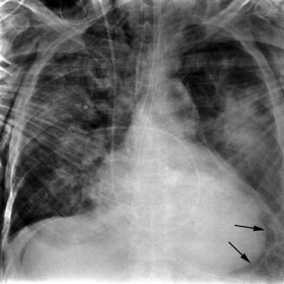
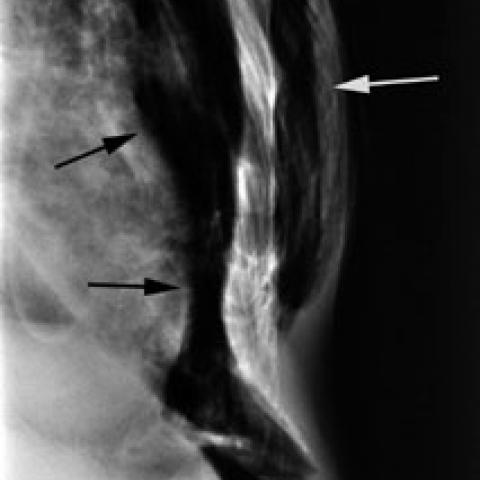
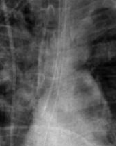
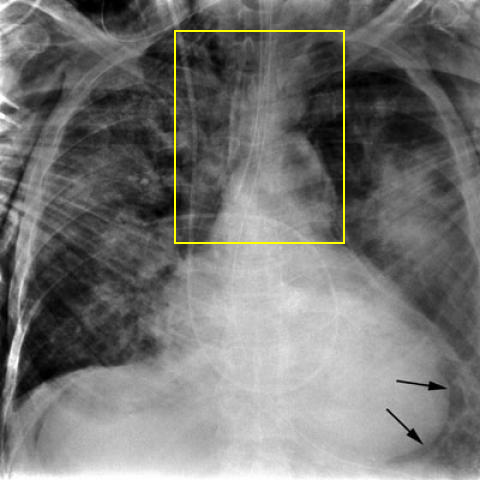

# Official gain: 562_8353802023537

Post-run explicit answers: D **F**, M **F**, P **D**, reference **F**. Frozen runtime answers: D F, M F, P D; original records unchanged.

[Complete observable requests, tools and stages](../traces/562_8353802023537.json) · [Original benchmark case](../../v12/results/cases/562_8353802023537.md) · [D cached original observable request](../../direct_qwen60/requests/562_8353802023537.json)

```text
A 61-year-old male patient involved in a high-speed deceleration traffic accident has been admitted for evaluation. Based on the chest X-rays provided:
Which of the following sets of findings most accurately supports the diagnosis of blunt tracheal rupture with subsequent pneumomediastinum, pneumoperitoneum, and subcutaneous emphysema?
A) Presence of pneumothorax and hemothorax with a tracheal shift
B) Subcutaneous emphysema, pneumopericardium, and bilateral pulmonary contusions
C) Pneumomediastinum, pneumothorax, and widened mediastinum
D) Interruption of radiolucent lumen and sharp angulation of trachea
E) Pneumopericardium, pneumothorax persisting despite chest tube drainage, and tension pneumothorax
F) Subcutaneous emphysema, pneumoperitoneum, and anterior pneumomediastinum delineated by xiphoid attachment
```





## D

```text
Answer: F  
Reason: The question asks for findings that most accurately support blunt tracheal rupture with *subsequent* pneumomediastinum, pneumoperitoneum, and subcutaneous emphysema. Option F explicitly lists all three key sequelae: subcutaneous emphysema, pneumoperitoneum, and anterior pneumomediastinum (the latter often visible as air outlining the thymus or heart border, especially delineated by xiphoid attachment on frontal CXR). The images show air in the soft tissues (subcutaneous emphysema—black arrows in Fig 1a) and a lucent stripe along the right heart border/mediastinum (white arrow in Fig 1b), consistent with pneumomediastinum; pneumoperitoneum is not directly visible on these CXRs but is clinically plausible after tracheal rupture with air dissecting downward. Other options include nonspecific or incorrect associations (e.g., hemothorax, pulmonary contusions, tension pneumothorax) not directly diagnostic of tracheal rupture.
```

## M

```text
F) Subcutaneous emphysema, pneumoperitoneum, and anterior pneumomediastinum delineated by xiphoid attachment

Reason: The chest X-ray report explicitly confirms "extensive subcutaneous emphysema." In blunt tracheal rupture, air escapes from the trachea into the mediastinum (pneumomediastinum), then tracks along tissue planes to the neck (subcutaneous emphysema) and downward through the diaphragmatic hiatus into the peritoneal cavity (pneumoperitoneum). Option F specifically describes the classic triad seen in tracheal rupture: subcutaneous emphysema, pneumoperitoneum, and anterior pneumomediastinum (the latter often visible as air outlining the anterior mediastinal structures, including the xiphoid attachment). While the images don't definitively show pneumoperitoneum on this single view, the clinical scenario (high-speed deceleration trauma) plus confirmed subcutaneous emphysema strongly supports this diagnosis, and option F is the only one that includes all three key findings mentioned in the question. Options A-E miss at least one critical component or include misleading findings (e.g., hemothorax, pulmonary contusions, or tension pneumothorax are not hallmark of tracheal rupture).
```

## P

```text
Answer: D) Interruption of radiolucent lumen and sharp angulation of trachea  

Evidence: The question asks for findings most specific to blunt tracheal rupture with pneumomediastinum, pneumoperitoneum, and subcutaneous emphysema. While pneumomediastinum and pneumoperitoneum are not confirmed in the images (per new observation), option D directly describes the hallmark radiographic sign of tracheal rupture—interruption of the tracheal air column and sharp angulation—which is more specific than nonspecific findings like pneumothorax or hemothorax. Other options include findings not observed (e.g., pneumoperitoneum, anterior pneumomediastinum) or less specific signs.
```

## P 实际派生图

以下为本轮传入 observe/final 的保存图像；框和解剖覆盖不代表病灶真值。

p1:roi · unmodified_pixel_roi · 来源 image:1



p1:location · location_overlay · 来源 image:1



