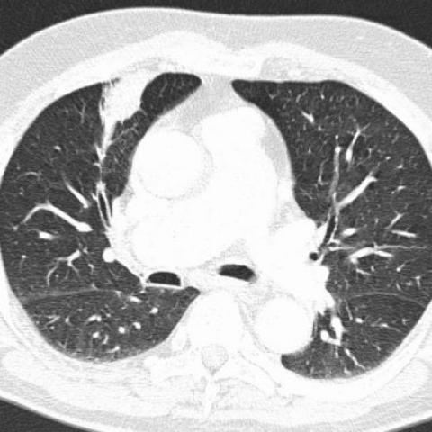
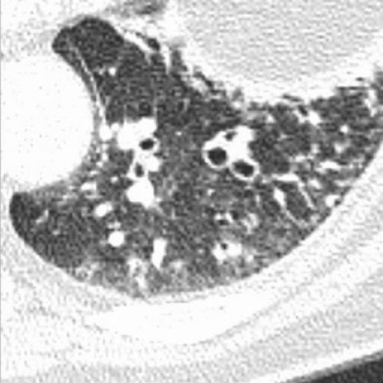
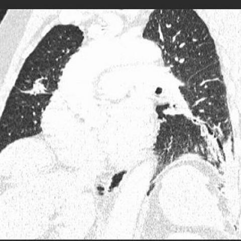
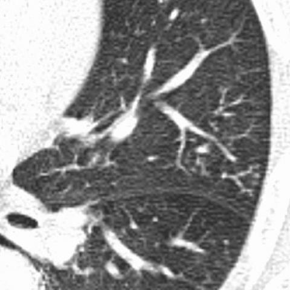
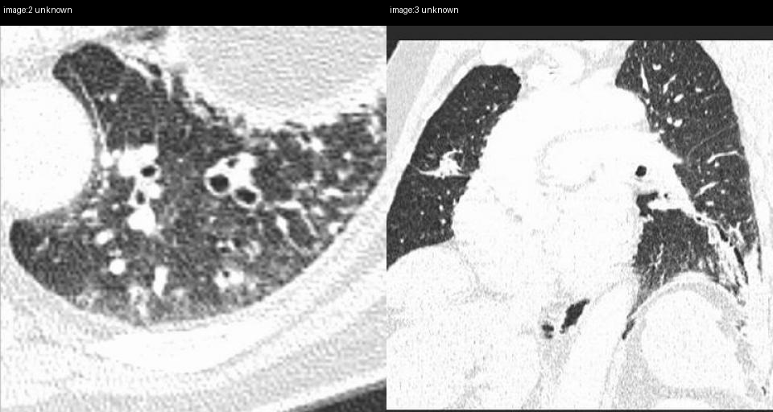

# Official gain: 722_8353802117601

Post-run explicit answers: D **D**, M **D**, P **D**, reference **D**. Frozen runtime answers: D D, M D, P D; original records unchanged.

[Complete observable requests, tools and stages](../traces/722_8353802117601.json) · [Original benchmark case](../../v12/results/cases/722_8353802117601.md) · [D cached original observable request](../../direct_qwen60/requests/722_8353802117601.json)

```text
Based on the chest X-ray findings, which of the following statements best describes the relationship between the bronchiectatic changes and the consolidation observed in this patient? 

A) The bronchiectatic changes are primarily located in the right upper lobe and are larger than the consolidation in the left lower lobe.
B) The bronchiectatic changes are primarily located in the left lower lobe and are smaller than the consolidation in the right middle lobe.
C) The bronchiectatic changes are primarily located in the right lower lobe and are of similar size to the consolidation in the left lower lobe.
D) The bronchiectatic changes are primarily located in the left lower lobe and are larger than the consolidation in the right middle lobe.
E) The bronchiectatic changes are primarily located in the left upper lobe and are smaller than the consolidation in the right middle lobe.
F) The bronchiectatic changes are primarily located in the left lower lobe and are of similar size to the consolidation in the right middle lobe.
```









## D

```text
Answer: D  
Reason: Figures 2b and 2d show cystic bronchiectasis predominantly in the left lower lobe (with visible dilated, thick-walled airways and “signet ring” signs), while Figure 2c shows a consolidative opacity in the right middle lobe. The bronchiectatic area in the left lower lobe is more extensive (involving multiple segments with numerous cystic spaces) than the focal consolidation in the right middle lobe, making option D the best match.
```

## M

```text
D) The bronchiectatic changes are primarily located in the left lower lobe and are larger than the consolidation in the right middle lobe.

Evidence: From visual inspection of the CT images (particularly image 2 and 3), there are extensive cystic bronchiectatic changes predominantly in the left lower lobe, characterized by multiple dilated airways with thick walls. The consolidation appears to be present in the right middle lobe but is less extensive than the bronchiectatic changes in the left lower lobe. While the question asks about chest X-ray findings and these appear to be CT images, the visual evidence consistently shows bronchiectasis in the left lower lobe as the primary finding, and it appears more extensive than any consolidation visible in the right middle lobe.
```

## P

```text
Answer: D) The bronchiectatic changes are primarily located in the left lower lobe and are larger than the consolidation in the right middle lobe.

Evidence: Image 2 shows extensive bronchiectatic change in the left lower lobe with multiple dilated, thick-walled airways and surrounding reticulation. Image 3 shows a focal area of consolidation in the right middle lobe without air bronchograms. Visually, the bronchiectatic region occupies a larger cross-sectional area than the consolidation, though volumetric comparison is limited by slice differences. Option D matches both location (left lower lobe for bronchiectasis, right middle lobe for consolidation) and relative size (larger bronchiectasis).
```

## P 实际派生图

以下为本轮传入 observe/final 的保存图像；框和解剖覆盖不代表病灶真值。

p3:paired · paired_original_pixels · 来源 image:2, image:3



