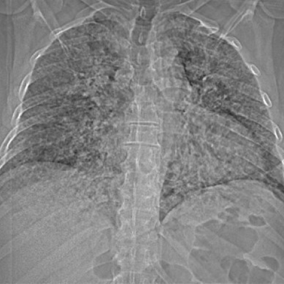

# Official gain: 7659_8353800871660

Post-run explicit answers: D **C**, M **C**, P **B**, reference **C**. Frozen runtime answers: D C, M C, P B; original records unchanged.

[Complete observable requests, tools and stages](../traces/7659_8353800871660.json) · [Original benchmark case](../../v12/results/cases/7659_8353800871660.md) · [D cached original observable request](../../direct_qwen60/requests/7659_8353800871660.json)

```text
A 61-year-old patient presented with cough, generalized musculoskeletal pain, and fever. The initial chest radiograph showed fine reticulonodular opacities throughout both lungs. Based on Figure 1, which statement is most accurate regarding the findings on the chest X-ray?

A) The reticulonodular opacities are predominantly located in the upper lobes and are symmetrical.

B) The reticulonodular opacities are predominantly located in the lower lobes and are asymmetrical.

C) The reticulonodular opacities are diffusely distributed throughout both lungs without a specific lobar predominance.

D) The reticulonodular opacities are associated with noticeable pleural effusion in the right lung.

E) The reticulonodular opacities are associated with noticeable pleural effusion in the left lung.

F) The reticulonodular opacities are accompanied by a significant shift of the mediastinum.
```



## D

```text
Answer: C) The reticulonodular opacities are diffusely distributed throughout both lungs without a specific lobar predominance.

Reason: Figure 1 shows fine reticulonodular opacities that involve both lungs symmetrically and extend from the apices to the bases, without clear upper- or lower-lobe predominance. There is no visible pleural effusion or mediastinal shift.
```

## M

```text
Based on my visual analysis and the tool outputs:

1. The chest X-ray classifier shows high probabilities for "Infiltration" (0.927), "Pneumonia" (0.999), and "Lung Opacity" (0.999), but low probability for "Effusion" (0.090), indicating no significant pleural effusion.

2. The report generator confirms "diffuse interstitial alveolar process" and explicitly states "no large pleural effusion" and "heart is normal in size" (indicating no mediastinal shift).

3. The phrase grounding tool locates reticulonodular opacities with bounding box coordinates [0.005, 0.035, 0.995, 0.745], which covers nearly the entire lung fields from top to bottom and side to side, confirming diffuse distribution.

4. The expert tool simply responds "Diffuse", confirming the diffuse nature of the opacities.

The findings show reticulonodular opacities that are diffusely distributed throughout both lungs without specific lobar predominance. There is no evidence of pleural effusion or mediastinal shift.

C) The reticulonodular opacities are diffusely distributed throughout both lungs without a specific lobar predominance.
```

## P

```text
Answer: B) The reticulonodular opacities are predominantly located in the lower lobes and are asymmetrical.

Evidence: The new observation states that reticulonodular opacities are more concentrated in the lower lobes, with greater density and coarseness in the basal regions bilaterally, and upper zones are relatively spared. A small right pleural effusion is present (blunting of right costophrenic angle), while no left effusion is seen, supporting asymmetry. The chest_xray_expert tool confirms pleural effusion in the right hemithorax.
```

