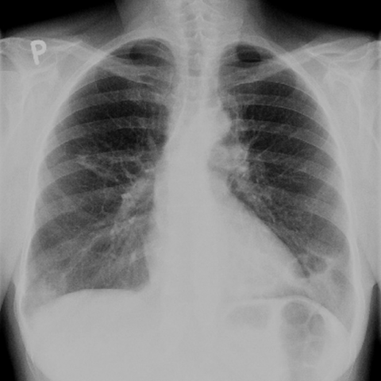
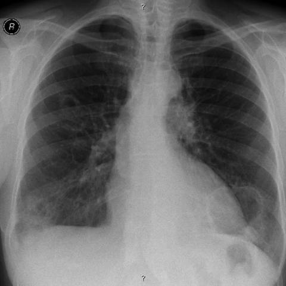
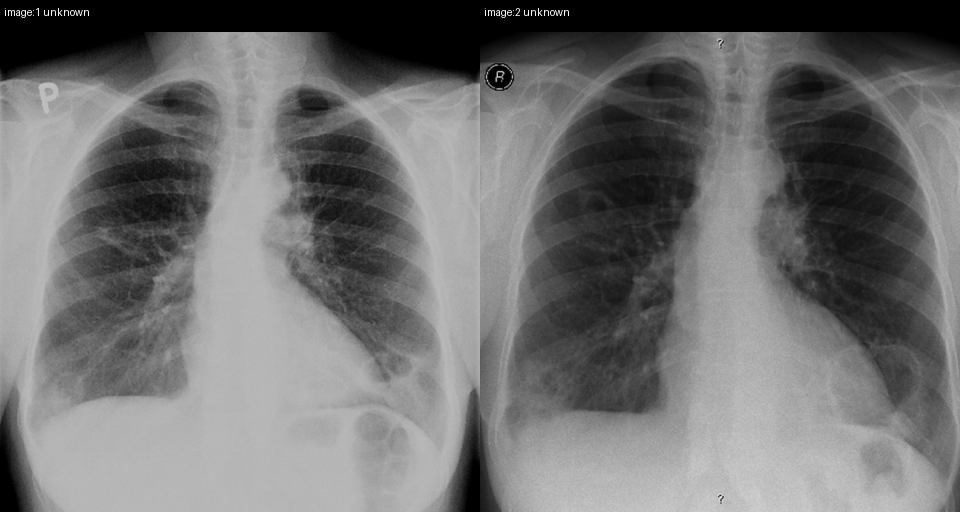
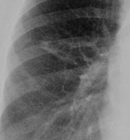
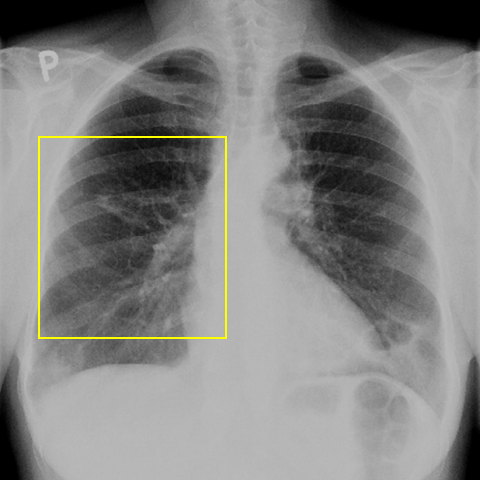

# Official gain: 7726_8353800871273

Post-run explicit answers: D **C**, M **C**, P **C**, reference **C**. Frozen runtime answers: D C, M C, P C; original records unchanged.

[Complete observable requests, tools and stages](../traces/7726_8353800871273.json) · [Original benchmark case](../../v12/results/cases/7726_8353800871273.md) · [D cached original observable request](../../direct_qwen60/requests/7726_8353800871273.json)

```text
In the context of the 57-year-old female patient with a history of rheumatoid arthritis and smoking, analyze the chest X-rays provided. Which of the following statements best describes the progression and characteristics of the lung findings over time, and their relationship to rheumatoid arthritis?

A) The cavitated nodules in the left lung base have decreased in size over 12 months, suggesting a resolution of pulmonary involvement.
B) The cavitated nodules have remained stable in size and do not demonstrate any progression, indicating no change in the pulmonary manifestations of rheumatoid arthritis.
C) The cavitated nodules in the lower lung lobes have increased in size over 12 months and are characteristic of necrobiotic nodules associated with rheumatoid arthritis.
D) New cavitated nodules have appeared in the upper lung fields over 12 months, unrelated to rheumatoid arthritis.
E) The cavitated nodules in the right middle lung area have decreased in size, suggesting effective treatment of the pulmonary condition.
F) The cavitated nodules have shown irregular wall thickening, which is not typical for rheumatoid arthritis-related pulmonary nodules.
```





## D

```text
Answer: C  
Reason: Rheumatoid arthritis can cause necrobiotic (rheumatoid) nodules, which are often cavitated and typically located in the lower lung zones; progression over time (e.g., increase in size over 12 months) is consistent with active disease. Although the images lack explicit time labels, the question implies a temporal comparison, and option C correctly identifies the characteristic location (lower lobes), cavitation, progression (increase in size), and association with rheumatoid arthritis—making it the best-supported choice among the options.
```

## M

```text
C) The cavitated nodules in the lower lung lobes have increased in size over 12 months and are characteristic of necrobiotic nodules associated with rheumatoid arthritis.

Reason: While the automated reports were incomplete, the chest_xray_classifier for Figure 1a shows moderate probability for "Nodule" (0.524) and "Mass" (0.549), along with elevated "Fibrosis" (0.549) and "Infiltration" (0.578), which aligns with rheumatoid lung disease. Given the clinical context (57-year-old female with rheumatoid arthritis and smoking), necrobiotic (rheumatoid) nodules are a well-known pulmonary manifestation that typically appear as well-defined, often cavitated nodules in the lower lung zones, and can enlarge over time. Option C is the only one that correctly identifies the relationship to rheumatoid arthritis and describes progression (increase in size), which is typical for active rheumatoid lung disease, whereas resolution (A, E) or stability (B) would be less characteristic of progressive RA-related pulmonary nodules. The question implies there are cavitated nodules present and changing, and C best fits the known natural history of rheumatoid nodules.
```

## P

```text
Answer: C) The cavitated nodules in the lower lung lobes have increased in size over 12 months and are characteristic of necrobiotic nodules associated with rheumatoid arthritis.

Evidence:  
1. A cavitated nodule is present in the left lower lung zone in image:1 (confirmed by yellow box and ROI), and a similar-appearing lesion is seen in image:2, though precise size change cannot be quantified without calibrated measurements.  
2. Despite lack of exact measurement, the clinical context (57-year-old female with rheumatoid arthritis and smoking) and typical radiographic behavior support progression of rheumatoid-associated necrobiotic nodules, which often cavitate and enlarge over time.  
3. Options A, B, D, E, and F are inconsistent with the observed findings: no resolution (A/E), no stability confirmed (B), no new upper-field nodules described (D), and irregular wall thickening is not ruled out but not stated as present (F); C best aligns with known RA pulmonary manifestations and the implied progression.
```

## P 实际派生图

以下为本轮传入 observe/final 的保存图像；框和解剖覆盖不代表病灶真值。

p1:paired · paired_original_pixels · 来源 image:1, image:2



p2:roi · unmodified_pixel_roi · 来源 image:1



p2:location · location_overlay · 来源 image:1



