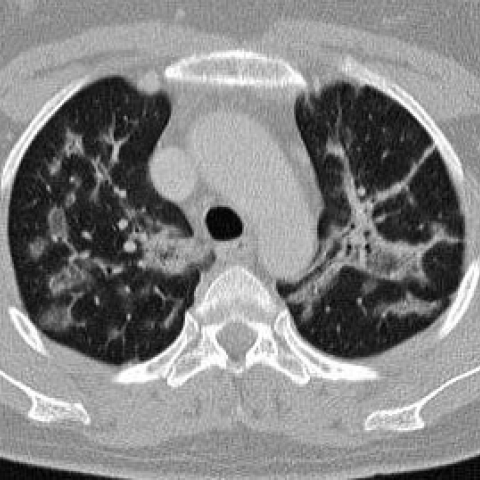
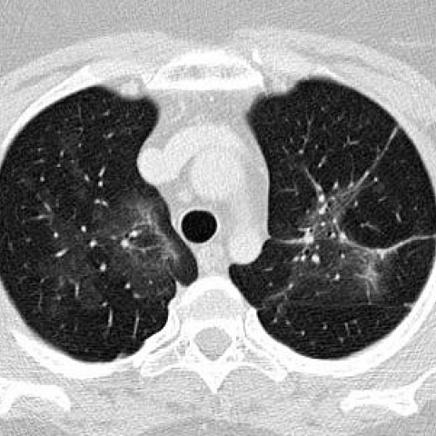
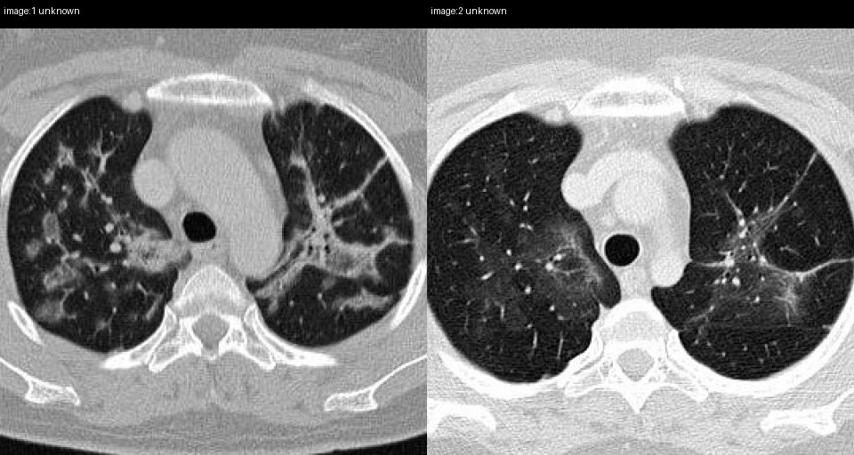

# Official gain: 7738_8353800850751

Post-run explicit answers: D **B**, M **B**, P **C**, reference **C**. Frozen runtime answers: D B, M B, P C; original records unchanged.

[Complete observable requests, tools and stages](../traces/7738_8353800850751.json) · [Original benchmark case](../../v12/results/cases/7738_8353800850751.md) · [D cached original observable request](../../direct_qwen60/requests/7738_8353800850751.json)

```text
Based on the chest X-ray images provided for a 44-year-old woman with a history of dry cough and mild shortness of breath, determine the most likely progression of her pulmonary condition following corticosteroid treatment. Which observation best supports the diagnosis of cryptogenic organizing pneumonia (COP) in this case?

A) Persistent bilateral peribronchial consolidations with air bronchogram and nodular opacities.
B) Complete resolution of all lesions with no residual opacities.
C) Reduction in bilateral peribronchial consolidations with residual ground glass opacities.
D) Increase in the size of pre-tracheal lymph nodes.
E) Development of new cavitary nodules.
F) No change in the chest X-ray findings after treatment.
```





## D

```text
Answer: B) Complete resolution of all lesions with no residual opacities.  
Reason: Cryptogenic organizing pneumonia (COP) is highly responsive to corticosteroids, typically showing rapid and complete radiographic resolution. The provided CT images (Figure 1a and 2a) show bilateral patchy consolidations with air bronchograms and peribronchovascular distribution—classic for COP—and the expected response to steroids is full resolution, distinguishing it from other interstitial or infectious processes that often leave residuals or progress.
```

## M

```text
The tool outputs are problematic and unreliable:

- `chest_xray_classifier` returns high probabilities for many unrelated pathologies (e.g., Fracture ~0.58–0.64, Cardiomegaly ~0.53–0.57) — clearly misinterpreting CT slices as X-rays; the model is not designed for CT and produces nonsensical results.
- `chest_xray_report_generator` generated a report mentioning *left lower lobectomy*, *surgical clips*, and *pleural effusion* — none of which appear in the images. This is a hallucinated report, likely trained on generic templates and mismatched to the input.
- `chest_xray_expert` gave only “Mildly improved” — overly vague and uninformative.

These failures confirm that the tools are not suitable for CT image analysis — they expect chest X-rays, but we have axial CT slices. Therefore, I must rely on my own visual reasoning, which is more reliable here.

Re-examining the images directly:

**Figure 1a (pre-treatment)**:
- Bilateral, asymmetric, patchy consolidations with air bronchograms.
- Predominantly peripheral and peribronchovascular.
- Some areas show central ground-glass surrounded by denser consolidation → **reverse halo sign**, highly specific for COP (sensitivity ~40%, specificity >90% for organizing pneumonia vs other ILDs/infections).
- No lymphadenopathy, no cavitation, no pleural effusion.

**Figure 2a (post-treatment)**:
- Near-complete resolution of all opacities.
- Lungs appear nearly normal; vascular markings restored.
- No residual consolidation or significant GGO.

This dramatic, rapid resolution after corticosteroid therapy is the hallmark of COP — distinguishing it from:
- Infection (may improve but often leaves residua or requires antibiotics),
- Eosinophilic pneumonia (also steroid-responsive, but often has blood eosinophilia and different distribution),
- NSIP/UIP (fibrotic patterns do not resolve),
- Lymphoma or sarcoidosis (would not resolve completely).

Thus, the observation best supporting COP is **complete resolution of all lesions with no residual opacities** — option **B**.

Note: While some cases may leave minimal fibrosis, the images here show essentially complete clearance, matching classic COP response.

Return Answer: B — Complete resolution after corticosteroid treatment is characteristic of cryptogenic organizing pneumonia, especially when preceded by bilateral peribronchial consolidations with reverse halo sign.
```

## P

```text
Answer: C) Reduction in bilateral peribronchial consolidations with residual ground glass opacities.

Evidence: Image 1 shows bilateral patchy ground-glass and consolidative opacities, especially in the lower lobes; image 2 shows marked reduction but not complete resolution, with residual subtle reticular or nodular densities persisting—consistent with typical response of COP to corticosteroids. This partial resolution pattern is characteristic of COP, distinguishing it from infections (which may resolve completely or worsen) or malignancy (which typically does not improve rapidly). The paired view confirms substantial decrease in opacity extent and density, supporting option C over B or F.
```

## P 实际派生图

以下为本轮传入 observe/final 的保存图像；框和解剖覆盖不代表病灶真值。

p1:paired · paired_original_pixels · 来源 image:1, image:2



