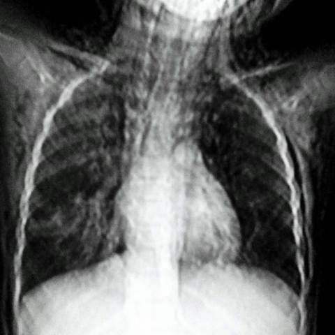
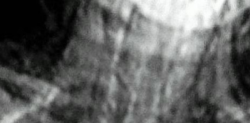
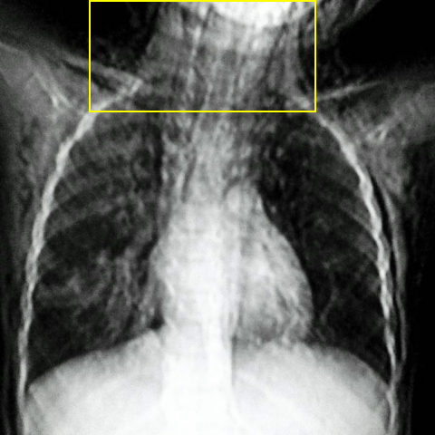
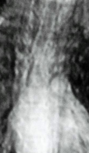
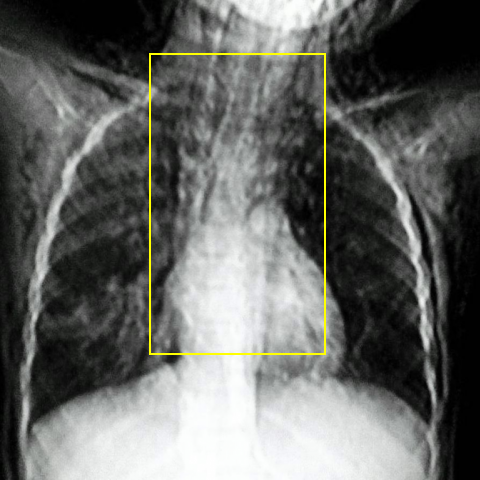

# Official gain: 8129_8353800862240

Post-run explicit answers: D **B**, M **B**, P **E**, reference **B**. Frozen runtime answers: D B, M B, P E; original records unchanged.

[Complete observable requests, tools and stages](../traces/8129_8353800862240.json) · [Original benchmark case](../../v12/results/cases/8129_8353800862240.md) · [D cached original observable request](../../direct_qwen60/requests/8129_8353800862240.json)

```text
Based on the chest X-ray findings, which of the following conditions is most accurately suggested by the images, given the clinical presentation of sudden respiratory distress and soft tissue oedema with crepitus over the chest and neck in a 5-year-old child?

A. Pneumonia with pleural effusion
B. Subcutaneous emphysema and pneumomediastinum
C. Rib fracture with pneumothorax
D. Asthmatic exacerbation with no additional findings
E. Foreign body aspiration with localized emphysema
F. Traumatic pneumothorax with rib fracture
```



## D

```text
Answer: B  
Reason: The chest X-ray shows linear lucencies along the neck and mediastinum (especially around the trachea and great vessels), consistent with air in the soft tissues (subcutaneous emphysema) and mediastinum (pneumomediastinum). This, combined with clinical findings of sudden respiratory distress, soft tissue edema, and crepitus in a child, strongly suggests spontaneous or traumatic rupture of alveoli leading to air tracking—most classically seen in conditions like severe coughing, asthma exacerbation with air trapping, or barotrauma. Option B directly matches these radiographic and clinical features; other options lack the characteristic air outlining mediastinal structures and subcutaneous planes.
```

## M

```text
Based on the clinical presentation (sudden respiratory distress, soft tissue edema with crepitus over chest and neck in a 5-year-old) and the imaging findings:

The chest X-ray report explicitly states "extensive subcutaneous emphysema" and the phrase grounding confirms both subcutaneous emphysema and pneumomediastinum. The crepitus described clinically is the palpable manifestation of subcutaneous emphysema.

While the classifier shows elevated probabilities for several conditions (likely due to the air patterns being interpreted as various pathologies), the definitive radiology report and phrase grounding are more reliable for this specific finding.

Subcutaneous emphysema with pneumomediastinum is the most accurate diagnosis given the combination of clinical crepitus and radiographic evidence of air in soft tissues and mediastinum.

B. Subcutaneous emphysema and pneumomediastinum
```

## P

```text
Answer: E. Foreign body aspiration with localized emphysema  
The clinical presentation includes sudden respiratory distress and crepitus, but the X-ray does not show subcutaneous emphysema, pneumomediastinum, rib fractures, pleural effusion, or consolidation. Localized hyperlucency (air trapping) without other structural abnormalities is consistent with foreign body aspiration in a child. The absence of classic signs for options A, B, C, D, and F supports E as the most plausible diagnosis given the acute onset and age.
```

## P 实际派生图

以下为本轮传入 observe/final 的保存图像；框和解剖覆盖不代表病灶真值。

p1:roi · unmodified_pixel_roi · 来源 image:1



p1:location · location_overlay · 来源 image:1



p2:roi · unmodified_pixel_roi · 来源 image:1



p2:location · location_overlay · 来源 image:1



