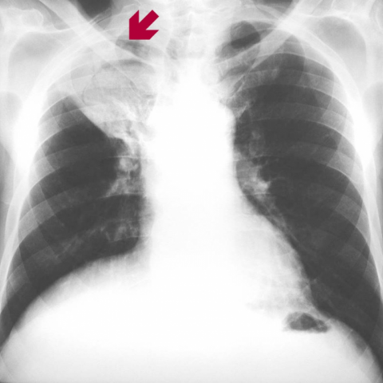
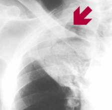
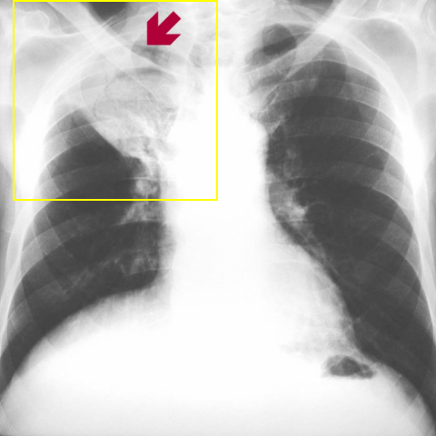

# Official gain: 8300_8353800861859

Post-run explicit answers: D **D**, M **D**, P **A**, reference **D**. Frozen runtime answers: D D, M D, P A; original records unchanged.

[Complete observable requests, tools and stages](../traces/8300_8353800861859.json) · [Original benchmark case](../../v12/results/cases/8300_8353800861859.md) · [D cached original observable request](../../direct_qwen60/requests/8300_8353800861859.json)

```text
A 78-year-old man with a history of lung tuberculosis presents with cough and moderate haemoptysis. A chest X-ray (Figure 1) reveals a finding in the right upper lobe. Based on the X-ray alone, what is the most likely diagnosis and recommended management plan for this patient?
A) Pneumonia; start broad-spectrum antibiotics.
B) Tuberculous cavity; initiate anti-tuberculous therapy.
C) Lung abscess; perform surgical drainage.
D) Aspergilloma (fungus ball); consider surgical resection due to risk of severe haemoptysis.
E) Bronchogenic carcinoma; schedule for a biopsy.
F) Pulmonary embolism; initiate anticoagulation therapy.
```



## D

```text
Answer: D) Aspergilloma (fungus ball); consider surgical resection due to risk of severe haemoptysis.  
Reason: The chest X-ray shows a well-defined, rounded opacity within a pre-existing cavity in the right upper lobe (indicated by the red arrow), consistent with a fungus ball (aspergilloma). Given the patient’s history of prior tuberculosis (a common cause of cavitary lung disease) and current haemoptysis, aspergilloma is the most likely diagnosis; surgical resection may be considered due to the risk of life-threatening haemoptysis.
```

## M

```text
Let me critically analyze the tool outputs:

1. **Classifier results**: High probabilities for Atelectasis (0.555), Consolidation (0.522), Effusion (0.543), Pneumothorax (0.501), Emphysema (0.511), Cardiomegaly (0.569), Nodule (0.511), Mass (0.506), Lung Lesion (0.515), Lung Opacity (0.646), Fracture (0.656). However, these are relatively low probabilities (all <0.66) and may reflect general abnormalities rather than specific diagnosis.

2. **Report generator**: States "no focal lung consolidation" and "stable right upper lobe nodule" - this contradicts the visual appearance which looks more like a cavity with possible fungus ball.

3. **Phrase grounding**: Successfully identified "Cavitary lesion in the right upper lobe" with bounding box coordinates [0.105, 0.075, 0.425, 0.375] - this is crucial information confirming a cavity.

4. **Expert tool**: Simply returned "Pneumonia" which seems incorrect given the clinical context and imaging findings.

Now, let me use my own clinical reasoning: The patient has:
- Age 78
- History of lung tuberculosis (creates cavities)
- Presenting with cough and moderate haemoptysis
- X-ray shows a cavitary lesion in right upper lobe

In patients with prior TB who develop haemoptysis, aspergilloma (fungus ball) is a classic diagnosis. Aspergillus fumigatus colonizes pre-existing cavities (from old TB) and forms a fungus ball that can cause haemoptysis when it erodes into vessels. The X-ray appearance of a rounded opacity within a cavity (fungus ball) is characteristic.

While tuberculous cavity (option B) is possible, active TB would typically show more infiltrative changes, and the patient's symptoms (moderate haemoptysis) are more characteristic of aspergilloma complications.

Option D (Aspergilloma) is most likely because:
- Pre-existing TB cavity provides the environment
- Haemoptysis is the hallmark presentation
- The finding is described as a cavitary lesion
- Aspergilloma carries risk of severe haemoptysis requiring intervention

The management would be consideration of surgical resection or embolization for recurrent/severe haemoptysis, though antifungal therapy alone is often insufficient for established aspergilloma.

Return Answer: D) Aspergilloma (fungus ball); consider surgical resection due to risk of severe haemoptysis.
```

## P

```text
Answer: A) Pneumonia; start broad-spectrum antibiotics.  
The X-ray shows a ground-glass infiltrate in the right upper lobe without definitive cavitation, air-fluid level, or mobile intracavitary opacity. The findings are more consistent with parenchymal consolidation (e.g., pneumonia) than with a cavitary lesion like aspergilloma, TB cavity, or abscess; haemoptysis can occur in bacterial pneumonia, especially in elderly patients with prior lung disease.
```

## P 实际派生图

以下为本轮传入 observe/final 的保存图像；框和解剖覆盖不代表病灶真值。

p1:roi · unmodified_pixel_roi · 来源 image:1



p1:location · location_overlay · 来源 image:1



