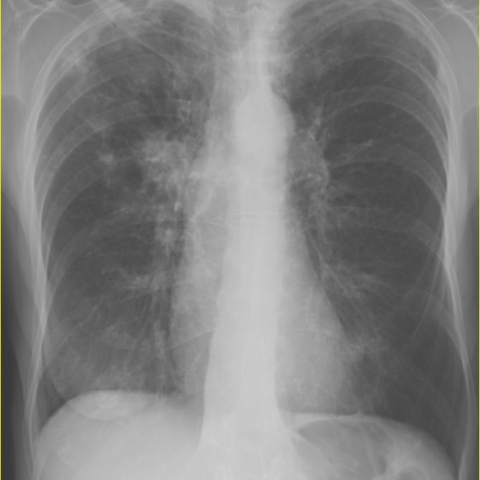
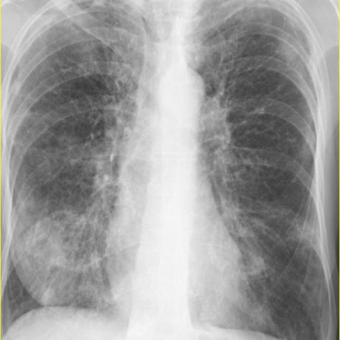
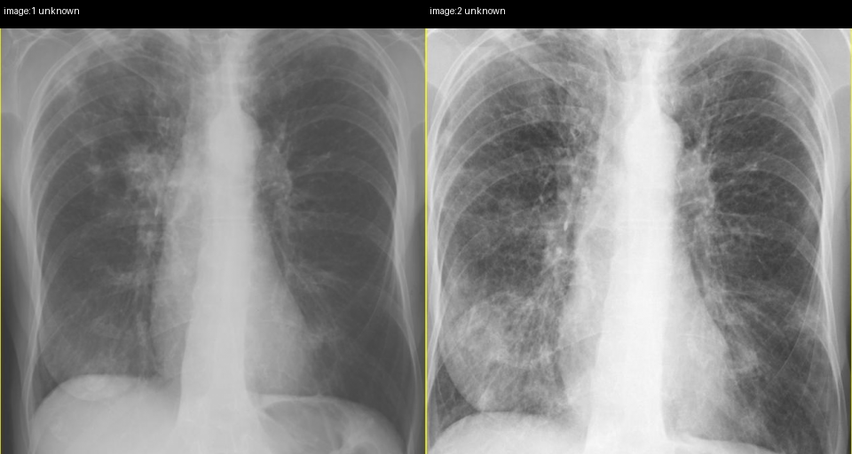
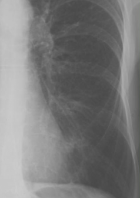
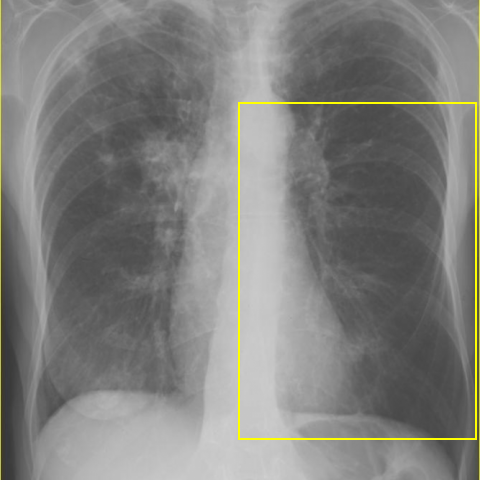

# Official gain: 8379_8353800889338

Post-run explicit answers: D **C**, M **C**, P **C**, reference **B**. Frozen runtime answers: D C, M C, P C; original records unchanged.

[Complete observable requests, tools and stages](../traces/8379_8353800889338.json) · [Original benchmark case](../../v12/results/cases/8379_8353800889338.md) · [D cached original observable request](../../direct_qwen60/requests/8379_8353800889338.json)

```text
Based on the chest X-ray findings, which statement best describes the evolution of the pulmonary findings in this patient with Churg-Strauss Syndrome?

A) The initial X-ray shows bilateral upper lobe consolidation, which resolves completely in the follow-up X-ray.
B) The initial X-ray shows right hilar parenchymal consolidation, which migrates to bilateral lower lobe consolidation in the follow-up X-ray.
C) The initial X-ray reveals left lung consolidation, which progresses to diffuse bilateral consolidation in the follow-up X-ray.
D) The initial X-ray demonstrates perihilar consolidation on the left side, with new right-sided upper lobe consolidation in the follow-up X-ray.
E) The initial X-ray demonstrates right lower lobe nodules that remain unchanged on the follow-up X-ray.
F) The initial X-ray shows right upper lobe consolidation with new left hilar consolidation in the follow-up X-ray.
```





## D

```text
Answer: C  
Reason: Figure 1 shows consolidation predominantly in the left lung (left mid-to-lower zone), while Figure 3 shows progression to more diffuse bilateral consolidation, consistent with evolving pulmonary involvement in Churg-Strauss Syndrome (now eosinophilic granulomatosis with polyangiitis), which commonly presents with migratory or progressive pulmonary infiltrates.
```

## M

```text
Based on my visual analysis of the two chest X-rays:

Figure 1 (initial): Shows prominent consolidation in the left lung, centered around the left hilum and extending into the upper/middle zones. The right lung appears relatively clear.

Figure 3 (follow-up): Shows progression to more extensive, diffuse bilateral consolidation. The left side is worse, and there's now significant involvement of the right lung, particularly in the lower zones.

Looking at the answer choices:
A) Incorrect - not bilateral upper lobe, and doesn't resolve
B) Incorrect - initial is left-sided, not right hilar, and doesn't "migrate" but progresses bilaterally
C) Correct - initial left lung consolidation that progresses to diffuse bilateral consolidation
D) Incorrect - initial is left perihilar but follow-up shows more diffuse bilateral, not just new right upper lobe
E) Incorrect - no right lower lobe nodules in initial image
F) Incorrect - initial is left-sided, not right upper lobe

The evolution matches Churg-Strauss Syndrome (now called eosinophilic granulomatosis with polyangiitis), which commonly presents with migratory pulmonary infiltrates that can progress from unilateral to bilateral involvement.

Answer: C) The initial X-ray reveals left lung consolidation, which progresses to diffuse bilateral consolidation in the follow-up X-ray.
```

## P

```text
Answer: C) The initial X-ray reveals left lung consolidation, which progresses to diffuse bilateral consolidation in the follow-up X-ray.

Evidence: Image 1 shows localized consolidation in the left mid-to-lower lung zone with no right-sided involvement; image 2 shows expanded opacities involving both lungs, especially the lower zones bilaterally; the paired view confirms progression from predominantly left-sided to bilateral diffuse consolidation.
```

## P 实际派生图

以下为本轮传入 observe/final 的保存图像；框和解剖覆盖不代表病灶真值。

p1:paired · paired_original_pixels · 来源 image:1, image:2



p2:roi · unmodified_pixel_roi · 来源 image:1



p2:location · location_overlay · 来源 image:1



